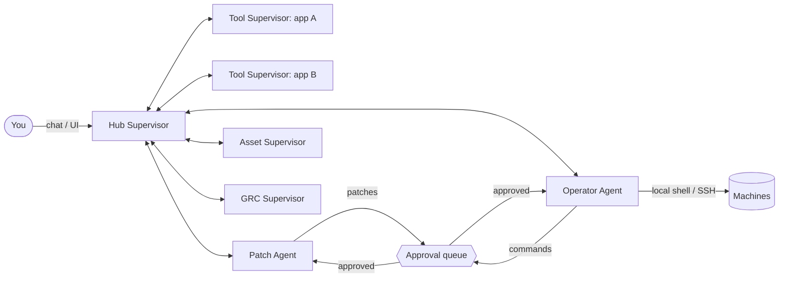

# Atrium

**An office suite for your whole toolchain - run by AI agents.**

Atrium is the central hall every tool opens onto.

Atrium imports your tools - open-source projects from GitHub, local projects, closed-source
applications and SaaS services - and makes them work together like the apps of an office
suite. A team of agents does the integration work:

- a **Hub Supervisor** that talks to every other agent and keeps the suite integrated,
- one **Tool Supervisor per imported tool**, responsible for that application,
- a **Patch Agent** that patches tools that don't fit (code patches on a git branch, or adapters
  for closed-source and SaaS tools),
- an **Operator Agent** that runs commands on this machine or on servers over SSH,
- an **Asset Supervisor**, a **Vulnerability Supervisor** and a **GRC Supervisor** for the built-in Assets,
  Vulnerabilities and Compliance apps - they also run the **data flows** that let tools exchange data through the
  hub (for example Snipe-IT assets -> Hub Assets -> OpenVAS scans -> Hub Vulnerabilities -> CISO Assistant).

Everything the agents say to each other is visible live, and anything that changes state waits
in an approval queue until a person approves it. People sign in to the hub and get a role -
viewer, operator or admin - that decides what they may do.

## What's inside

| App | What it does |
| --- | --- |
| **Portals** | App launcher (top bar) for the built-in apps and every imported tool. Tools open inside the hub. |
| **Apps** | Import from GitHub / local folder / SaaS URL (+ OpenAPI spec). Each tool gets a manifest, an integration score, health checks, start/stop, logs and its own supervisor agent. |
| **Integration hub** | Map of how tools connect - shared capabilities, single sign-on, event routes - plus port conflicts and missing dependencies. The **Identity** card lists the suite's identity providers (Keycloak, authentik, Zitadel, Authelia, ...), the suite default and each tool's single sign-on; the Patch Agent connects tools to the chosen provider natively (Grafana, Gitea, MinIO, BookStack, Outline, Nextcloud, Wazuh, Snipe-IT, Zammad, ...) and registers them there. |
| **Agents** | Manage the agents (pause/resume, model, instructions), chat with the Hub Supervisor or any team agent, and watch agent-to-agent messages live. Each tool's supervisor can lead an **agent team** - proposed from templates for what the tool is (SIEM, GRC, asset inventory, vulnerability scanner, plus a maintainer for every tool) or designed by Claude - and admins create, edit and remove custom agents running on Claude, on a **local model** (Ollama, LM Studio, vLLM, llama.cpp - any OpenAI-compatible server) or on rules, with permissions, a schedule and a standing task. |
| **Approvals** | Review and approve or reject agent commands and patches, with diffs. Full audit history. |
| **Operator** | Run commands locally or over SSH, manage hosts, discover host facts. |
| **Data flows** | Each tool gets a **connection** (a built-in connector - Snipe-IT, CISO Assistant, OpenVAS / Greenbone - or a generic REST mapping, which Claude can generate from an OpenAPI spec) with encrypted credentials. The hub proposes flows between tools and its apps (assets, vulnerabilities, controls and evidence, risks), runs them on a schedule, skips unchanged records, and after three failures in a row the Patch Agent proposes a repair. |
| **Assets** | Asset register kept in sync automatically (tools, SaaS services, hosts, inventories such as Snipe-IT - merged by address, hostname or serial) plus manual assets, owners, criticality and vulnerability-scan scope. |
| **Vulnerabilities** | Findings from scanners and other tools: scans of in-scope assets (with approval), severity, CVEs, remediation deadlines per severity (SLA), automatic "fixed" when a rescan no longer finds them, and risks for critical findings past their deadline. |
| **Compliance hub** | GRC: a control baseline evaluated against live hub state, mapped to ISO/IEC 27001:2022, SOC 2 and NIS2; risk register with heatmap (risks open and close automatically); policies with templates. |
| **Users & access** | Admins only. Accounts (local passwords or single sign-on through the suite's OIDC identity provider), roles, password resets, and API tokens for scripts and tools. Everyone can change their password and sign out other sessions from the user menu. |

## Quick start

Requires Python 3.11+ and git.

```bash
python -m venv .venv
.venv/bin/pip install -e ".[ai,ssh,dev]"    # Windows: .venv\Scripts\pip install -e ".[ai,ssh,dev]"
.venv/bin/atrium                            # Windows: .venv\Scripts\atrium
```

On the first start there are no accounts yet, so the hub prints a one-time setup link:

```
First run: create the administrator at http://127.0.0.1:8710/#/setup?token=...
```

Open it, choose an administrator username and password (at least 12 characters), and you are
signed in. Then click **Get Started** and import the projects in [`examples/`](examples/) to see
the agents at work. Add colleagues under **Users & access**.

To skip the link, set `HUB_ADMIN_USERNAME` and `HUB_ADMIN_PASSWORD` before the first start, or
create the account offline with `atrium user create alice --role admin`. The same command line is
the way back in if every administrator is locked out:

```bash
.venv/bin/atrium user passwd alice           # set a new password, sign out all of alice's sessions
.venv/bin/atrium user create rescue --role admin
```

Roles, sessions, API tokens and single sign-on are described in [docs/AUTH.md](docs/AUTH.md).

### Turn on Claude (optional)

Without credentials the agents run in **rules mode**: imports, analysis, scoring, template
patches, adapters, commands, assets and compliance all work deterministically. With Claude:

- the Hub Supervisor understands plain language and plans multi-step work using the other agents,
- the Patch Agent writes real source-code patches (e.g. adds a `/healthz` endpoint in the
  project's own framework),
- Tool Supervisors refine descriptions and capabilities from the README.

Set `ANTHROPIC_API_KEY` (or run `ant auth login`) before starting the hub, or put it in a `.env`
file - see [`.env.example`](.env.example). The default model is `claude-opus-5-5`; change it in
**Settings** or per agent. Requests opt into server-side refusal fallbacks
(`server-side-fallback-2026-07-01`, `fallbacks: "default"`).

Team agents can also run on a **local model**: add a provider under **Settings > AI providers** (any server with an
OpenAI-compatible API; the default base URL `http://localhost:11434/v1` is Ollama's), test it to list its models, and
pick it for the agent. Tool calling needs a model and server that support it (vLLM: `--enable-auto-tool-choice`;
llama.cpp: `--jinja`); otherwise switch the provider's tools off and its agents answer in plain text.

## How it works



1. **Import** - the Hub Supervisor clones the repo (or points at the folder / SaaS URL) and
   assigns a Tool Supervisor.
2. **Analyse** - the Tool Supervisor infers a [hub manifest](docs/MANIFEST.md): stack, launch
   command, port, health endpoint, API, SSO, capabilities provided/consumed, events. A tool that
   ships its own `hub.manifest.yaml` is *native*.
3. **Score** - the Hub Supervisor scores every tool against the rest of the suite (manifest,
   launchable, health, API, SSO, events, port conflicts, dependencies).
4. **Patch** - each gap goes to the Patch Agent, which proposes a patch: a commit on a new branch
   in a separate git worktree (your checkout is never touched), an adapter kept by the hub
   (health probe, oauth2-proxy SSO, event poller, API wrapper), or a manifest override (new port).
5. **Approve** - patches and state-changing commands wait for you. Approved patches are applied
   and the suite is re-scored.
6. **Govern** - the Asset Supervisor registers everything as assets; the GRC Supervisor
   re-evaluates controls, collects evidence and opens/closes risks.
7. **Exchange data** - once a tool has a connection, the Hub Supervisor proposes data flows
   between it and the hub's apps; the module supervisors run them through the tool's supervisor
   (the only agent that decrypts its credentials), and failing flows get a repair proposal.

More detail in [docs/ARCHITECTURE.md](docs/ARCHITECTURE.md).

## Safety model

- **Sign-in and roles**: every API call needs a signed-in person or an API token, checked on the
  server. `viewer` reads everything, `operator` may also change things (import, approve, run
  commands, ...), `admin` also manages accounts, tokens, settings and agents. Tokens with the
  `integration` role can only publish events. Sign in with a local password (scrypt-hashed,
  12+ characters, throttled after repeated failures) or through single sign-on (OIDC) against the
  suite's identity provider, which is where MFA belongs. By default sessions expire after 12 hours
  idle and 7 days at most. Details in [docs/AUTH.md](docs/AUTH.md).
- **Autonomy levels** (Settings): `manual` - every agent command and patch needs approval;
  `assisted` (default) - agents may run known read-only commands, everything else needs approval;
  `autonomous` - agents act alone (the GRC Supervisor flags this as a failing control).
- **People and automation**: commands an operator types run directly; commands from agents and
  API tokens follow the autonomy level. Approvals record who decided them.
- **Blocked commands** (wiping disks, `rm -rf /`, shutdown, piping downloads into a shell, ...)
  are refused for everyone, people included (guardrail `block_catastrophic_commands`).
- **Agent guardrails** (Settings > Agent guardrails, admins): team agents never get more permissions than the agent
  that created them, teams are limited in size (5) and do not nest, team agents' actions follow the autonomy level,
  and new teams wait for approval. Relaxing one asks for confirmation, is logged as a warning, and makes control
  HB-AC-6 fail or go partial.
- **SSH** uses keys only - the hub never stores passwords - and verifies host keys by default.
- **Tool credentials** (API tokens, passwords of connections) are encrypted with `HUB_SECRET_KEY`
  (or a generated `secret.key` in the data folder - back it up separately), never returned by the
  API or logged, and only sent to the address they were entered for: a changed address, or a
  repair, cannot redirect them. Only admins edit connections.
- **Scans** only ever target assets in scan scope; scheduled and agent-initiated scans wait for
  approval (guardrail `scans_need_approval`, on by default) unless the hub runs autonomously.
- **Patches** to source code land on a new branch in a separate worktree.
- **Web hardening**: binds to `127.0.0.1` by default, rejects unknown `Host` headers
  (DNS rebinding), uses `HttpOnly`, `SameSite=Lax` session cookies, and requires an
  `X-Hub-Request: 1` header on every state-changing browser call (cross-site request forgery). If
  other people reach the hub over a network, put a TLS reverse proxy in front and set
  `HUB_PUBLIC_URL`, `HUB_ALLOWED_HOSTS` and `HUB_COOKIE_SECURE=1`.

## Project layout

```
hub/
  agents/          Hub Supervisor, Tool Supervisor, Patch Agent, Operator, Asset, Vulnerability & GRC Supervisors,
                   agent teams and custom agents, the shared agent toolkit
  auth/            accounts, passwords, sessions, API tokens, role policy, single sign-on (OIDC)
  connectors/      connector SDK and connectors to tools' own APIs (Snipe-IT, CISO Assistant, OpenVAS, generic REST)
  integration/     analyzer, compatibility scoring, importer, patch planner, tool event bus, connections, data flows, strategy planner
  execution/       command policy, local/SSH runners, tool process manager
  grc/             control baseline (ISO 27001 / SOC 2 / NIS2 mapping) and automated checks
  web/             the UI (vanilla JS modules, no build step)
  api.py           REST + Server-Sent Events API (docs at /api/docs)
  bus.py           agent message bus
  core.py          the Hub runtime (and the data flow scheduler)
  secrets.py       encryption of stored tool credentials
  guardrails.py    the agent guardrails admins can relax
  llm_providers.py local models with an OpenAI-compatible API (Ollama, LM Studio, vLLM, llama.cpp)
docs/              architecture, sign-in and access control, manifest specification
examples/          sample tools to import
tests/             pytest suite
```

## Development

```bash
.venv/bin/pytest            # run the tests
.venv/bin/atrium --port 8711 --data-dir .hub-dev
```

A fresh data directory prints its own setup link; set `HUB_ADMIN_USERNAME` and
`HUB_ADMIN_PASSWORD` to get an administrator without it. The UI is plain ES modules served by the
API - edit `hub/web/` and reload.

## Roadmap

- More built-in apps: service desk / ticketing, vulnerability management (match tool versions
  against advisories), backup orchestration
- Pull requests for patches on GitHub-hosted tools
- Container-based tool runtime and secrets vault integration
- Connector catalogue for popular SaaS services
