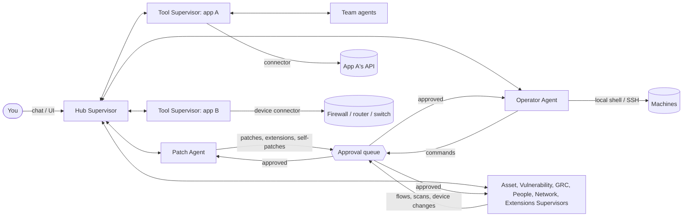

# Atrium

**An office suite for your whole toolchain - run by AI agents.**

Atrium is the central hall every tool opens onto.

Atrium imports your tools - open-source projects from GitHub, local projects, closed-source
applications and SaaS services - and makes them work together like the apps of an office
suite. A team of agents does the integration work:

- a **Hub Supervisor** that talks to every other agent and keeps the suite integrated,
- one **Tool Supervisor per imported tool**, responsible for that application and the lead of its **agent team**,
- a **Patch Agent** that patches tools that don't fit (code patches on a git branch, or adapters
  for closed-source and SaaS tools) and, when a new tool needs it, extends Atrium itself,
- an **Operator Agent** that runs commands on this machine or on servers over SSH,
- an **Asset**, a **Vulnerability**, a **GRC**, a **People**, a **Network** and an **Extensions Supervisor** for the
  built-in apps - they also run the **data flows** that let tools exchange data through the hub (for example Snipe-IT
  assets -> Hub Assets -> OpenVAS scans -> Hub Vulnerabilities -> CISO Assistant, Okta people -> Hub People -> leavers
  found, or firewall rules -> Hub Network -> segmentation and compliance evidence),
- **team agents** that people or supervisors create, on Claude, on a local model or on rules.

Everything the agents say to each other is visible live, and anything that changes state waits
in an approval queue until a person approves it. People sign in to the hub and get a role -
viewer, operator or admin - that decides what they may do.

## Screenshots

<!-- screenshots -->

## What's inside

| App | What it does |
| --- | --- |
| **Portals** | App launcher (top bar) for the built-in apps and every imported tool. Tools open inside the hub. |
| **Apps** | Import from GitHub / local folder / SaaS URL (+ OpenAPI spec). Each tool gets a manifest, an integration score, health checks, start/stop, logs, its own supervisor agent and a **Connection** to its API. |
| **Integration hub** | Three tabs. **Overview**: how tools connect - shared capabilities, single sign-on, event routes, data flows - plus port conflicts and missing dependencies. **Map**: the visual management panel - every tool and hub app in lanes, linked by data flows, single sign-on and event routes; drag from a tool to an app or another tool to propose a data flow (the Connect panel shows what is possible, recommends what the planner would propose and refuses loops). **Segmentation**: a firewall's zones, the assets inside them and the traffic its rules may allow, with compliance and vulnerability overlays and guarded change proposals. The **Identity** card lists the suite's identity providers (Keycloak, authentik, Zitadel, Authelia, ...) and each tool's single sign-on: the Patch Agent connects tools to the chosen provider natively (Grafana, Gitea, Forgejo, MinIO, BookStack, Outline, Nextcloud, Wazuh, CISO Assistant, Snipe-IT, Zammad, ...) and registers them there. **Data flows** move assets, vulnerabilities, controls and evidence, risks, people and accounts, compliance frameworks and self-assessments, and network device snapshots between tools and the hub's apps through built-in connectors (Snipe-IT, CISO Assistant, OpenVAS / Greenbone, Okta, Keycloak, SCIM 2.0, and the network device connectors) or a generic REST mapping, on a schedule, with a repair proposal after three failures. |
| **Agents** | Manage the agents, chat with the Hub Supervisor or any team agent, and watch agent-to-agent messages live. Each tool's supervisor can lead an **agent team** - proposed from templates for what the tool is (SIEM, GRC, asset inventory, vulnerability scanner, plus a maintainer) or designed by Claude - and admins create, edit and remove team agents running on Claude, on a **local model** (Ollama, LM Studio, vLLM, llama.cpp - any OpenAI-compatible server) or on rules, with permissions, a schedule and a standing task. |
| **Approvals** | Review and approve or reject agent commands, patches, data flows, scans, repairs, agent teams, extension packs, changes to Atrium itself and network device changes, with diffs, test results, policy violations and expiry countdowns. Device changes need a second administrator. Full audit history. |
| **Operator** | Run commands locally or over SSH, manage hosts, discover host facts. |
| **Network** | Firewalls, routers, switches and host firewalls read through their own APIs (OPNsense, pfSense, MikroTik RouterOS, FortiGate, PAN-OS, Cisco IOS-XE, Linux nftables / ufw / firewalld, Windows Defender Firewall): rules, interfaces and zones, snapshot history with diffs, **drift** (changes made outside Atrium) with baselines, and encrypted configuration **backups**. **Device changes are off by default**; switched on, every change is a proposal a second administrator approves, applied in a maintenance window after a backup, verified and rolled back unless it passes. |
| **Assets** | Asset register kept in sync automatically (tools, SaaS services, hosts, inventories such as Snipe-IT - merged by address, hostname or serial) plus manual assets, owner and user (people), criticality and vulnerability-scan scope. |
| **People** | The workforce directory merged from Okta, Keycloak and SCIM (by email, then login), the accounts people hold in the tools, the assets they own or use, and a person page with a relationship map. **Leavers** who still have access or devices are flagged, with one-click actions. |
| **Vulnerabilities** | Findings from scanners and other tools: scans of in-scope assets (with approval), severity, CVEs, remediation deadlines per severity (SLA), automatic "fixed" when a rescan no longer finds them, and risks for critical findings past their deadline. |
| **Compliance hub** | GRC: 29 controls evaluated against live hub state (including network segmentation, drift, device backups and device-change control), mapped to ISO/IEC 27001:2022, SOC 2, NIS2 and CyFun; risk register with heatmap (risks open and close automatically); policies with templates. **Frameworks**: CyberFundamentals (CyFun) 2025 and 2023 built in - catalog browser, self-assessments with two maturity scores per requirement, conformity per level (Basic, Important, Essential) with its reasons, and a verifiable **audit pack** (ZIP with SHA-256 manifest) - plus frameworks read from CISO Assistant, such as the EU Cyber Resilience Act. |
| **Extensions** | Packs that add data types (alerts, tickets, incidents, ...) with their own apps, connector mappings, SSO recipes, compliance rules and team templates - data only, versioned, enabled without a restart. Generated after an import from templates or by Claude, and approved by an admin. When only code can help, a **self-patch** of Atrium is tested on its own branch and opened as a pull request after approval. |
| **Settings** | Autonomy level, default model, vulnerability deadlines, **Agent guardrails**, **Network changes** (device-change guardrails and maintenance windows), **AI providers** (local models) and **Sign-in & SSO** (presets for Okta, Microsoft Entra ID, Google, Keycloak, authentik). |
| **Users & access** | Admins only. Accounts (local passwords or single sign-on), roles, password resets, API tokens for scripts and tools, and the person each account belongs to. Everyone can change their password and sign out other sessions from the user menu. |

## Quick start

Requires Python 3.11+ and git.

### With the installer

Linux and macOS (also Git Bash on Windows), from a clone of the repository:

```bash
bash install.sh                # options: --install-dir DIR  --port PORT  --dev  --service
./start-atrium.sh
```

Windows (PowerShell 5.1 or later):

```powershell
powershell -NoProfile -ExecutionPolicy Bypass -File .\install.ps1     # options: -InstallDir DIR -Port PORT -NoShortcut -Dev
.\start-atrium.cmd             # or the "Atrium" shortcut on the desktop
```

The installers find Python 3.11 or newer (set `ATRIUM_PYTHON` to choose one), check for git, create `.venv`, install
Atrium with the `ai` and `ssh` extras, copy `.env.example` to `.env` when there is none, and write the start scripts.
They are safe to run again (after `git pull`, say): an existing `.env` and the hub's data are never touched.
`--install-dir` / `-InstallDir` copies the program to another folder first (without local state such as `.venv`,
`.env` and `.hub`). `--service` writes a systemd user unit on Linux (`~/.config/systemd/user/atrium.service`) but does
not enable it; enable it with `systemctl --user daemon-reload && systemctl --user enable --now atrium.service`, and
read the setup link with `systemctl --user status atrium.service`.

### With Docker

```bash
docker compose up -d --build
docker compose logs atrium     # shows the first-run setup link
```

The image (Python 3.13 slim, git and the SSH client, a non-root user) keeps the hub's data in the `atrium-data`
volume at `/data` and is published on `127.0.0.1:8710` only. Settings come from `.env` when it exists (Docker Compose
2.24 or newer); add other host names people use to `HUB_ALLOWED_HOSTS` there. To run commands over SSH, mount your
keys into the container (see the comment in `docker-compose.yml`). Account commands run inside the container:
`docker compose exec atrium atrium user list`. Tools that Atrium would start
itself (for example `npm start`) need their runtime in the image too; SaaS tools and tools on other hosts work as usual.
Self-patching needs a git checkout, so it is not available in the container.

### By hand

```bash
python -m venv .venv
.venv/bin/pip install -e ".[ai,ssh,dev]"    # Windows: .venv\Scripts\pip install -e ".[ai,ssh,dev]"
.venv/bin/atrium                            # Windows: .venv\Scripts\atrium
```

### First run

On the first start there are no accounts yet, so the hub prints a one-time setup link:

```
First run: create the administrator at http://127.0.0.1:8710/#/setup?token=...
```

Open it, choose an administrator username and password (at least 12 characters), and you are
signed in. Then click **Get Started** and import the projects in [`examples/`](examples/) to see
the agents at work. Add colleagues under **Users & access**.

To skip the link, set `HUB_ADMIN_USERNAME` and `HUB_ADMIN_PASSWORD` before the first start, or
create the account offline with `atrium user create alice --role admin`. The same command line is
the way back in if every administrator is locked out:

```bash
.venv/bin/atrium user passwd alice           # set a new password, sign out all of alice's sessions
.venv/bin/atrium user create rescue --role admin
```

Roles, sessions, API tokens and single sign-on are described in [docs/AUTH.md](docs/AUTH.md).

### Turn on Claude (optional)

Without credentials the agents run in **rules mode**: imports, analysis, scoring, template
patches, adapters, commands, assets, data flows, people, template extensions and compliance all work
deterministically. With Claude:

- the Hub Supervisor understands plain language and plans multi-step work using the other agents,
- the Patch Agent writes real source-code patches (e.g. adds a `/healthz` endpoint in the
  project's own framework), generic REST connectors from OpenAPI specs, extension packs and self-patches,
- Tool Supervisors refine descriptions and capabilities from the README and can design agent teams.

Set `ANTHROPIC_API_KEY` (or run `ant auth login`) before starting the hub, or put it in a `.env`
file - see [`.env.example`](.env.example). The default model is `claude-opus-5-5`; change it in
**Settings** or per agent. Requests opt into server-side refusal fallbacks
(`server-side-fallback-2026-07-01`, `fallbacks: "default"`).

Team agents can also run on a **local model**: add a provider under **Settings > AI providers** (any server with an
OpenAI-compatible API; the default base URL `http://localhost:11434/v1` is Ollama's), test it to list its models, and
pick it for the agent. Tool calling needs a model and server that support it (vLLM: `--enable-auto-tool-choice` with a
`--tool-call-parser`; llama.cpp: `--jinja`); otherwise switch the provider's tools off and its agents answer in plain
text. See [docs/AGENTS.md](docs/AGENTS.md#local-models).

## How it works



1. **Import** - the Hub Supervisor clones the repo (or points at the folder / SaaS URL) and
   assigns a Tool Supervisor.
2. **Analyse** - the Tool Supervisor infers a [hub manifest](docs/MANIFEST.md): stack, launch
   command, port, health endpoint, API, SSO, capabilities provided/consumed, events. A tool that
   ships its own `hub.manifest.yaml` is *native*.
3. **Score** - the Hub Supervisor scores every tool against the rest of the suite (manifest,
   launchable, health, API, SSO, events, port conflicts, dependencies).
4. **Patch** - each gap goes to the Patch Agent, which proposes a patch: a commit on a new branch
   in a separate git worktree (your checkout is never touched), an adapter kept by the hub
   (health probe, native SSO configuration plus the client registration at the identity provider, oauth2-proxy, event
   poller, API wrapper), or a manifest override (new port).
5. **Extend** - when Atrium itself lacks something for the tool (a place for a SIEM's alerts or a service desk's
   tickets, a connector, an SSO recipe), the Patch Agent proposes an extension pack; when only code can help, a
   tested change to Atrium on its own branch.
6. **Approve** - patches, extensions and state-changing commands wait for you. Approved patches are applied
   and the suite is re-scored.
7. **Exchange data** - once a tool has a connection, the Hub Supervisor proposes data flows
   between it and the hub's apps; the module supervisors run them through the tool's supervisor
   (the only agent that decrypts its credentials), and failing flows get a repair proposal.
8. **Govern** - the Asset Supervisor registers everything as assets, the People Supervisor links people to their
   accounts and devices, the Network Supervisor keeps device snapshots, drift and backups, and the GRC Supervisor
   re-evaluates controls, collects evidence and opens/closes risks. People score themselves against CyFun in the
   Compliance hub and export an audit pack.
9. **Change the network (off by default)** - with device changes switched on, an operator proposes an allow rule
   between two zones (or disabling rules) on the segmentation map; a second administrator approves it on the
   Approvals page; the Network Supervisor applies it in a maintenance window after a backup, verifies it over a new
   connection and confirms it, or rolls it back.

More detail in [docs/ARCHITECTURE.md](docs/ARCHITECTURE.md).

## Safety model

- **Sign-in and roles**: every API call needs a signed-in person or an API token, checked on the
  server. `viewer` reads everything, `operator` may also change things (import, approve, run
  commands, edit people, propose device changes, ...), `admin` also manages accounts, tokens, settings, agents,
  credentials, extensions and self-patches, and decides device changes. Tokens with the `integration` role can only publish events. Sign in with a local password
  (scrypt-hashed, 12+ characters, throttled after repeated failures) or through single sign-on (OIDC) - configured in
  **Settings > Sign-in & SSO** or with `HUB_OIDC_*` variables, which win - against the identity provider, which is
  where MFA belongs. By default sessions expire after 12 hours idle and 7 days at most. Details in
  [docs/AUTH.md](docs/AUTH.md).
- **Autonomy levels** (Settings): `manual` - every agent command and patch needs approval;
  `assisted` (default) - agents may run known read-only commands, everything else needs approval;
  `autonomous` - agents act alone (the GRC Supervisor flags this as a failing control).
- **People and automation**: commands an administrator types run directly; an operator's run
  directly on SSH hosts, but on the hub machine only read-only ones do - anything else, and starting
  a tool, waits for an administrator (it would run with Atrium's own privileges). Commands from
  agents and API tokens follow the autonomy level, and what an agent does on a person's chat request
  counts as that person's. Approvals record who decided them.
- **Blocked commands** (wiping disks, `rm -rf /`, shutdown, piping downloads into a shell, ...)
  are refused for everyone, people included (guardrail `block_catastrophic_commands`).
- **Agent guardrails** (Settings > Agent guardrails, admins): team agents never get more permissions than the agent
  that created them, teams are limited in size (5) and do not nest, team agents' actions follow the autonomy level,
  new teams and scheduled scans wait for approval, generated extensions wait for approval, and self-patches must pass
  the tests, be approved and go through a pull request. Relaxing one asks for confirmation, is logged as a warning,
  and makes control HB-AC-6, HB-AC-2 or HB-CM-2 fail or go partial ([docs/AGENTS.md](docs/AGENTS.md#guardrails)).
- **Second person and expiry**: device changes can only be approved by an administrator who did not propose them
  (guardrail `device_changes_need_second_person`, on); `approvals_need_second_person` (off by default) extends the
  rule to self-patches and flows drawn on the integration map. Device-change and self-patch approvals are bound to
  what was reviewed (the device revision and the operations' hash, the self-patch's commit) and expire after
  `approval_expiry_hours` (24).
- **Extensions are data**: packs are validated strictly and nothing in them is executed; packs an agent generates and
  changes to Atrium's code are decided by admins only. A self-patch is committed on its own branch in a separate
  worktree and tested there. Its tests run before anyone approves it, without credentials in their environment but
  not sandboxed: switch `allow_self_patching` off if that is too much.
- **SSH** for the Operator Agent uses keys only - the hub never stores those passwords - and verifies host keys by
  default. Device connections over SSH prefer keys (a password only for devices that cannot use them, encrypted like
  every credential), always check host keys strictly, and use `sudo -n` with fixed commands on Linux hosts.
- **Credentials** (API tokens and passwords of tool connections, local model API keys, the SSO client secret) are
  encrypted with `HUB_SECRET_KEY` (or a generated `secret.key` in the data folder - back it up separately), never
  returned by the API or logged, and only sent to the address they were entered for: a changed address, or a repair,
  cannot redirect them. Only admins edit them. Device configuration backups are encrypted with the same key, checked
  by SHA-256, and only an admin can download one.
- **Network devices are read-only by default**: the guardrail `device_changes` is off. Switched on, a change is
  possible only through the change path ([docs/NETWORK.md](docs/NETWORK.md#device-changes)):
  - a person's proposal;
  - a second administrator's approval on the Approvals page;
  - a maintenance window (or an admin's justified emergency);
  - an encrypted backup first;
  - the device's own rollback armed before writing;
  - verification over a new connection, else rollback, else restore of the backup.

  Atrium never opens "any", refuses changes that could cut it off from the device, and switching `device_changes`
  off blocks every approved change at once. The write methods can never be called as connector actions.
- **Untrusted text**: rule descriptions and names read from devices, and requirement text read from GRC tools, are
  shown as text only, never used in commands, and never handed to agents or models. Agents see network counts only.
- **Side-effecting connector actions** (an OpenVAS scan) run only for a person or through their approval path, never
  for a team agent or another module.
- **Viewers never see webhook URLs, connection settings or tool-event payloads** in the Integration hub and on the
  map (the tool pages still show the manifest's webhook URL - see [docs/INTEGRATIONS.md](docs/INTEGRATIONS.md#integration-map)).
- **Scans** only ever target assets in scan scope; scheduled and agent-initiated scans wait for
  approval (guardrail `scans_need_approval`, on by default) unless the hub runs autonomously.
- **Compliance claims**: control-to-framework references are analyst mappings, and the CyFun conformity thresholds
  come from the CISO Assistant library copy (the CCB originals were unreachable). Both are labelled as unverified in
  the UI and the audit pack ([docs/COMPLIANCE.md](docs/COMPLIANCE.md)).
- **Leavers**: Atrium flags people who left but still have access or devices; it never changes accounts in the tools
  itself, and disabling a leaver's Atrium account is an admin action.
- **Patches** to source code land on a new branch in a separate worktree.
- **Web hardening**: binds to `127.0.0.1` by default, rejects unknown `Host` headers
  (DNS rebinding), uses `HttpOnly`, `SameSite=Lax` session cookies, and requires an
  `X-Hub-Request: 1` header on every state-changing browser call (cross-site request forgery). If
  other people reach the hub over a network, put a TLS reverse proxy in front and set
  `HUB_PUBLIC_URL`, `HUB_ALLOWED_HOSTS` and `HUB_COOKIE_SECURE=1`.

## Documentation

| Page | Covers |
| --- | --- |
| [docs/ARCHITECTURE.md](docs/ARCHITECTURE.md) | components, request pipeline, agents, approvals, network, compliance, state and files, events, endpoints, extending |
| [docs/AUTH.md](docs/AUTH.md) | sign-in, roles, sessions, API tokens, single sign-on for Atrium and the Sign-in & SSO settings |
| [docs/INTEGRATIONS.md](docs/INTEGRATIONS.md) | connections and connectors, credentials and the secret key, data flows, the Integration map, repairs, vulnerabilities and scans, single sign-on for tools |
| [docs/AGENTS.md](docs/AGENTS.md) | agents, team agents and teams, local models, guardrails, extensions, self-patching |
| [docs/PEOPLE.md](docs/PEOPLE.md) | the People app, directories, accounts, person-asset links, leavers |
| [docs/NETWORK.md](docs/NETWORK.md) | the Network app, device connectors per vendor (what is verified, least-privilege setup), drift, backups, the segmentation map, guarded device changes and maintenance windows |
| [docs/COMPLIANCE.md](docs/COMPLIANCE.md) | the control baseline with its references, CyFun 2025 / 2023 self-assessments and conformity, the audit pack, CISO Assistant framework sync, the CRA |
| [docs/MANIFEST.md](docs/MANIFEST.md) | the hub manifest of a tool, capabilities, events |

## Project layout

```
hub/
  agents/          Hub Supervisor, Tool Supervisor, Patch Agent, Operator, Asset, Vulnerability, GRC, People, Network
                   and Extensions Supervisors, agent teams and team agents, the shared agent toolkit
  auth/            accounts, passwords, sessions, API tokens, role policy, single sign-on (OIDC), Sign-in & SSO settings
  connectors/      connector SDK and connectors to tools' own APIs (Snipe-IT, CISO Assistant, OpenVAS, Okta,
                   Keycloak admin, SCIM 2.0, generic REST), the network device model (netmodel.py) and device
                   connectors (OPNsense, pfSense, MikroTik, FortiGate, PAN-OS, Cisco IOS-XE, Linux host firewalls,
                   Windows Defender Firewall, and a fake firewall for development)
  extensions/      extension packs, their registry and records, compliance rules, gap detection and templates,
                   packs written by Claude, self-patching
  integration/     analyzer, compatibility scoring, importer, patch planner, identity providers and the SSO catalog,
                   tool event bus, connections, data flows, strategy planner, the integration map (canvas.py), the
                   network read model, segmentation, device changes and maintenance windows
  execution/       command policy, local/SSH runners and SSH sessions for device connectors, tool process manager
  grc/             control baseline (ISO 27001 / SOC 2 / NIS2 / CyFun mapping) and automated checks
    frameworks/    CyFun 2025 and 2023 catalogs, self-assessments, scoring, audit pack, CISO Assistant sync
  web/             the UI (vanilla JS modules, no build step; js/canvas/ is the map engine)
  api.py           REST + Server-Sent Events API (docs at /api/docs)
  network_api.py, network_changes_api.py, canvas_api.py   routes of the Network app, device changes and the maps
  bus.py           agent message bus
  core.py          the Hub runtime (and the scheduler for data flows, agents and device changes)
  people.py        the People app: merging, accounts, links, leavers
  secrets.py       encryption of stored credentials and device backups
  guardrails.py    the guardrails admins can relax (agents, extensions, approvals, network changes)
  llm_providers.py local models with an OpenAI-compatible API (Ollama, LM Studio, vLLM, llama.cpp)
docs/              architecture, sign-in and access control, integrations, agents and extensions, people, network,
                   compliance, manifest; research/ holds the vendor and framework research behind them
examples/          sample tools to import
scripts/           install_copy.py (used by the installers), build_cyfun_catalog.py (regenerates the CyFun catalogs)
tests/             pytest suite; tests/js/ holds the map engine's Node tests (run by tests/test_js.py when node exists)
install.sh         installer for Linux and macOS (and Git Bash)
install.ps1        installer for Windows
Dockerfile, docker-compose.yml   the container image and its Compose file
```

## Development

```bash
.venv/bin/pytest            # run the tests
.venv/bin/atrium --port 8711 --data-dir .hub-dev
```

A fresh data directory prints its own setup link; set `HUB_ADMIN_USERNAME` and
`HUB_ADMIN_PASSWORD` to get an administrator without it. The UI is plain ES modules served by the
API - edit `hub/web/` and reload. The tests use mocked HTTP transports, fake models and temporary git
repositories, and `tests/conftest.py` sets `HUB_LLM=off` and `HUB_SELF_PATCH=off`, so no test calls a model or
patches the real checkout. Device connectors are tested against fake devices (`httpx.MockTransport`, a fake SSH
transport, a NETCONF fake); no test contacts a real device. With Node installed, `tests/test_js.py` also checks every
UI module with `node --check` and runs the map engine's unit tests (`node --test tests/js/*.test.mjs`); without Node
those tests are skipped. Some host-firewall tests need root, `unshare` or PowerShell (`pwsh` or `ATRIUM_TEST_PWSH`)
and skip elsewhere.

To try the Network app without a device, start a development hub with `HUB_DEV_FAKE_DEVICES=1`: it registers an
in-memory **fake firewall** connector (never set this in production).

## Roadmap

- Testing the device connectors against real devices, and closing the items they mark unverified
  ([docs/NETWORK.md](docs/NETWORK.md))
- First-match evaluation of firewall rules on the segmentation map (block rules, rule order, NAT), and more device
  change kinds (editing and removing rules; a `remove_rules` operation so Cisco IOS-XE allows can be reverted)
- Confirming the CyFun conformity thresholds and the control mappings against the CCB's and the standards' own texts
- Sandboxed test runs for self-patches (a container or a separate user)
- Pull requests for patches to GitHub-hosted tools (self-patches of Atrium already use them)
- Matching tool versions against security advisories, and backup orchestration
- Container-based tool runtime and secrets vault integration
- Connector catalogue for popular SaaS services
