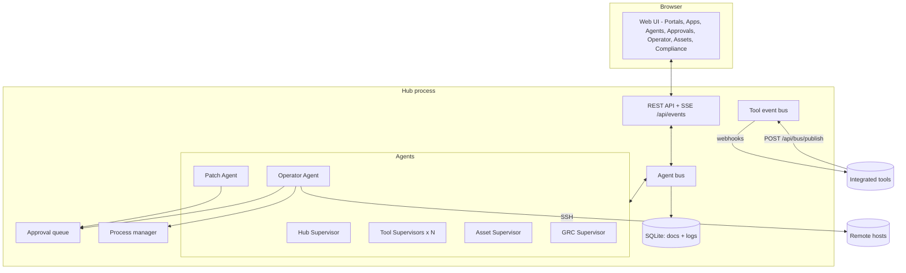
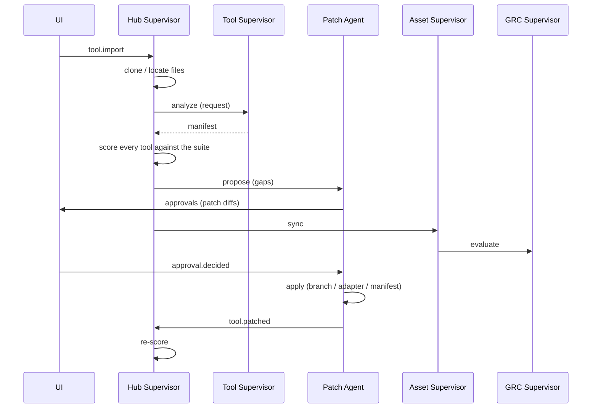

# Architecture

Hub is a single Python process (FastAPI + asyncio) that hosts the web UI, the REST/SSE API and
a team of agents. State lives in one SQLite file; imported repositories, adapters and patch
worktrees live in the workspace directory (`HUB_DATA_DIR`, default `./.hub`).

## The agent bus

Agents never call each other directly. They exchange `Message`s on the bus
(`hub/bus.py`):

- `request` - expects a `reply` (the bus resolves a future for the sender),
- `reply` - answer to a request; `{"error": ...}` raises `AgentError` at the caller,
- `event` - fire-and-forget notification.

Every message is appended to the `messages` log and pushed to the UI over Server-Sent Events, so
the Agents page shows the conversation as it happens. Each agent handles messages concurrently
(bounded by `max_concurrency`) so two agents asking each other questions cannot deadlock. A
handler for subject `tool.imported` is the method `on_tool_imported`.

## Agents

| Agent | Id | Responsibilities |
| --- | --- | --- |
| Hub Supervisor | `supervisor` | Imports tools, assigns Tool Supervisors, scores the suite (`integration/compatibility.py`), sends gaps to the Patch Agent, runs health sweeps, chat (Claude tool use, or rules). |
| Tool Supervisor | `tool:<id>` | One per tool. Analyses it into a manifest, health checks, start/stop via the Operator, describes it to others. |
| Patch Agent | `patcher` | Turns gaps into patches (`integration/patches.py`) or, with Claude, source-code patches; submits them for approval; applies approved ones. |
| Operator Agent | `operator` | Runs commands locally or over SSH under the command policy (`execution/policy.py`); launches tool processes. |
| Asset Supervisor | `module:assets` | Syncs tools/hosts into the asset register, runs read-only discovery on hosts. |
| GRC Supervisor | `module:grc` | Evaluates controls (`grc/checks.py`), stores evidence, opens/closes automatic risks. |

Agents can be paused, given a different model or custom instructions from the UI; settings are
stored in the `agents` collection.

## Import flow

## Patches

| Target | Used for | Where it lands |
| --- | --- | --- |
| `repo` | Tools with source code (manifest adoption, Claude code patches) | New branch `hub/<strategy>-<id>` in a git worktree under `workspace/patches/<patch id>`; folders that aren't git repos get the files staged there instead. |
| `adapter` | Closed-source and SaaS tools, or gaps solvable from outside (health probe, SSO proxy, event poller, API wrapper) | `workspace/adapters/<tool id>/` |
| `manifest` | Hub-side decisions (port reassignment) | The tool's manifest in the hub database |

Patch paths are validated (no absolute paths, no `..`), and Claude may only rewrite files it
was shown.

## Command policy

`execution/policy.py` classifies a command as `blocked`, `read_only` or `change`:

- **blocked** patterns are refused for everyone,
- anything with shell chaining/redirection is never read-only,
- **read-only** commands come from an allowlist (`uname`, `df`, `git status`, `docker ps`,
  `systemctl status`, `kubectl get`, ...).

Agent commands then follow the autonomy level; commands a person types in the Operator console
run directly.

## Compliance

`grc/baseline.py` defines the Hub Security Baseline - 16 controls (asset inventory, ownership,
SSO, approval of agent actions, SSH hardening, configuration as code, change review, health
monitoring, audit logging, software versions, supplier inventory, risk review, and policies).
Each maps to ISO/IEC 27001:2022, SOC 2 and NIS2 Art. 21 references. Automated checks are pure
functions over a `Snapshot` of hub state; people can override any control with a justification.
Controls with a risk template raise a risk when they fail and close it when they pass again.

## Extending

- **New agent**: subclass `BaseAgent`, add `on_<subject>` handlers, register it in
  `AgentRegistry.start_core`.
- **New built-in app**: add an agent (like `module:assets`), API routes in `api.py`, and a view
  in `hub/web/js/views/` registered in `APPS` in `app.js` - it appears in the sidebar and Portals.
- **New control**: add a `Control` to `CONTROLS` and, if automated, a check to `CHECKS`.
- **New patch strategy**: emit it as `Check.fix` in `compatibility.py` and handle it in
  `plan_patch`.
