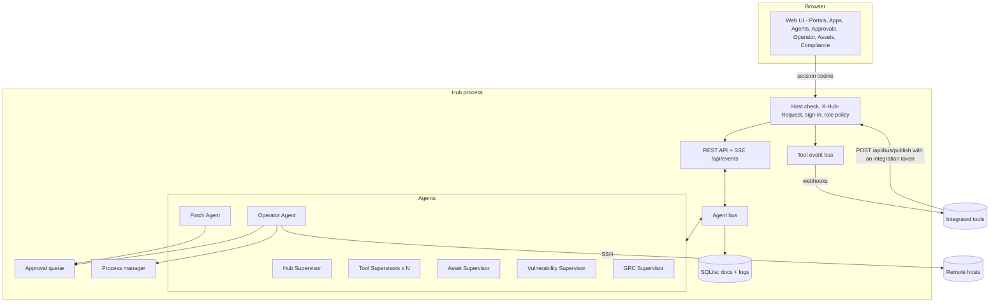
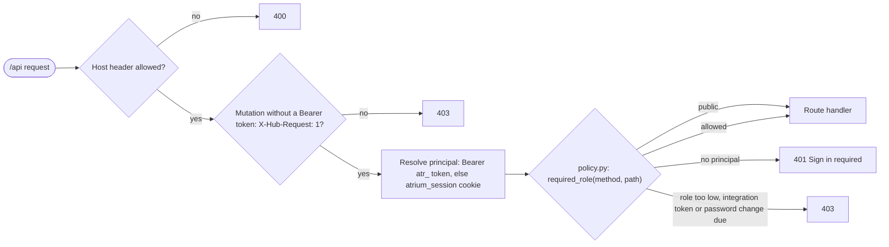
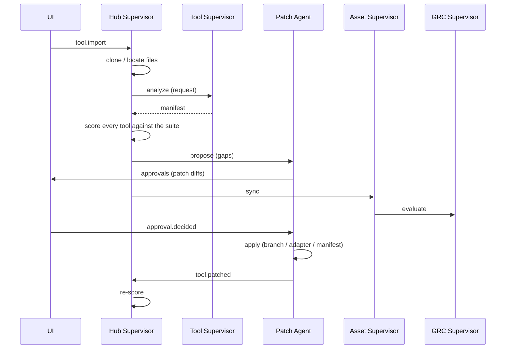
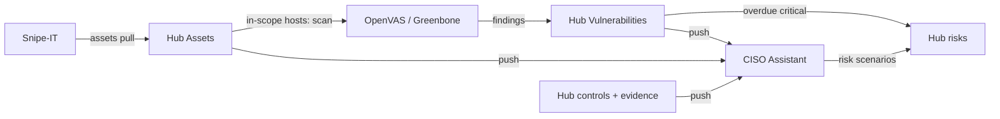

# Architecture

Hub is a single Python process (FastAPI + asyncio) that hosts the web UI, the REST/SSE API and
a team of agents. State lives in one SQLite file; imported repositories, adapters and patch
worktrees live in the workspace directory (`HUB_DATA_DIR`, default `./.hub`).

## Authentication and authorization

Every `/api` request passes the same pipeline before a route handler runs:

1. **Trusted Host** (`TrustedHostMiddleware`, the outermost layer): `127.0.0.1`, `localhost` and
   `HUB_ALLOWED_HOSTS`.
2. **X-Hub-Request**: requests other than `GET`, `HEAD` and `OPTIONS` that carry no Bearer token
   must send `X-Hub-Request: 1`. Cross-site pages cannot add the header without a CORS preflight,
   which the hub never grants.
3. **Principal** (`AuthService.resolve`): an `Authorization: Bearer atr_...` header is looked up as
   an API token (SHA-256 match, not expired); otherwise the `atrium_session` cookie is looked up as
   a session of an enabled account. The result is put on `request.state.principal`:
   `{kind: "user" | "token", id, name, role, actor, bus_id}`.
4. **Policy** (`auth/policy.py`): `required_role(method, path)` returns `None` for the public
   endpoints (health, `GET /api/auth/me`, login, setup, the two OIDC endpoints), `viewer` for the
   self-service endpoints (logout, password, sessions), `admin` for `/api/users`, `/api/tokens`
   (and everything below them, matched on a `/` boundary), `PATCH /api/settings`, `PATCH /api/settings/guardrails`,
   `POST /api/agents`, `PATCH` / `DELETE /api/agents/{id}`, `POST /api/llm/providers`,
   `PATCH` / `DELETE /api/llm/providers/{id}`, `POST /api/llm/providers/{id}/test`, `PUT /api/identity-providers/default`, `PATCH /api/identity-providers/{id}`,
   `POST /api/identity-providers/{id}/atrium` and `PUT` / `DELETE /api/tools/{id}/connection` (tool credentials),
   `operator` for `GET /api/tools/{id}/connection/options/{field}` (a read that uses the stored credentials),
   `viewer` for every other `GET`/`HEAD`, and `operator` for everything else. `authorize` then refuses: no principal on a protected path (401), an `integration` token
   outside `POST /api/bus/publish` and `GET /api/health` (403), an account that must change its
   password outside me/logout/password (403, `code: password_change_required`), or a role below
   the required one (403).

Files outside `/api` (the UI) are public; the UI asks `GET /api/auth/me` at start-up and shows the
setup, sign-in or change-password screen until the person is signed in. It sets `body[data-role]`
and hides controls marked `data-min-role` that the role cannot use; the server-side policy is what
actually enforces access.

| Module | Contents |
| --- | --- |
| `auth/service.py` | `AuthService` (`hub.auth`): accounts, first-run bootstrap and setup token, sign-in throttling, sessions, API tokens, OIDC account provisioning |
| `auth/policy.py` | role required per route, access decision |
| `auth/routes.py` | `/api/auth/*`, `/api/users*`, `/api/tokens*` |
| `auth/passwords.py` | scrypt hashing, password policy |
| `auth/oidc.py` | `OidcClient`: OpenID Connect authorization code flow and ID-token checks |

State lives in three collections: `users` (password hashes, never returned by the API), `sessions`
(keyed by the SHA-256 of the cookie value) and `tokens` (SHA-256 of the secret). Account records
are written straight to the store rather than through `hub.save`, so they are never broadcast on
the event stream. The event stream itself re-checks its session or token every 15 seconds and
closes when it is no longer valid.

**Who did it.** Route handlers take the principal and use it everywhere they act for someone:

- bus messages sent on behalf of a request use `principal.bus_id` as the sender: `user:<username>`
  for people, `token:<name>` for API tokens;
- activity log entries use `principal.actor` (the username, or `token:<name>`);
- approval decisions store `decided_by`.

The Operator Agent treats a command as typed by a person only when its sender starts with `user:`;
commands from API tokens are automation and follow the autonomy level like agent commands.

Roles, sessions, tokens and single sign-on are described for operators in [AUTH.md](AUTH.md).

## The agent bus

Agents never call each other directly. They exchange `Message`s on the bus
(`hub/bus.py`):

- `request` - expects a `reply` (the bus resolves a future for the sender),
- `reply` - answer to a request; `{"error": ...}` raises `AgentError` at the caller,
- `event` - fire-and-forget notification.

Every message is appended to the `messages` log and pushed to the UI over Server-Sent Events, so
the Agents page shows the conversation as it happens. Each agent handles messages concurrently
(bounded by `max_concurrency`) so two agents asking each other questions cannot deadlock. A
handler for subject `tool.imported` is the method `on_tool_imported`.

## Agents

| Agent | Id | Responsibilities |
| --- | --- | --- |
| Hub Supervisor | `supervisor` | Imports tools, assigns Tool Supervisors, scores the suite (`integration/compatibility.py`), sends gaps to the Patch Agent, runs health sweeps, chat (Claude tool use, or rules). |
| Tool Supervisor | `tool:<id>` | One per tool. Analyses it into a manifest, health checks, start/stop via the Operator, describes it to others. The only agent that decrypts the tool's credentials: it builds the tool's connector for `connector.test`, `connector.options`, `connector.pull`, `connector.push` and `connector.action`. |
| Patch Agent | `patcher` | Turns gaps into patches (`integration/patches.py`) or, with Claude, source-code patches; submits them for approval; applies approved ones. Repairs failing data flows (`integration.repair`) and, with Claude, generates generic REST connectors from OpenAPI specs (`connector.generate`). |
| Operator Agent | `operator` | Runs commands locally or over SSH under the command policy (`execution/policy.py`); launches tool processes. |
| Asset Supervisor | `module:assets` | Syncs tools/hosts into the asset register, runs read-only discovery on hosts, sets vulnerability-scan scope, runs the asset data flows. |
| Vulnerability Supervisor | `module:vulns` | The Vulnerabilities app: scan flows (with approval), findings, SLA deadlines, "fixed" after a clean rescan, risks for overdue critical findings, vulnerability data flows. |
| GRC Supervisor | `module:grc` | Evaluates controls (`grc/checks.py`), stores evidence, opens/closes automatic risks, pushes controls and evidence to GRC tools and pulls their risks. |

| Team agents | `agent:<slug>` | Custom agents people or other agents create (see [Agent teams](#agent-teams-local-models-and-guardrails)): a role, instructions, a model provider, permissions, a team and an optional schedule with a standing task. |

Admins can pause core agents and give them a different model or custom instructions from the UI;
settings are stored in the `agents` collection. Core agents cannot be removed.

## Agent teams, local models and guardrails

**Teams.** A team belongs to a tool (team = the tool id; its lead is the Tool Supervisor), to the hub (`hub`; lead:
the Hub Supervisor) or to a built-in app (`module:assets`, `module:vulns`, `module:grc`; lead: that app's supervisor).
Custom agents are defined in the `agent_defs` collection (`AgentDef` in `models.py`): id `agent:<slug>`, name, title
(role), description, instructions, provider (`anthropic`, a local provider id, or `rules`), model (empty: the
provider's default), permissions, team, parent, depth, `schedule_minutes` (0 or at least 5) with a standing `task`,
enabled, template, created_by, and the last run. The parent is the agent that created it - for an agent a person
creates, the team's lead or another agent of the team - and depth counts the levels below the core agents (a lead's
members have depth 1). `agents/teams.py` validates and stores definitions, `agents/custom.py` is the agent
(`CustomAgent`), and `AgentRegistry.start_custom` starts them with the hub. A disabled agent is paused.

**Permissions.** `read`, `tool_api` (a tool's own API through its connection), `commands`, `patches`, `flows` (also
scan requests), `assets_write`, `grc_write` and `agents` (propose teams and members). Core agents declare theirs
(`BaseAgent.permissions`: the Hub Supervisor and Tool Supervisors have all, the Operator `read` + `commands`, the Patch
Agent `read` + `patches`, the app supervisors their domains plus `agents`). A team agent's effective permissions are
its own, clamped to its parent's effective permissions while the `limit_to_parent_permissions` guardrail is on - every
time it acts, so narrowing a parent narrows its members at once.

**Toolkit** (`agents/toolkit.py`): every tool an agent can call from a model, tagged with the permission it needs.
The Hub Supervisor's chat gets them all; a team agent gets those its effective permissions allow, and an agent of a
tool's team only reaches that tool with the tools that act on one tool. Tools never bypass the hub: commands go
through the Operator Agent, patches through the Patch Agent's approval flow and scans through the Vulnerability
Supervisor, always with the team agent as the sender. The module also has the Claude loop (through `hub.llm.create`,
so the default model `claude-opus-5-5` and the request options apply).

**Local models** (`llm_providers.py`, collection `llm_providers`): servers with an OpenAI-compatible API - Ollama
(default base URL `http://localhost:11434/v1`), LM Studio, vLLM, llama.cpp's server. The hub lists models with
`GET {base_url}/models` and runs the agent loop with `POST {base_url}/chat/completions` and `tools` (never
`tool_choice`, which Ollama does not support); a provider whose server or model cannot call tools gets `tools: false`.
The optional API key is encrypted like connection secrets, never returned or logged, and only sent to the endpoint it
was entered for. **Rules** agents run deterministic template actions only - a health check, the team's data flows, a
summary of the state - and say so when a task needs a model.

**Proposals.** A Tool Supervisor proposes a team (`team.propose`) from templates keyed by what the tool is
(`teams.classify`: SIEM / monitoring such as Wazuh -> alert triage analyst + health watcher; GRC such as CISO Assistant
-> compliance analyst + evidence collector; asset inventory such as Snipe-IT -> inventory reconciler; vulnerability
scanner such as OpenVAS -> vulnerability triage analyst; every tool -> maintainer), or with Claude (structured
output) when it is available and a person asked (`POST /api/tools/{id}/team`). The hub proposes by itself - once per
tool, from the templates - when a tool gets a connection, when flows are planned for a connected tool, and when a
known complex tool is imported. The proposal is an approval of kind `agent_team` (payload: team, tool_id, parent,
depth, members, designer, category, rationale); approving it creates the members, re-checked against the guardrails
as they are then. In autonomous mode, or with `team_requires_approval` off, the members are created at once. Team
agents with the `agents` permission can propose members of their own team (`create_team_member`) within the same
rules.

**Guardrails** (`guardrails.py`, preference `guardrails`, `PATCH /api/settings/guardrails`): a registry of switches
and limits with their default and the risk of relaxing them (later features register their own). Every change is
logged with the actor - relaxing a protection as a warning - and the GRC Supervisor re-evaluates HB-AC-6.

| Guardrail | Default | Effect |
| --- | --- | --- |
| `limit_to_parent_permissions` | on | team agents never exceed their parent's effective permissions |
| `allow_nested_teams`, `max_team_depth` | off, 1 | whether team agents may have members of their own, and how deep |
| `limit_team_size`, `max_team_size` | on, 5 | team agents per team |
| `team_actions_need_approval` | on | team agents' commands and patches follow the autonomy level; off = they act without approval |
| `block_catastrophic_commands` | on | blocked command patterns are refused for everyone; off = they become `change` commands |
| `scans_need_approval` | on | scheduled and agent-started scans wait for approval |
| `team_requires_approval` | on | team proposals wait for approval (unless the hub is autonomous) |

**Scheduler.** `Hub.tick_agents` runs in the same background loop as the flows (off when `start_background_tasks` is
false): an enabled agent with a schedule and a standing task runs it one interval after its last run (or its
creation), as a `run` message, so a slow model never blocks the loop.

## Import flow

## Patches

| Target | Used for | Where it lands |
| --- | --- | --- |
| `repo` | Tools with source code (manifest adoption, Claude code patches) | New branch `hub/<strategy>-<id>` in a git worktree under `workspace/patches/<patch id>`; folders that aren't git repos get the files staged there instead. |
| `adapter` | Closed-source and SaaS tools, or gaps solvable from outside (health probe, SSO connection or proxy, event poller, API wrapper) | `workspace/adapters/<tool id>/` |
| `manifest` | Hub-side decisions (port reassignment) | The tool's manifest in the hub database |

Patch paths are validated (no absolute paths, no `..`), and Claude may only rewrite files it
was shown.

## Single sign-on

`integration/identity.py` finds the suite's identity providers (tools that provide `auth.oidc` / `auth.saml`), their
kind (Keycloak, authentik, Zitadel, Authelia or generic), base URL and issuer (Keycloak `{base}/realms/{realm}`,
authentik `{base}/application/o/{slug}/` per application, others `{base}`), and selects the provider for each tool
(see [MANIFEST.md](MANIFEST.md#single-sign-on)). Hub preferences hold the suite default (`identity_provider`),
per-tool choices (`sso_choices`) and per-provider settings (`idp_settings`: Keycloak realm, default `hub`; authentik
application slug of Atrium's own sign-in, default `atrium`; public URL).

`compatibility.py` picks the strategy for the **Single sign-on** check:

| Situation | Fix |
| --- | --- |
| No identity provider in the suite | `sso_proxy` (oauth2-proxy with a placeholder issuer); the detail suggests importing one |
| Several providers, none selected for the tool | none - choose a provider for the tool or a suite default |
| The tool signs in natively with a protocol the provider offers (`integration/sso_catalog.py`, its `.env` OIDC keys, or `auth.sso`) | `sso_connect` |
| Source code, no native SSO, Claude available | `sso_code` (Claude adds OIDC login reading `OIDC_ISSUER` / `OIDC_CLIENT_ID` / `OIDC_CLIENT_SECRET`) |
| Anything else (also Uptime Kuma, n8n community, Mattermost Team) | `sso_proxy` through the selected provider |

`sso_catalog.py` knows how Grafana, Gitea, Forgejo, MinIO, BookStack, Outline, Nextcloud (user_oidc), the Wazuh
dashboard / OpenSearch Dashboards, CISO Assistant, Snipe-IT (SAML), Zammad and generic `.env`-configured tools do SSO,
and generates their configuration plus the redirect URIs. Every SSO patch also registers the tool at the provider:
a Keycloak client (`keycloak-client.json` with `register-keycloak.sh` for kcadm.sh on the host and, when the provider
runs from a compose file the hub can see, `register-keycloak-compose.sh` using `docker compose exec`), an authentik
blueprint (applied with `ak apply_blueprint`), or written instructions for other providers. The files land in the
tool's adapter folder (`idp/<provider>/`, tool-side files in `sso/`).

**Secrets.** Patches, diffs, approvals, API answers, bus messages and the activity log only ever contain the
`<generated-client-secret>` placeholder. When an SSO patch is applied the hub generates the secret once per tool and
provider (`workspace/secrets/sso/`), and writes it into the adapter files only; it refuses to commit a known secret to
a tool's repository. `POST /api/tools/{id}/sso/register` asks the Operator Agent to run the registration script
(the command policy applies: people run it directly, API tokens and agents follow the autonomy level).

Changing the provider of a tool (`POST /api/tools/{id}/sso`), the suite default or a provider's settings makes the
Hub Supervisor re-score the suite and the Patch Agent re-plan SSO (`sso.plan`): a pending SSO patch for another
provider is superseded and its approval rejected with a note. Importing or removing a provider does the same.
`identity.atrium_client()` generates the client Atrium itself signs in with (redirect
`{HUB_PUBLIC_URL}/api/auth/oidc/callback`, groups `atrium-admins` / `atrium-operators`) and returns the `HUB_OIDC_*`
values, the secret as a `SecretStr`.

## Integration fabric: connections and data flows

Tools exchange data through the hub. The hub's built-in apps are the canonical data model: **Assets**,
**Vulnerabilities** and **Compliance** (controls with evidence, risks).

**Connectors** (`hub/connectors/`): `base.py` is the SDK - `Connector` (`test`, `options`, `pull`, `push`, `action`,
`detect`), `ConnectorField`, `ConnectorError` (a message safe to show, the HTTP status, a redacted excerpt) and the
canonical record shapes of the four domains (`assets`, `vulnerabilities`, `risks`, `controls`). `REGISTRY` in
`__init__.py` maps a kind to `"module:Class"` (imported on first use): `snipeit`, `ciso_assistant`, `openvas`,
`generic_rest`. The generic REST connector is driven by a declarative mapping per domain (list path, items path,
pagination, field map, create/update templates); every path is relative to the configured base URL, so a mapping
can never send the credentials to another scheme, host or port.

**Connections** (`integration/connections.py`, collection `connections`, keyed by tool id): kind, non-secret settings,
secrets encrypted with `hub.secrets` (`secrets.py`: Fernet, key from `HUB_SECRET_KEY` - comma-separated keys rotate - or
`{data dir}/secret.key`, created owner-only on first use), the endpoint the secrets were entered for, and the last
test. A stored secret is only reused while the endpoint (scheme, host, port) stays the same, so neither a person
editing the address nor an agent's repair can redirect it. Connections are written straight to the store; the event
stream only carries `{tool_id, kind}`.

**Flows** (`integration/flows.py`, collection `flows`): `domain`, `source` / `target` (`hub` or `tool:<id>`), `action`
(`scan`), `schedule_minutes` (0 = by hand), `status` (`proposed`, `enabled`, `disabled`), `strategy` (`connector` or
`generated`), `options`, `last_run`, `last_result {ok, counts, error, detail, trigger, at, duration, sample}`,
consecutive `failures`, `repair` and, for scans, `job`. **Sync links** (collection `sync_links`) pair a hub record with
its counterpart in a tool and keep the hash of what was last sent, so unchanged records are skipped.

**Planning** (`integration/strategies.py`): from each connection's capabilities (its last successful test, else what
the connector declares) the Hub Supervisor proposes flows - scanner: scan in-scope assets and import the findings;
reads vulnerabilities: pull; writes vulnerabilities: push findings; reads assets and is their system of record (or
cannot take them): pull and merge; writes assets and is not their system of record: push Hub Assets; writes
controls: push controls with evidence; reads risks: pull risks. Each proposal is an approval of kind `flow` (enabled
directly in autonomous mode); a rejected one stays as a disabled flow and is not proposed again. A successful
connection test re-plans. The module also gives the per-tool strategy overview (identity, events, data flows,
generated connector, adapters and patches) the UI shows.

**Running**: a flow is run by the agent that owns its domain (`assets` -> Asset Supervisor, `vulnerabilities` ->
Vulnerability Supervisor, `controls` / `risks` -> GRC Supervisor; shared code in `agents/fabric.py`), which asks the
tool's supervisor for `connector.pull` / `connector.push` / `connector.action`. The Asset Supervisor merges pulled
assets with registered ones by address, hostname, serial or MAC instead of duplicating them (assets the flow created
follow the tool; merged ones keep their name and gain the tool's facts), and retires assets that disappear from the
tool. The scheduler in the Hub runtime (`Hub.tick_flows`, every `HUB_FLOW_INTERVAL` seconds; off when
`start_background_tasks` is false) starts due flows, polls running scans and checks the SLA hourly. Bus bodies above
32 KB (pulled records) reach their recipient in full but are logged as a summary.

**Scans**: only assets with `scan_scope` are ever scanned, and only their IP addresses / hostnames
(`connectors.base.valid_scan_target`). Scheduled and agent-initiated scans create an approval of kind `scan` unless
the hub runs autonomously or the admin guardrail `scans_need_approval` is off; a person pressing "Scan now" decides
themselves. When the scanner reports the scan done, the findings since its start are imported; an open finding of a
scanned host that the scan no longer reports is marked fixed, and the scanned assets get `last_scanned_at`.

**Vulnerabilities** (collection `vulnerabilities`): severity, CVSS, CVEs, asset, host, port, source tool,
external id, status (`open`, `in_progress`, `accepted`, `false_positive`, `fixed`), first/last seen, due date
(`first_seen` + the SLA days of its severity, admin setting `vuln_sla_days`, default 7 / 30 / 90 / 180), note. Open
critical findings past their due date raise one risk per asset (`source: vuln:<asset>`), closed automatically once
none is overdue. Controls HB-VM-2 (in-scope assets scanned within 30 days) and HB-VM-3 (critical and high findings
fixed within SLA) evaluate this data.

**Repairs**: after three consecutive failures (or when an operator asks, `POST /api/flows/{id}/repair`) the Hub
Supervisor sends `integration.repair` to the Patch Agent with the error and a sanitized sample (secret-looking keys
masked, secret values redacted). With Claude it proposes a changed generic REST mapping or connection setting
(validated, never a different endpoint); without Claude it applies rules: 401/403 -> check the credentials, 404 -> try
base-path variants (`/api` added or removed) with a connection test and propose the one that works, 400/409/422 ->
the tool's validation message verbatim. The proposal is an approval of kind `repair` (applied directly in autonomous
mode when it changes something); approving applies the change and re-runs the flow. With Claude and an OpenAPI spec,
`connector.generate` proposes a generic REST connection the same way (`diagnosis: generated`).

## Command policy

`execution/policy.py` classifies a command as `blocked`, `read_only` or `change`:

- **blocked** patterns are refused for everyone (while the `block_catastrophic_commands` guardrail is on; off, they
  are `change` commands),
- anything with shell chaining/redirection is never read-only,
- **read-only** commands come from an allowlist (`uname`, `df`, `git status`, `docker ps`,
  `systemctl status`, `kubectl get`, ...).

Commands from agents and API tokens then follow the autonomy level; commands a signed-in person
(sender `user:<name>`, role operator or above) types in the Operator console run directly. Team agents
(`agent:<slug>`) follow the autonomy level too, unless an admin switched `team_actions_need_approval` off.

## Compliance

`grc/baseline.py` defines the Hub Security Baseline - 21 controls (asset inventory, ownership,
SSO, approval of agent actions, SSH hardening, authenticated role-based access to the hub
(HB-AC-4), dormant hub accounts (HB-AC-5), AI agent guardrails (HB-AC-6), configuration as code, change review,
health monitoring, audit logging, software versions, vulnerability scan coverage (HB-VM-2) and
remediation within SLA (HB-VM-3), supplier inventory, risk review, and policies).
The `Snapshot` includes the hub's own accounts, whether OIDC is configured and the guardrails, and the GRC
Supervisor re-evaluates after account and guardrail changes. HB-AC-6 fails while `block_catastrophic_commands`,
`team_actions_need_approval` or `limit_to_parent_permissions` is off, and is partial while team size is unlimited or
nested teams are allowed.
Each maps to ISO/IEC 27001:2022, SOC 2 and NIS2 Art. 21 references. Automated checks are pure
functions over a `Snapshot` of hub state; people can override any control with a justification.
Controls with a risk template raise a risk when they fail and close it when they pass again.

## Extending

- **New agent**: subclass `BaseAgent`, add `on_<subject>` handlers, declare its `permissions`, register it in
  `AgentRegistry.start_core`. (Agents that only need a role, instructions and tools are custom agents: no code.)
- **New agent tool**: decorate a handler with `@tool(name, description, permission, properties)` in
  `agents/toolkit.py`; it goes through the hub's agents (bus messages as the calling agent), never around them.
- **New guardrail**: `guardrails.register(Guardrail(...))` with its default and the risk of relaxing it; settings,
  validation, logging and the UI catalog pick it up.
- **New built-in app**: add an agent (like `module:assets`), API routes in `api.py`, and a view
  in `hub/web/js/views/` registered in `APPS` in `app.js` - it appears in the sidebar and Portals.
  New routes are protected automatically (`GET` needs viewer, anything else operator); add a rule
  to `auth/policy.py` for a public or admin-only route, mark mutation controls in the view with
  `data-min-role`, and send bus messages as `principal.bus_id`.
- **New control**: add a `Control` to `CONTROLS` and, if automated, a check to `CHECKS`.
- **New connector**: subclass `connectors.base.Connector` (fields, capabilities, actions, `detect`, the operations it
  supports, records in the canonical shapes) and add one line to `connectors.REGISTRY`; the planner, the flows and
  the UI pick it up from there.
- **New patch strategy**: emit it as `Check.fix` in `compatibility.py` and handle it in
  `plan_patch`.
