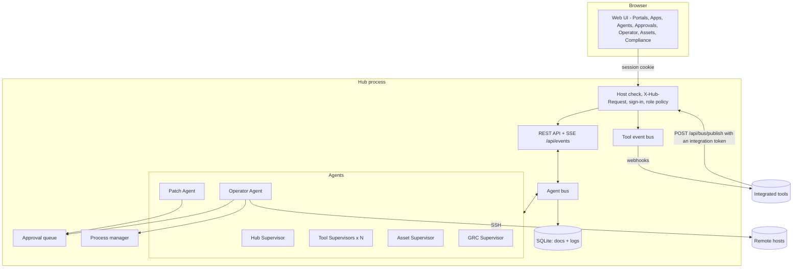
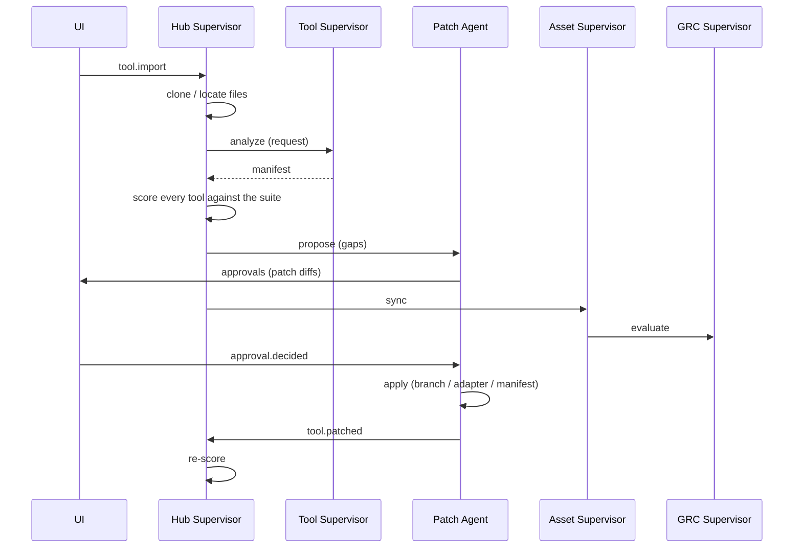

# Architecture

Hub is a single Python process (FastAPI + asyncio) that hosts the web UI, the REST/SSE API and
a team of agents. State lives in one SQLite file; imported repositories, adapters and patch
worktrees live in the workspace directory (`HUB_DATA_DIR`, default `./.hub`).

## Authentication and authorization

Every `/api` request passes the same pipeline before a route handler runs:

1. **Trusted Host** (`TrustedHostMiddleware`, the outermost layer): `127.0.0.1`, `localhost` and
   `HUB_ALLOWED_HOSTS`.
2. **X-Hub-Request**: requests other than `GET`, `HEAD` and `OPTIONS` that carry no Bearer token
   must send `X-Hub-Request: 1`. Cross-site pages cannot add the header without a CORS preflight,
   which the hub never grants.
3. **Principal** (`AuthService.resolve`): an `Authorization: Bearer atr_...` header is looked up as
   an API token (SHA-256 match, not expired); otherwise the `atrium_session` cookie is looked up as
   a session of an enabled account. The result is put on `request.state.principal`:
   `{kind: "user" | "token", id, name, role, actor, bus_id}`.
4. **Policy** (`auth/policy.py`): `required_role(method, path)` returns `None` for the public
   endpoints (health, `GET /api/auth/me`, login, setup, the two OIDC endpoints), `viewer` for the
   self-service endpoints (logout, password, sessions), `admin` for `/api/users`, `/api/tokens`
   (and everything below them, matched on a `/` boundary), `PATCH /api/settings` and
   `PATCH /api/agents/{id}`, `viewer` for every other `GET`/`HEAD`, and `operator` for everything
   else. `authorize` then refuses: no principal on a protected path (401), an `integration` token
   outside `POST /api/bus/publish` and `GET /api/health` (403), an account that must change its
   password outside me/logout/password (403, `code: password_change_required`), or a role below
   the required one (403).

Files outside `/api` (the UI) are public; the UI asks `GET /api/auth/me` at start-up and shows the
setup, sign-in or change-password screen until the person is signed in. It sets `body[data-role]`
and hides controls marked `data-min-role` that the role cannot use; the server-side policy is what
actually enforces access.

| Module | Contents |
| --- | --- |
| `auth/service.py` | `AuthService` (`hub.auth`): accounts, first-run bootstrap and setup token, sign-in throttling, sessions, API tokens, OIDC account provisioning |
| `auth/policy.py` | role required per route, access decision |
| `auth/routes.py` | `/api/auth/*`, `/api/users*`, `/api/tokens*` |
| `auth/passwords.py` | scrypt hashing, password policy |
| `auth/oidc.py` | `OidcClient`: OpenID Connect authorization code flow and ID-token checks |

State lives in three collections: `users` (password hashes, never returned by the API), `sessions`
(keyed by the SHA-256 of the cookie value) and `tokens` (SHA-256 of the secret). Account records
are written straight to the store rather than through `hub.save`, so they are never broadcast on
the event stream. The event stream itself re-checks its session or token every 15 seconds and
closes when it is no longer valid.

**Who did it.** Route handlers take the principal and use it everywhere they act for someone:

- bus messages sent on behalf of a request use `principal.bus_id` as the sender: `user:<username>`
  for people, `token:<name>` for API tokens;
- activity log entries use `principal.actor` (the username, or `token:<name>`);
- approval decisions store `decided_by`.

The Operator Agent treats a command as typed by a person only when its sender starts with `user:`;
commands from API tokens are automation and follow the autonomy level like agent commands.

Roles, sessions, tokens and single sign-on are described for operators in [AUTH.md](AUTH.md).

## The agent bus

Agents never call each other directly. They exchange `Message`s on the bus
(`hub/bus.py`):

- `request` - expects a `reply` (the bus resolves a future for the sender),
- `reply` - answer to a request; `{"error": ...}` raises `AgentError` at the caller,
- `event` - fire-and-forget notification.

Every message is appended to the `messages` log and pushed to the UI over Server-Sent Events, so
the Agents page shows the conversation as it happens. Each agent handles messages concurrently
(bounded by `max_concurrency`) so two agents asking each other questions cannot deadlock. A
handler for subject `tool.imported` is the method `on_tool_imported`.

## Agents

| Agent | Id | Responsibilities |
| --- | --- | --- |
| Hub Supervisor | `supervisor` | Imports tools, assigns Tool Supervisors, scores the suite (`integration/compatibility.py`), sends gaps to the Patch Agent, runs health sweeps, chat (Claude tool use, or rules). |
| Tool Supervisor | `tool:<id>` | One per tool. Analyses it into a manifest, health checks, start/stop via the Operator, describes it to others. |
| Patch Agent | `patcher` | Turns gaps into patches (`integration/patches.py`) or, with Claude, source-code patches; submits them for approval; applies approved ones. |
| Operator Agent | `operator` | Runs commands locally or over SSH under the command policy (`execution/policy.py`); launches tool processes. |
| Asset Supervisor | `module:assets` | Syncs tools/hosts into the asset register, runs read-only discovery on hosts. |
| GRC Supervisor | `module:grc` | Evaluates controls (`grc/checks.py`), stores evidence, opens/closes automatic risks. |

Admins can pause agents and give them a different model or custom instructions from the UI;
settings are stored in the `agents` collection.

## Import flow

## Patches

| Target | Used for | Where it lands |
| --- | --- | --- |
| `repo` | Tools with source code (manifest adoption, Claude code patches) | New branch `hub/<strategy>-<id>` in a git worktree under `workspace/patches/<patch id>`; folders that aren't git repos get the files staged there instead. |
| `adapter` | Closed-source and SaaS tools, or gaps solvable from outside (health probe, SSO proxy, event poller, API wrapper) | `workspace/adapters/<tool id>/` |
| `manifest` | Hub-side decisions (port reassignment) | The tool's manifest in the hub database |

Patch paths are validated (no absolute paths, no `..`), and Claude may only rewrite files it
was shown.

## Command policy

`execution/policy.py` classifies a command as `blocked`, `read_only` or `change`:

- **blocked** patterns are refused for everyone,
- anything with shell chaining/redirection is never read-only,
- **read-only** commands come from an allowlist (`uname`, `df`, `git status`, `docker ps`,
  `systemctl status`, `kubectl get`, ...).

Commands from agents and API tokens then follow the autonomy level; commands a signed-in person
(sender `user:<name>`, role operator or above) types in the Operator console run directly.

## Compliance

`grc/baseline.py` defines the Hub Security Baseline - 18 controls (asset inventory, ownership,
SSO, approval of agent actions, SSH hardening, authenticated role-based access to the hub
(HB-AC-4), dormant hub accounts (HB-AC-5), configuration as code, change review, health
monitoring, audit logging, software versions, supplier inventory, risk review, and policies).
The `Snapshot` includes the hub's own accounts and whether OIDC is configured, and the GRC
Supervisor re-evaluates after account changes.
Each maps to ISO/IEC 27001:2022, SOC 2 and NIS2 Art. 21 references. Automated checks are pure
functions over a `Snapshot` of hub state; people can override any control with a justification.
Controls with a risk template raise a risk when they fail and close it when they pass again.

## Extending

- **New agent**: subclass `BaseAgent`, add `on_<subject>` handlers, register it in
  `AgentRegistry.start_core`.
- **New built-in app**: add an agent (like `module:assets`), API routes in `api.py`, and a view
  in `hub/web/js/views/` registered in `APPS` in `app.js` - it appears in the sidebar and Portals.
  New routes are protected automatically (`GET` needs viewer, anything else operator); add a rule
  to `auth/policy.py` for a public or admin-only route, mark mutation controls in the view with
  `data-min-role`, and send bus messages as `principal.bus_id`.
- **New control**: add a `Control` to `CONTROLS` and, if automated, a check to `CHECKS`.
- **New patch strategy**: emit it as `Check.fix` in `compatibility.py` and handle it in
  `plan_patch`.
