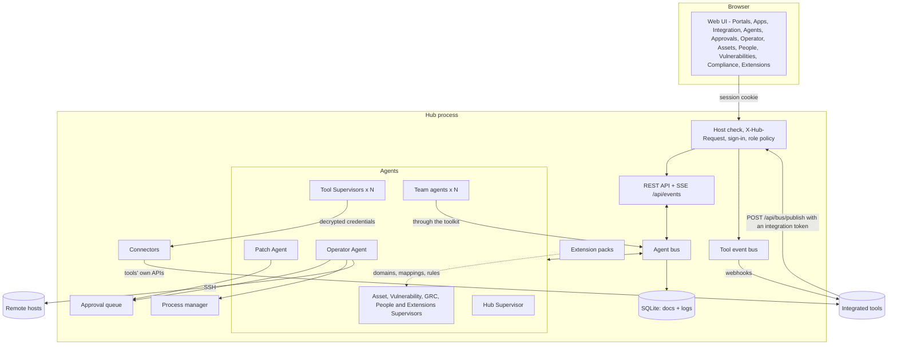
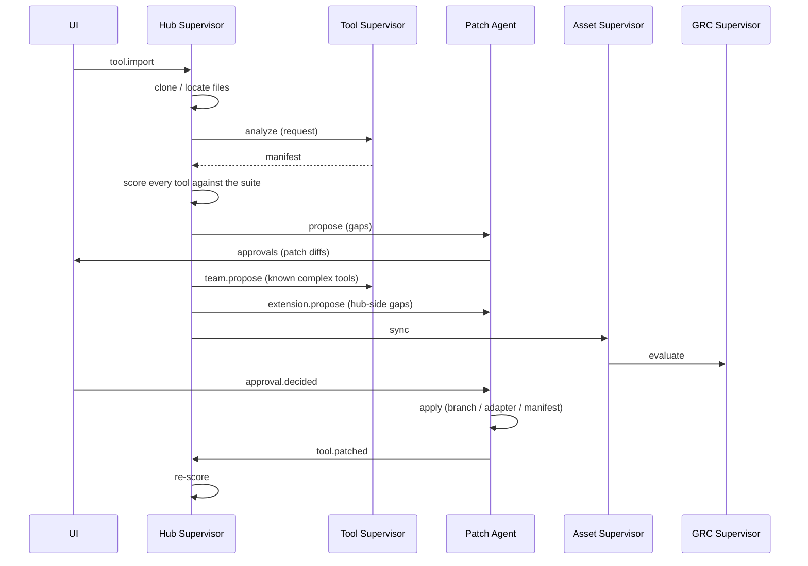

# Architecture

Atrium is a single Python process (FastAPI + asyncio, package `hub`) that hosts the web UI, the REST/SSE API and a
team of agents. State lives in one SQLite file; imported repositories, adapters, patch worktrees and generated files
live in the workspace directory under the data directory (`HUB_DATA_DIR`, default `./.hub`).

| Page | Covers |
| --- | --- |
| [AUTH.md](AUTH.md) | sign-in, roles, sessions, API tokens, single sign-on for Atrium, the Sign-in & SSO settings |
| [INTEGRATIONS.md](INTEGRATIONS.md) | connections, connectors, credentials and the secret key, data flows, repairs, vulnerabilities and scans, single sign-on for tools |
| [AGENTS.md](AGENTS.md) | agents, team agents and teams, local models, guardrails, extension packs, self-patching |
| [PEOPLE.md](PEOPLE.md) | the People app: directories, merging, accounts, links to assets, leavers |
| [MANIFEST.md](MANIFEST.md) | the hub manifest of a tool |

## Authentication and authorization

Every `/api` request passes the same pipeline before a route handler runs:

1. **Trusted Host** (`TrustedHostMiddleware`, the outermost layer): `127.0.0.1`, `localhost` and
   `HUB_ALLOWED_HOSTS`.
2. **X-Hub-Request**: requests other than `GET`, `HEAD` and `OPTIONS` that carry no Bearer token
   must send `X-Hub-Request: 1`. Cross-site pages cannot add the header without a CORS preflight,
   which the hub never grants.
3. **Principal** (`AuthService.resolve`): an `Authorization: Bearer atr_...` header is looked up as
   an API token (SHA-256 match, not expired); otherwise the `atrium_session` cookie is looked up as
   a session of an enabled account. The result is put on `request.state.principal`:
   `{kind: "user" | "token", id, name, role, actor, bus_id}`.
4. **Policy** (`auth/policy.py`): `required_role(method, path)` returns `None` for the public endpoints (health,
   `GET /api/auth/me`, login, setup, the two OIDC endpoints), `viewer` for the self-service endpoints (logout,
   password, sessions), `admin` for `/api/users` and `/api/tokens` (and everything below them, matched on a `/`
   boundary) and for these single routes:
   - settings and guardrails: `PATCH /api/settings`, `PATCH /api/settings/guardrails`;
   - agent definitions: `POST /api/agents`, `PATCH` / `DELETE /api/agents/{id}`;
   - AI model providers (they may hold API keys): `POST /api/llm/providers`, `PATCH` / `DELETE /api/llm/providers/{id}`,
     `POST /api/llm/providers/{id}/test`;
   - identity providers: `PUT /api/identity-providers/default`, `PATCH /api/identity-providers/{id}`,
     `POST /api/identity-providers/{id}/atrium`;
   - tool credentials: `PUT` / `DELETE /api/tools/{id}/connection`;
   - Atrium's Sign-in & SSO settings: `GET` / `PUT` / `DELETE /api/auth/sso`, `POST /api/auth/sso/test`;
   - disabling a leaver's Atrium account: `POST /api/people/{id}/actions/disable_atrium_account`;
   - extensions and self-patches: `POST /api/extensions`, `PATCH` / `DELETE /api/extensions/{id}`,
     `POST /api/extensions/{id}/rollback`, `POST /api/tools/{id}/extend`, `POST /api/self-patches`,
     `POST /api/self-patches/{id}/apply`.

   It returns `operator` for `GET /api/tools/{id}/connection/options/{field}` (a read that uses the stored
   credentials), `viewer` for every other `GET`/`HEAD`, and `operator` for everything else. `authorize` then refuses:
   no principal on a protected path (401), an `integration` token outside `POST /api/bus/publish` and
   `GET /api/health` (403), an account that must change its password outside me/logout/password (403,
   `code: password_change_required`), or a role below the required one (403).
5. **Per kind**: `POST /api/approvals/{id}` needs operator, but approvals of kind `extension` and `self_patch` (changes
   to Atrium itself) are decided by admins only; the route answers 403 for anyone else.

Files outside `/api` (the UI) are public; the UI asks `GET /api/auth/me` at start-up and shows the
setup, sign-in or change-password screen until the person is signed in. It sets `body[data-role]`
and hides controls marked `data-min-role` that the role cannot use; the server-side policy is what
actually enforces access. The permission-matrix tests (`tests/test_auth.py`) check every route against the policy.

| Module | Contents |
| --- | --- |
| `auth/service.py` | `AuthService` (`hub.auth`): accounts, first-run bootstrap and setup token, sign-in throttling, sessions, API tokens, OIDC account provisioning |
| `auth/policy.py` | role required per route, access decision |
| `auth/routes.py` | `/api/auth/*`, `/api/users*`, `/api/tokens*` |
| `auth/passwords.py` | scrypt hashing, password policy |
| `auth/oidc.py` | `OidcClient`: OpenID Connect authorization code flow and ID-token checks, and the discovery check behind the settings' Test button |
| `auth/sso_settings.py` | the Sign-in & SSO settings: stored values, precedence of `HUB_OIDC_*`, presets, rebuilding `hub.auth.oidc` |

Account state lives in three collections: `users` (password hashes, never returned by the API), `sessions` (keyed by
the SHA-256 of the cookie value) and `tokens` (SHA-256 of the secret). Account records are written straight to the
store rather than through `hub.save`, so they are never broadcast on the event stream. The event stream itself
re-checks its session or token every 15 seconds and closes when it is no longer valid.

**Who did it.** Route handlers take the principal and use it everywhere they act for someone:

- bus messages sent on behalf of a request use `principal.bus_id` as the sender: `user:<username>`
  for people, `token:<name>` for API tokens;
- activity log entries use `principal.actor` (the username, or `token:<name>`);
- approval decisions store `decided_by`.

The Operator Agent treats a command as typed by a person only when its sender starts with `user:`;
commands from API tokens are automation and follow the autonomy level like agent commands.

Roles, sessions, tokens and single sign-on are described for operators in [AUTH.md](AUTH.md).

## The agent bus

Agents never call each other directly. They exchange `Message`s on the bus
(`hub/bus.py`):

- `request` - expects a `reply` (the bus resolves a future for the sender),
- `reply` - answer to a request; `{"error": ...}` raises `AgentError` at the caller,
- `event` - fire-and-forget notification.

Every message is appended to the `messages` log and pushed to the UI over Server-Sent Events, so
the Agents page shows the conversation as it happens. Each agent handles messages concurrently
(bounded by `max_concurrency`) so two agents asking each other questions cannot deadlock. A
handler for subject `tool.imported` is the method `on_tool_imported`. Bodies over 32 KB (pulled records) reach their
recipient in full but are logged as a summary.

## Agents

| Agent | Id | Responsibilities |
| --- | --- | --- |
| Hub Supervisor | `supervisor` | Imports tools, assigns Tool Supervisors, scores the suite (`integration/compatibility.py`), sends gaps to the Patch Agent, plans data flows, looks for hub-side gaps after an import (extensions), runs health sweeps, chat (Claude tool use, or rules). |
| Tool Supervisor | `tool:<id>` | One per tool. Analyses it into a manifest, health checks, start/stop via the Operator, describes it to others, proposes its agent team. The only agent that decrypts the tool's credentials: it builds the tool's connector for `connector.test`, `connector.options`, `connector.pull`, `connector.push` and `connector.action`. |
| Patch Agent | `patcher` | Turns gaps into patches (`integration/patches.py`) or, with Claude, source-code patches; submits them for approval; applies approved ones. Repairs failing data flows (`integration.repair`), generates generic REST connectors from OpenAPI specs (`connector.generate`), writes extension packs (`extension.propose`) and self-patches (`self_patch.propose`). |
| Operator Agent | `operator` | Runs commands locally or over SSH under the command policy (`execution/policy.py`); launches tool processes. |
| Asset Supervisor | `module:assets` | Syncs tools/hosts into the asset register, runs read-only discovery on hosts, sets vulnerability-scan scope, runs the asset data flows. |
| Vulnerability Supervisor | `module:vulns` | The Vulnerabilities app: scan flows (with approval), findings, SLA deadlines, "fixed" after a clean rescan, risks for overdue critical findings, vulnerability data flows. |
| GRC Supervisor | `module:grc` | Evaluates controls (`grc/checks.py`), stores evidence, opens/closes automatic risks, pushes controls and evidence to GRC tools and pulls their risks. |
| People Supervisor | `module:people` | The People app: people and accounts flows, re-linking people to accounts and assets after every pull, leaver findings ([PEOPLE.md](PEOPLE.md)). |
| Extensions Supervisor | `module:extensions` | The apps extension packs add: their data flows, typing records by the domain's fields, links to assets and people ([AGENTS.md](AGENTS.md#extensions)). |
| Team agents | `agent:<slug>` | Custom agents people or other agents create: a role, instructions, a model provider (Claude, a local model or rules), permissions, a team and an optional schedule with a standing task ([AGENTS.md](AGENTS.md#team-agents)). |

`AgentRegistry.start_core` starts the eight core agents (Tool Supervisors are added per tool) and `start_custom` the
team agents. Admins can pause core agents and give them a different model or custom instructions from the UI;
settings are stored in the `agents` collection. Core agents cannot be removed.

Every agent declares its **permissions** (`read`, `tool_api`, `commands`, `patches`, `flows`, `assets_write`,
`grc_write`, `agents`). Agents that run on a model act through the shared **toolkit** (`agents/toolkit.py`): every tool
is tagged with the permission it needs, a team agent only gets the tools its effective permissions allow, and tools
go through the other agents (commands through the Operator, patches through the Patch Agent's approval flow, scans
through the Vulnerability Supervisor), never around them. Team agents' permissions are clamped to their parent's while
the guardrail `limit_to_parent_permissions` is on. Teams, local model providers (`llm_providers.py`) and the
guardrails (`guardrails.py`) are described in [AGENTS.md](AGENTS.md).

## Import flow

## Patches

| Target | Used for | Where it lands |
| --- | --- | --- |
| `repo` | Tools with source code (manifest adoption, Claude code patches) | New branch `hub/<strategy>-<id>` in a git worktree under `workspace/patches/<patch id>`; folders that aren't git repos get the files staged there instead. |
| `adapter` | Closed-source and SaaS tools, or gaps solvable from outside (health probe, SSO connection or proxy, event poller, API wrapper) | `workspace/adapters/<tool id>/` |
| `manifest` | Hub-side decisions (port reassignment) | The tool's manifest in the hub database |

Patch paths are validated (no absolute paths, no `..`), and Claude may only rewrite files it
was shown. Changes to Atrium itself are not patches: they are extension packs or self-patches on a branch
`atrium/self-<id>` in `workspace/self-patches/` ([AGENTS.md](AGENTS.md#self-patching)).

## Single sign-on for tools

`integration/identity.py` finds the suite's identity providers (tools that provide `auth.oidc` / `auth.saml`) and
selects one for each tool: the choice made for the tool, the tool's `auth.provider`, the suite default, or the only
provider. `compatibility.py` picks the fix for the **Single sign-on** check - `sso_connect` (the tool signs in natively;
configuration from `integration/sso_catalog.py`), `sso_code` (Claude adds OIDC login to a tool with source code) or
`sso_proxy` (oauth2-proxy) - and every SSO patch also registers the tool at the provider (Keycloak client and
`kcadm.sh` script, authentik blueprint, or instructions). Client secrets are generated by the hub and written only
into adapter files; patches, diffs, API answers and logs carry a placeholder. Details in
[INTEGRATIONS.md](INTEGRATIONS.md#single-sign-on-to-the-suites-identity-provider).

## Integration fabric

Tools exchange data through the hub's built-in apps, which are the canonical data model.

- **Connectors** (`hub/connectors/`): `base.py` is the SDK (`Connector`, `ConnectorField`, `ConnectorError`, the
  canonical record shapes of the domains `assets`, `vulnerabilities`, `risks`, `controls`, `people`, `accounts` and
  extension domains `x:<key>`). `REGISTRY` maps a kind to `"module:Class"`: `snipeit`, `ciso_assistant`, `openvas`,
  `okta`, `keycloak`, `scim`, `generic_rest`.
- **Connections** (`integration/connections.py`, collection `connections`): a connector kind, settings and secrets
  encrypted by `secrets.py` (Fernet; `HUB_SECRET_KEY` or `{data dir}/secret.key`), bound to the endpoint they were
  entered for.
- **Flows** (`integration/flows.py`, collections `flows` and `sync_links`) are proposed by the planner
  (`integration/strategies.py`) as approvals of kind `flow`, and run by the agent that owns their domain through the
  tool's supervisor (`agents/fabric.py`). `Hub.tick_flows` runs due flows every `HUB_FLOW_INTERVAL` seconds.
- **Repairs**: after three consecutive failures the Patch Agent proposes a fix (approval kind `repair`).
- **Maps** (`integration/canvas.py`, `api_canvas.py`): `GET /api/integration/map` and `GET /api/integration/map/options`,
  layouts at `/api/layouts/{view}` (`integration` or `segmentation`), and `POST /api/flows`. A layout change publishes
  SSE event `canvas_layout`. The segmentation read model is `GET /api/segmentation` (`integration/segmentation.py`).
- **Vulnerabilities** (collection `vulnerabilities`): scans of in-scope assets (approval kind `scan`), SLA deadlines,
  risks for overdue critical findings.
- **Network devices** (`integration/network.py`, `api_network.py`, `integration/changes.py`): snapshots, drift, backups
  and guarded firewall changes. Connectors include OPNsense, pfSense, MikroTik, FortiGate, PAN-OS, IOS-XE (read-only),
  Linux host firewalls and Windows Defender Firewall. Details in [NETWORK.md](NETWORK.md).

Details in [INTEGRATIONS.md](INTEGRATIONS.md).

## People

`hub/people.py` merges people from directories (`people` flows: Okta, Keycloak, SCIM) by source id, email and login
into the `people` collection, stores tool accounts in `accounts`, links assets (`owner_person_id`,
`assigned_person_id`), risks and policies to people and Atrium users by email, and finds leavers (control HB-AC-7). The
People Supervisor runs the flows and reports leavers. Details in [PEOPLE.md](PEOPLE.md).

## Extensions and self-patching

`hub/extensions/` lets Atrium grow without code: `pack.py` (strict models of a pack: domains, connector mappings, SSO
recipes, control rules, team templates; nothing is executed), `registry.py` (versions, enable/disable/rollback in the
running process; collection `extensions`), `records.py` (records of extension domains in `x:<key>` collections),
`controls.py` (control rules), `gaps.py` (hub-side gaps after an import, and the template packs), `generate.py`
(packs and self-patches written by Claude) and `selfpatch.py` (changes to Atrium's own repository on a branch in a
worktree, tested, approved by an admin, then a pull request or a local merge). Details in
[AGENTS.md](AGENTS.md#extensions).

## Command policy

`execution/policy.py` classifies a command as `blocked`, `read_only` or `change`:

- **blocked** patterns are refused for everyone (while the `block_catastrophic_commands` guardrail is on; off, they
  are `change` commands),
- anything with shell chaining/redirection is never read-only,
- **read-only** commands come from an allowlist (`uname`, `df`, `git status`, `git branch` without a delete,
  `docker ps`, `systemctl status`, `kubectl get`, ...). `git branch -D` and `git tag -d` are state-changing.
  A command that names `secret.key`, `hub.db` or `.hub` is blocked.

Commands from agents and API tokens then follow the autonomy level. A signed-in person (sender `user:<name>`) runs
read-only commands immediately. An administrator also runs state-changing commands immediately. An operator's
state-changing command **on this machine** waits for an administrator, because the console runs as the hub user.
Commands on a remote host still run as the person who typed them. Team agents (`agent:<slug>`) follow the autonomy
level too, unless an admin switched `team_actions_need_approval` off.

## Approvals

Everything that changes state on an agent's initiative waits in the approval queue (collection `approvals`) unless the
autonomy level or a guardrail says otherwise. Each approval records who asked and who decided.

| Kind | Proposed by | Approving it |
| --- | --- | --- |
| `command`, `process` | Operator Agent | runs the command (refused if the blocked-command guardrail now blocks it), starts or stops the tool |
| `patch` | Patch Agent | applies the patch (branch, adapter or manifest) |
| `flow` | Hub Supervisor | enables the data flow |
| `scan` | Vulnerability Supervisor | starts the scan |
| `repair` | Patch Agent | applies the changed connection or mapping and runs the flow again |
| `agent_team` (admins only) | a Tool Supervisor | creates the team agents |
| `extension` (admins only) | Patch Agent | enables the extension pack |
| `self_patch` (admins only) | Patch Agent | opens a pull request or merges the change into Atrium's checkout |

## Compliance

`grc/baseline.py` defines the Hub Security Baseline - 22 controls: asset inventory and ownership (HB-AM-1, HB-AM-2),
SSO for tools (HB-AC-1), approval of agent actions (HB-AC-2), SSH hardening (HB-AC-3), authenticated role-based access
to the hub (HB-AC-4), dormant hub accounts (HB-AC-5), AI agent guardrails (HB-AC-6), leavers (HB-AC-7), configuration
as code (HB-CM-1), change review (HB-CM-2), health monitoring (HB-OP-1), audit logging (HB-OP-2), software versions
(HB-VM-1), vulnerability scan coverage (HB-VM-2) and remediation within SLA (HB-VM-3), supplier inventory (HB-SC-1),
risk review (HB-RM-1), and policies (HB-PO-1, HB-PO-2, HB-IR-1, HB-BC-1). Each maps to ISO/IEC 27001:2022, SOC 2 and
NIS2 Art. 21 references.

Automated checks are pure functions over a `Snapshot` of hub state: tools, hosts, assets, risks, policies, patches,
the autonomy level, the hub's own accounts, whether OIDC is configured, vulnerabilities, the guardrails, people and
accounts, and the results of extension packs' control rules. The GRC Supervisor re-evaluates after account, guardrail,
flow and extension changes. People can override any control with a justification. Controls with a risk template raise
a risk when they fail and close it when they pass again.

Guardrails name the control they weaken (`guardrails.weakened`): HB-AC-6 fails while `block_catastrophic_commands`,
`team_actions_need_approval` or `limit_to_parent_permissions` is off and is partial with unlimited team size or nested
teams; HB-AC-2 fails in autonomous mode and is partial while `scans_need_approval` or `team_requires_approval` is off;
HB-CM-2 fails while `self_patch_requires_approval` or `self_patch_requires_tests` is off and is partial while
`extensions_need_approval` is off (or in autonomous mode). HB-AC-7 fails while a leaver still has an enabled Atrium
account or an active tool account, and is partial when they only still have assets. Extension control rules can make
any control worse, never better, and add their evidence ([AGENTS.md](AGENTS.md#what-a-pack-can-contain)).

## State and files

| Collection | Holds |
| --- | --- |
| `tools`, `patches`, `approvals`, `hosts`, `commands` | imported tools with their manifests, patches, the approval queue, SSH hosts, command history |
| `assets`, `vulnerabilities`, `risks`, `policies`, `controls` | the built-in apps |
| `people`, `accounts` | the People app |
| `connections`, `flows`, `sync_links` | the integration fabric (connection secrets encrypted) |
| `agents`, `agent_defs`, `llm_providers` | core agent settings, team agents, local model providers (API keys encrypted) |
| `extensions`, `x:<key>`, `self_patches` | extension packs with their versions, records of extension apps, self-patches |
| `settings` | preferences (autonomy, model, SLA days, guardrails, identity provider choices) and the Sign-in & SSO settings |
| `canvas_layouts` | saved lane order for the integration and segmentation maps |
| `users`, `sessions`, `tokens` | accounts and credentials (hashes only) |
| `messages`, `activity`, `toolbus` | logs: agent messages, the activity log, tool events |

| Path under the data directory | Holds |
| --- | --- |
| `hub.db` | the SQLite database (mode `0600`; the data directory is `0700`) |
| `secret.key` | the encryption key for stored credentials, unless `HUB_SECRET_KEY` is set (back it up separately; mode `0600`) |
| `workspace/tools/` | cloned repositories |
| `workspace/patches/<id>/` | worktrees of patches to tools |
| `workspace/adapters/<tool id>/` | adapters: health probes, SSO configuration and provider registration, event pollers |
| `workspace/secrets/sso/` | client secrets the hub generated for single sign-on (owner-only files) |
| `workspace/identity/atrium/<provider>/` | Atrium's own sign-in client at a provider |
| `workspace/self-patches/<id>/` | worktrees of self-patches |

## Extending

- **New agent**: subclass `BaseAgent`, add `on_<subject>` handlers, declare its `permissions`, register it in
  `AgentRegistry.start_core`. (Agents that only need a role, instructions and tools are team agents: no code.)
- **New agent tool**: decorate a handler with `@tool(name, description, permission, properties)` in
  `agents/toolkit.py`; it goes through the hub's agents (bus messages as the calling agent), never around them.
- **New guardrail**: `guardrails.register(Guardrail(...))` with its default, the risk of relaxing it and the control it
  weakens (`control`, `weakens`, `finding`); settings, validation, logging, the UI catalog and the compliance check pick
  it up (a control other than HB-AC-2, HB-AC-6 and HB-CM-2 needs its check to call `_guardrail_findings`).
- **New data type, connector mapping, SSO recipe, compliance rule or team template**: an extension pack, no code
  ([AGENTS.md](AGENTS.md#extensions)).
- **New built-in app**: add an agent (like `module:assets`), API routes in `api.py`, and a view
  in `hub/web/js/views/` registered in `APPS` in `app.js` - it appears in the sidebar and Portals.
  New routes are protected automatically (`GET` needs viewer, anything else operator); add a rule
  to `auth/policy.py` for a public or admin-only route and to the permission-matrix tests, mark mutation controls in
  the view with `data-min-role`, and send bus messages as `principal.bus_id`.
- **New control**: add a `Control` to `CONTROLS` and, if automated, a check to `CHECKS`.
- **New connector**: subclass `connectors.base.Connector` (fields, capabilities, actions, `detect`, the operations it
  supports, records in the canonical shapes) and add one line to `connectors.REGISTRY`; the planner, the flows and
  the UI pick it up from there.
- **New patch strategy**: emit it as `Check.fix` in `compatibility.py` and handle it in
  `plan_patch`.
