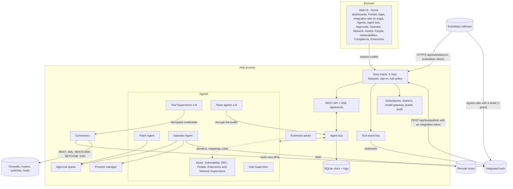
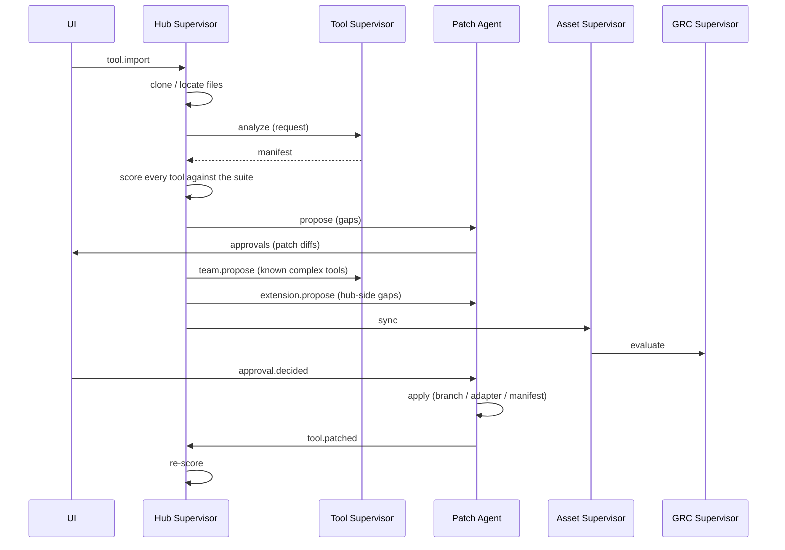
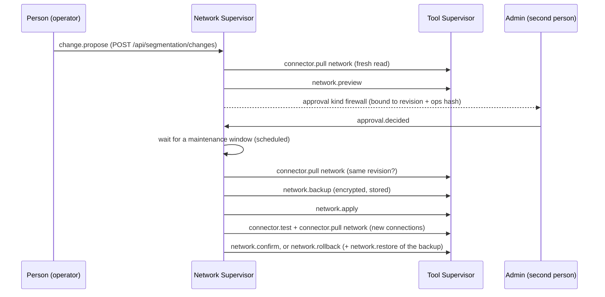
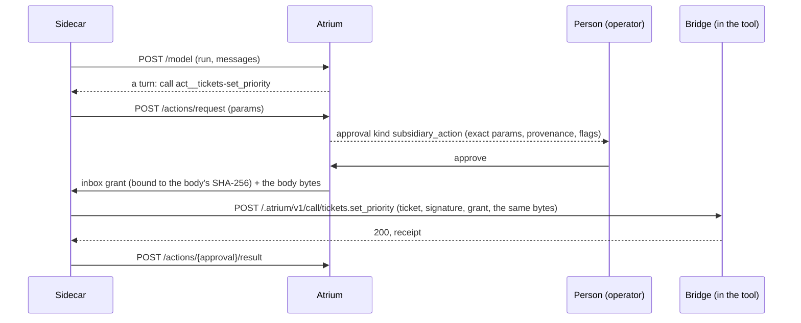

# Architecture

Atrium is a single Python process (FastAPI + asyncio, package `hub`) that hosts the web UI, the REST/SSE API and a
team of agents. State lives in one SQLite file; imported repositories, adapters, patch worktrees and generated files
live in the workspace directory under the data directory (`HUB_DATA_DIR`, default `./.hub`).

| Page | Covers |
| --- | --- |
| [AUTH.md](AUTH.md) | sign-in, roles, sessions, API tokens, single sign-on for Atrium, the Sign-in & SSO settings |
| [INTEGRATIONS.md](INTEGRATIONS.md) | connections, connectors, credentials and the secret key, data flows, repairs, vulnerabilities and scans, single sign-on for tools |
| [AGENTS.md](AGENTS.md) | agents, team agents and teams, local models, guardrails, extension packs, self-patching |
| [PEOPLE.md](PEOPLE.md) | the People app: directories, merging, accounts, links to assets, leavers |
| [NETWORK.md](NETWORK.md) | the Network app: device connectors, the read model, drift, backups, the segmentation map, guarded device changes |
| [COMPLIANCE.md](COMPLIANCE.md) | the control baseline with its references, CyFun frameworks and self-assessments, the audit pack, CISO Assistant framework sync |
| [DASHBOARD.md](DASHBOARD.md) | Home dashboards: tabs, drag and drop with keyboard and click alternatives, the widget catalog, widgets from every tool, the AI models and settings widgets, widgets declared by packs and manifests |
| [SUBSIDIARIES.md](SUBSIDIARIES.md) | agent teams inside a tool: the bridge patch, the sidecar, the charter, in-tool actions and grants, governance, the bridge contract `atrium-bridge/1` |
| [MANIFEST.md](MANIFEST.md) | the hub manifest of a tool |

## Authentication and authorization

Every `/api` request passes the same pipeline before a route handler runs:

1. **Trusted Host** (`TrustedHostMiddleware`, the first check): `127.0.0.1`, `localhost` and
   `HUB_ALLOWED_HOSTS`. Around it, `FrameDenialMiddleware` (`app.py`) adds `X-Frame-Options: DENY` and
   `Content-Security-Policy: frame-ancestors 'none'` to every response, refusals and the UI's files included, so no
   other site can embed the hub (clickjacking).
2. **X-Hub-Request**: requests other than `GET`, `HEAD` and `OPTIONS` that carry no Bearer token
   must send `X-Hub-Request: 1`. Cross-site pages cannot add the header without a CORS preflight,
   which the hub never grants.
3. **Principal** (`AuthService.resolve`): an `Authorization: Bearer atr_...` header is looked up as
   an API token (SHA-256 match, not expired); otherwise the `atrium_session` cookie is looked up as
   a session of an enabled account. The result is put on `request.state.principal`:
   `{kind: "user" | "token", id, name, role, actor, bus_id}`.
4. **Policy** (`auth/policy.py`): `required_role(method, path)` returns `None` for the public endpoints (health,
   `GET /api/auth/me`, login, setup, the two OIDC endpoints), `viewer` for the self-service endpoints (logout,
   password, sessions, and a person's own Home dashboards and tabs: `SELF_SERVICE_ROUTES`, whose handlers refuse API
   tokens and scope every write to the caller's account), `admin` for `/api/users` and `/api/tokens` (and everything below them, matched on a `/`
   boundary) and for these single routes:
   - settings and guardrails: `PATCH /api/settings`, `PATCH /api/settings/guardrails`;
   - agent definitions: `POST /api/agents`, `PATCH` / `DELETE /api/agents/{id}`;
   - AI model providers (they may hold API keys): `POST /api/llm/providers`, `PATCH` / `DELETE /api/llm/providers/{id}`,
     `POST /api/llm/providers/{id}/test`, `POST /api/llm/providers/{id}/probe`; the AI price table: `PUT /api/llm/prices`;
   - identity providers: `PUT /api/identity-providers/default`, `PATCH /api/identity-providers/{id}`,
     `POST /api/identity-providers/{id}/atrium`;
   - tool credentials: `PUT` / `DELETE /api/tools/{id}/connection`;
   - Atrium's Sign-in & SSO settings: `GET` / `PUT` / `DELETE /api/auth/sso`, `POST /api/auth/sso/test`;
   - disabling a leaver's Atrium account: `POST /api/people/{id}/actions/disable_atrium_account`;
   - extensions and self-patches: `POST /api/extensions`, `PATCH` / `DELETE /api/extensions/{id}`,
     `POST /api/extensions/{id}/rollback`, `POST /api/tools/{id}/extend`, `POST /api/self-patches`,
     `POST /api/self-patches/{id}/apply`;
   - the Network app: `POST` / `DELETE /api/network/devices/{id}/baseline`, `GET /api/network/backups/{id}/download`
     (a device's full configuration), `PATCH /api/network/settings`;
   - segmentation: `PATCH /api/segmentation/zones/{zone id}` (zone roles), `PUT /api/segmentation/policy`;
   - device changes: `POST /api/segmentation/changes/{id}/emergency`, and `POST`, `PATCH` and `DELETE` of
     `/api/network/maintenance-windows[/{id}]`;
   - compliance frameworks: `DELETE /api/frameworks/{id}/assessments/{aid}`.
   - Home dashboards: shared dashboards and the default, `POST /api/dashboards/shared`,
     `PUT` / `DELETE /api/dashboards/shared/{id}`, `PUT /api/dashboards/default`.
   - subsidiaries: `PUT /api/subsidiaries/{id}/charter`, `PUT` / `DELETE /api/subsidiaries/{id}/credential`,
     `POST /api/subsidiaries/{id}/enrollment`, `/conformance`, `/rotate-key`, `/resume`, `/stop`, and
     `DELETE /api/subsidiaries/{id}` (enrollment, resume and stop also need a signed-in person).

   It returns `operator` for `GET /api/tools/{id}/connection/options/{field}` (a read that uses the stored
   credentials), `viewer` for every other `GET`/`HEAD`, and `operator` for everything else. `authorize` then refuses:
   no principal on a protected path (401), an `integration` token outside `POST /api/bus/publish` and
   `GET /api/health` (403), a `subsidiary` token outside `/api/subsidiary/v1/*` and anyone else on it (403; only
   `POST /api/subsidiary/v1/enroll` is public, with a one-time code), an account that must change its password outside me/logout/password (403,
   `code: password_change_required`), or a role below the required one (403).
5. **Per kind**: `POST /api/approvals/{id}` needs operator. Some kinds are decided by admins only, and the route
   answers 403 for anyone else:
   - `extension` and `self_patch` (changes to Atrium itself) and `agent_team`;
   - `firewall` (device changes), with `code: admin_required`;
   - a subsidiary's `subsidiary_charter`, its bridge patch (`patch` with `payload.strategy == "atrium_bridge"`) and its
     `subsidiary_action`s of `admin` risk or with an external effect (`code: admin_required`; operators decide the
     other `subsidiary_action`s). Approving any of these needs a person (`code: person_required` for a token), and
     their proposer never approves them, whatever the second-person guardrail says (`code: same_person`).

   **Second person** (`Approvals.check_second_person`): the person who proposed an approval cannot
   approve it while its second-person guardrail is on (403, `code: same_person`); they can still reject it. The
   guardrails are `device_changes_need_second_person` (default on) for kind `firewall`, and
   `approvals_need_second_person` (default off) for self-patches and every approval whose payload records
   `proposed_by`. An API token counts as the person who created it (`approvals.identities`; the proposer's identities
   are recorded with the approval as `proposer_ids`), and device changes are approved by people only (403
   `person_required` for a token). Enabling a proposed flow or extension in its own list checks the same rules
   before anything changes. An approval whose payload carries `expires_at` can no longer be approved after it (409).

Files outside `/api` (the UI) are public; the UI asks `GET /api/auth/me` at start-up and shows the
setup, sign-in or change-password screen until the person is signed in. It sets `body[data-role]`
and hides controls marked `data-min-role` that the role cannot use; the server-side policy is what
actually enforces access. The permission-matrix tests (`tests/test_auth.py`) check every route against the policy.

| Module | Contents |
| --- | --- |
| `auth/service.py` | `AuthService` (`hub.auth`): accounts, first-run bootstrap and setup token, sign-in throttling, sessions, API tokens, OIDC account provisioning |
| `auth/policy.py` | role required per route, access decision |
| `auth/routes.py` | `/api/auth/*`, `/api/users*`, `/api/tokens*` |
| `auth/passwords.py` | scrypt hashing, password policy |
| `auth/oidc.py` | `OidcClient`: OpenID Connect authorization code flow and ID-token checks, and the discovery check behind the settings' Test button |
| `auth/sso_settings.py` | the Sign-in & SSO settings: stored values, precedence of `HUB_OIDC_*`, presets, rebuilding `hub.auth.oidc` |

Account state lives in three collections: `users` (password hashes, never returned by the API), `sessions` (keyed by
the SHA-256 of the cookie value) and `tokens` (SHA-256 of the secret). Account records are written straight to the
store rather than through `hub.save`, so they are never broadcast on the event stream. The event stream itself
re-checks its session or token every 15 seconds and closes when it is no longer valid.

**Who did it.** Route handlers take the principal and use it everywhere they act for someone:

- bus messages sent on behalf of a request use `principal.bus_id` as the sender: `user:<username>`
  for people, `token:<name>` for API tokens, `subsidiary:<tool>` for a subsidiary's sidecar (never a person);
- activity log entries use `principal.actor` (the username, or `token:<name>`);
- approval decisions store `decided_by`.

The Operator Agent treats a command as typed by a person only when its sender starts with `user:`;
commands from API tokens are automation and follow the autonomy level like agent commands.

Roles, sessions, tokens and single sign-on are described for operators in [AUTH.md](AUTH.md).

## The agent bus

Agents never call each other directly. They exchange `Message`s on the bus
(`hub/bus.py`):

- `request` - expects a `reply` (the bus resolves a future for the sender),
- `reply` - answer to a request; `{"error": ...}` raises `AgentError` at the caller,
- `event` - fire-and-forget notification.

Every message is appended to the `messages` log (every hub secret in its body masked) and pushed to the UI over
Server-Sent Events, so the Agents page shows the conversation as it happens. The log's bodies are for operators and
administrators: `GET /api/messages`, `GET /api/agents/{id}/messages` and the `message` event give viewers routing,
subject, time and a failed reply's error text only (`{"redacted": "role"}`). Each agent handles messages concurrently
(bounded by `max_concurrency`) so two agents asking each other questions cannot deadlock. Subjects in an agent's
`unthrottled_subjects` skip that bound. The GRC Supervisor's `evaluate` and `summary` are such subjects, so a data
flow waiting minutes for a slow GRC tool never delays a compliance evaluation; evaluations are serialised by their
own lock instead. A handler for subject `tool.imported` is the method `on_tool_imported`. Bodies over 32 KB (pulled records) reach their
recipient in full but are logged as a summary.

**Conversations.** Every message carries `thread` (the id of the message that started the conversation, its root),
`parent` (the message whose handling sent it) and `origin` (who started it). The bus keeps the conversation of the
code that runs now in a context variable (`bus.TRACE`): `BaseAgent._handle` sets it for each message it handles, and
the API middleware sets one per request, so whatever a handler or a person's request asks, tells or answers joins
that conversation; a reply always keeps its request's. Scheduled and background work (the flow and agent scheduler,
health sweeps, start-up) runs outside any, so each of its messages starts a conversation of its own. Rows logged
before conversations existed group a reply with its request (`bus.thread_key`). `hub/conversations.py` indexes the
log by conversation (routing only, caught up on every read) for the **Agent bus** page (`GET /api/bus/threads`); a
response that sent bus messages names its conversation in the `X-Atrium-Thread` header, and a chat reply in `thread`.

**Agent errors.** Every failure of an agent is recorded (`hub/agent_errors.py`, collection `agent_errors`): an
exception in a handler, an error reply, a request nobody answered in time or no agent could receive, a failed AI model
call (`hub.llm`, after its fallbacks; not the playground). One failure is one record: the error reply an exception or a
failed model call causes is not recorded again, nor the exception a failed model call ends its handler with;
different failures of one message (a timeout, then the late handler's own exception; a failed model call, then the
rules it fell back to failing too) are each recorded.
A record names the agent, the subject, who asked, the message and its conversation, the error text (hub secrets and
credential-looking pairs masked, at most 2,000 characters), the error class, a code (`timeout`, `unreachable`,
`llm_<kind>`, a reply's code) and who acknowledged it. At most 200 per agent are kept, none older than 30 days. An
agent's record shows `errors` (since start) and `errors_unacknowledged` (stored).

**Privacy of a person's chat (review D7).** A person's chat request makes its conversation private to them: the
chat text never reaches the log, and every other message of that conversation - an agent passing the person's words to
another agent, its answer, an error text - is logged with each string that quotes the person's text replaced by
`[private: quotes a person's chat]` (`bus.Quotes`, case and spacing ignored, erring on the side of a quote: the string
is inside the text, the whole text is inside the string, it shares 10 characters in a row with it, or it contains a
distinctive word of it - letters with digits or symbols, inner capitals, a capitalised name, also one that opens a
sentence unless it is a usual opener such as "Please", "The" or "Run"; also numbers of 4+ digits the text has, in any
thousands format and inside strings too ("85,000" and "85000"), and dictionary keys carrying such a word; a plain
short word such as a tool's id stays readable, and a paraphrase is not recognised). "The person's text" is every turn
of theirs the agent's model reads: with the agent's memory on, their earlier turns too (`hub/llm/memory.py` tells the
conversation) - distinctive words, names and numbers of all of them, the 10-character runs of the newest 100,000
characters. A chat text is at most 20,000 characters. The originals are kept for the person alone, Fernet-encrypted in
the collection `bus_private` under their user id, deleted with their account and (a message's) pruned with the log;
for anyone else a chat's own failure has no error text.
The logs every signed-in account reads follow the same rule: an activity entry or a command record (and its live
`activity` / `command` event) written while an agent works in a person's private conversation is stored with the
strings that quote the chat replaced and marked `private`; its person reads the original in `GET /api/activity` and
`GET /api/commands` (`mine`). Every activity entry also has the hub's secrets and credential-looking pairs masked
(`Hub.activity`). An approval asked for in a private conversation keeps it (`hub/approvals.py`): its decision and
everything the agents do about it once it is decided - run the command, tell who asked, log it - happen in that
conversation, so the rule holds after the chat ended. The approval itself (title, payload, result) is read by everyone
who reads the approval queue, so its deciders see what they decide.

## Agents

| Agent | Id | Responsibilities |
| --- | --- | --- |
| Hub Supervisor | `supervisor` | Imports tools, assigns Tool Supervisors, scores the suite (`integration/compatibility.py`), sends gaps to the Patch Agent, plans data flows, looks for hub-side gaps after an import (extensions), runs health sweeps, chat (tool use on its AI model, or rules). |
| Tool Supervisor | `tool:<id>` | One per tool. Analyses it into a manifest, health checks, start/stop via the Operator, describes it to others, proposes its agent team, and is the managing director of its subsidiary (it requests the subsidiary's approvals, carries out API-only in-tool changes after approval, receives escalations; [SUBSIDIARIES.md](SUBSIDIARIES.md)). The only agent that decrypts the tool's credentials: it builds the tool's connector for `connector.test`, `connector.options`, `connector.pull`, `connector.push` and `connector.action`. Side-effecting actions (OpenVAS `scan`) run only for a person or the agent that owns their approval path. For network devices it serves `network.backup` and the change subjects `network.preview`, `network.apply`, `network.confirm`, `network.rollback` and `network.restore`, only for the Network Supervisor, re-checking the change and its approval from the store each time. |
| Patch Agent | `patcher` | Decides per gap what to propose, or says why not (`integration/gapfix.py`); turns gaps into patches (`integration/patches.py`) or, with an AI model, source-code patches and launch proposals after reading the tool's files (`agents/reader.py`); submits them for approval; applies approved ones. Repairs failing data flows (`integration.repair`), generates generic REST connectors from OpenAPI specs (`connector.generate`), writes extension packs (`extension.propose`) and self-patches (`self_patch.propose`). |
| Operator Agent | `operator` | Runs commands locally or over SSH under the command policy (`execution/policy.py`); launches tool processes. |
| Asset Supervisor | `module:assets` | Syncs tools/hosts into the asset register, runs read-only discovery on hosts, sets vulnerability-scan scope, runs the asset data flows. |
| Vulnerability Supervisor | `module:vulns` | The Vulnerabilities app: scan flows (with approval), findings, SLA deadlines, "fixed" after a clean rescan, risks for overdue critical findings, vulnerability data flows. |
| GRC Supervisor | `module:grc` | Evaluates controls (`grc/checks.py`), stores evidence, opens/closes automatic risks, pushes controls and evidence to GRC tools and pulls their risks. Pulls the frameworks GRC tools have loaded (read only) and, when an admin enables it, pushes the hub's CyFun self-assessments ([COMPLIANCE.md](COMPLIANCE.md)). |
| Network Supervisor | `module:network` | The Network app: runs the `network` pull flows, stores snapshots, history and drift, takes scheduled and pre-change backups (stored encrypted by the tool's supervisor), feeds the segmentation map and the network controls, and is the only agent that applies approved device changes ([NETWORK.md](NETWORK.md)). |
| People Supervisor | `module:people` | The People app: people and accounts flows, re-linking people to accounts and assets after every pull, leaver findings ([PEOPLE.md](PEOPLE.md)). |
| Extensions Supervisor | `module:extensions` | The apps extension packs add: their data flows, typing records by the domain's fields, links to assets and people ([AGENTS.md](AGENTS.md#extensions)). |
| Team agents | `agent:<slug>` | Custom agents people or other agents create: a role, instructions, a model provider (the hub's choice by default, Claude, a local model or rules), permissions, a team and an optional schedule with a standing task ([AGENTS.md](AGENTS.md#team-agents)). A subsidiary's staff are team agents with `placement="sidecar"`: they run in the sidecar next to their tool, through the `SubsidiaryAgent` proxy, and only an approved charter creates them ([SUBSIDIARIES.md](SUBSIDIARIES.md)). |

`AgentRegistry.start_core` starts the nine core agents (Tool Supervisors are added per tool) and `start_custom` the
team agents. Admins can pause core agents and give them a different model or custom instructions from the UI;
settings are stored in the `agents` collection. Core agents cannot be removed.

Every agent declares its **permissions** (`read`, `tool_api`, `commands`, `patches`, `flows`, `assets_write`,
`grc_write`, `agents`, `tool_actions`; sidecar staff are clamped to `read`, `tool_actions` and `patches`). Agents that run on a model act through the shared **toolkit** (`agents/toolkit.py`): every tool
is tagged with the permission it needs, a team agent only gets the tools its effective permissions allow, and tools
go through the other agents (commands through the Operator, patches through the Patch Agent's approval flow, scans
through the Vulnerability Supervisor), never around them. Team agents' permissions are clamped to their parent's while
the guardrail `limit_to_parent_permissions` is on. Every model call goes through the provider layer `hub/llm/`
(the gateway `hub.llm`): it resolves the provider and model per agent and purpose (`resolve.py`: the agent's own
choice, its team's, the task's and the suite's from `selection.py`, the fallback chain, local-only and the
`allow_cloud_llm` guardrail; per-agent settings - model parameters, instructions, language, allowed tools, budgets,
rate limits, memory, with a history - in `agents/settings.py`, their extra routes and the playground in
`agent_settings_api.py`; escalation, failed-run pauses and notifications in `agents/notify.py`; what settings add to
a prompt in `prompting.py`), runs the
provider-neutral tool loop (`loop.py`) and structured answers (`structured.py`) on adapters for Claude, OpenAI and
Azure OpenAI (Responses API) and OpenAI-compatible servers (`adapters/`), learns what a model refuses, masks the hub's secrets in everything it sends (`masking.py`), meters each
call and enforces budgets and rate limits before it (`usage.py`), and keeps chat memory per agent and person - off,
for the session, or stored encrypted with a retention (`memory.py`). Teams, the model providers
(`llm_providers.py` stores their records) and the guardrails (`guardrails.py`) are described in
[AGENTS.md](AGENTS.md).

## Import flow

An import address never carries a credential: a repository, service or OpenAPI URL with user info
(`https://oauth2:<token>@host/...`) or a query parameter named like a credential (`?api_key=`, `?access_token=`)
is refused with `400` (it would be shown to every viewer, logged, sent to the model and to asset tools, and written to
the clone's `.git/config`). Private repositories are cloned with this machine's own git credentials (a credential
helper or an SSH key, `git@host:owner/repo.git`); a SaaS tool's API credentials go in its connection. Tools imported
before this rule keep their stored address, but it is shown, logged and pushed without the credential.

## Patches

| Target | Used for | Where it lands |
| --- | --- | --- |
| `repo` | Tools with source code (manifest adoption, Claude code patches) | New branch `hub/<strategy>-<id>` in a git worktree under `workspace/patches/<patch id>`; folders that aren't git repos get the files staged there instead. |
| `adapter` | Closed-source and SaaS tools, or gaps solvable from outside (health probe, SSO connection or proxy, event poller, API wrapper) | `workspace/adapters/<tool id>/` |
| `manifest` | Hub-side decisions (port reassignment) | The tool's manifest in the hub database |

Patch paths are validated (no absolute paths, no `..`), and Claude may only rewrite files it
was shown. The strategy `atrium_bridge` (a subsidiary's bridge patch) makes its branch and runs the tool's tests in a
container when it is proposed, binds the approval to that commit and is never applied automatically
([SUBSIDIARIES.md](SUBSIDIARIES.md#the-bridge-patch)). Changes to Atrium itself are not patches: they are extension packs or self-patches on a branch
`atrium/self-<id>` in `workspace/self-patches/` ([AGENTS.md](AGENTS.md#self-patching)).

## Single sign-on for tools

`integration/identity.py` finds the suite's identity providers (tools that provide `auth.oidc` / `auth.saml`) and
selects one for each tool: the choice made for the tool, the tool's `auth.provider`, the suite default, or the only
provider. `compatibility.py` picks the fix for the **Single sign-on** check - `sso_connect` (the tool signs in natively;
configuration from `integration/sso_catalog.py`), `sso_code` (Claude adds OIDC login to a tool with source code) or
`sso_proxy` (oauth2-proxy) - and every SSO patch also registers the tool at the provider (Keycloak client and
`kcadm.sh` script, authentik blueprint, or instructions). Client secrets are generated by the hub and written only
into adapter files; patches, diffs, API answers and logs carry a placeholder. Details in
[INTEGRATIONS.md](INTEGRATIONS.md#single-sign-on-to-the-suites-identity-provider).

## Integration fabric

Tools exchange data through the hub's built-in apps, which are the canonical data model.

- **Connectors** (`hub/connectors/`): `base.py` is the SDK (`Connector`, `ConnectorField`, `ConnectorError`, the
  canonical record shapes of the domains `assets`, `vulnerabilities`, `risks`, `controls`, `people`, `accounts`,
  `network`, `frameworks`, `assessments` and extension domains `x:<key>`, and the network device contract).
  `netmodel.py` holds the device record, the change operations and their helpers; `grcmodel.py` the framework and
  assessment records. `REGISTRY` maps a kind to `"module:Class"`:
  - tools: `snipeit`, `ciso_assistant`, `openvas`, `okta`, `keycloak`, `scim`, `generic_rest`;
  - devices: `opnsense`, `pfsense`, `mikrotik`, `fortigate`, `panos`, `cisco_iosxe`, `hostfw`, `windows_firewall`;
  - `fake_firewall` only with `HUB_DEV_FAKE_DEVICES=1`.

  `side_effect_actions` marks actions that change something; the tool's supervisor runs them only for a person or
  the agent that owns their approval path.
- **Connections** (`integration/connections.py`, collection `connections`): a connector kind, settings and secrets
  encrypted by `secrets.py` (Fernet; `HUB_SECRET_KEY` or `{data dir}/secret.key`), bound to the endpoint they were
  entered for.
- **Flows** (`integration/flows.py`, collections `flows` and `sync_links`) are proposed by the planner
  (`integration/strategies.py`) as approvals of kind `flow`, or drawn on the Integration map (`POST /api/flows`, the
  Hub Supervisor's `flows.create`). They are run by the agent that owns their domain through the tool's supervisor
  (`agents/fabric.py`). `Hub.tick_flows` runs due flows every `HUB_FLOW_INTERVAL` seconds and sends the Network
  Supervisor its `changes.tick`. The planner's rules (`strategies.tool_rules`) are shared by `proposals()` and the
  Connect panel's `connect_options()`. The loop rule (F7) keeps a pull and a push of the same domain for the same tool
  from coexisting.
- **Integration map** (`integration/canvas.py`, `hub/canvas_api.py`): one read model for the map, plus the shared
  layouts (collection `canvas_layouts`). It never carries connection config, webhook URLs or event payloads (F24).
- **Repairs**: after three consecutive failures the Patch Agent proposes a fix (approval kind `repair`).
- **Vulnerabilities** (collection `vulnerabilities`): scans of in-scope assets (approval kind `scan`), SLA deadlines,
  risks for overdue critical findings.

Details in [INTEGRATIONS.md](INTEGRATIONS.md).

## People

`hub/people.py` merges people from directories (`people` flows: Okta, Keycloak, SCIM) by source id, email and login
into the `people` collection, stores tool accounts in `accounts`, links assets (`owner_person_id`,
`assigned_person_id`), risks and policies to people and Atrium users by email, and finds leavers (control HB-AC-7). The
People Supervisor runs the flows and reports leavers. Details in [PEOPLE.md](PEOPLE.md).

## Network

One connection per device. The Network Supervisor runs each device's `network` pull. `integration/network.py`
stores:

- the normalised record as the current snapshot, plus a bounded history;
- drift against the previous snapshot, attributed to Atrium's own changes where they explain it;
- an optional admin baseline;
- encrypted configuration backups.

`integration/segmentation.py` computes the segmentation map (zones, asset placement, the traffic rules may allow,
the policy) and the facts behind HB-NW-1..5.

Device changes (`integration/changes.py`, `integration/maintenance.py`) are proposals with an approval of kind
`firewall`:

- bound to the device revision and the operations' hash, and expiring;
- applied by the Network Supervisor inside a maintenance window, after a backup;
- verified over new connections, and rolled back unless the checks pass.

Device text is untrusted throughout. Details in [NETWORK.md](NETWORK.md).

## Compliance frameworks

`grc/frameworks/` holds the CyFun 2025 and 2023 catalogs and the rest of the framework code:

- the catalogs are JSON generated by `scripts/build_cyfun_catalog.py`: ids, tree, level tags and NIST CSF titles,
  never CCB text;
- `scoring.py`: the conformity rules of the CISO Assistant library copy;
- `assessments.py`: self-assessments, collection `framework_assessments`;
- `audit_pack.py`: the ZIP export;
- `mapping.py`: hub controls to CyFun requirements;
- `sync.py`: frameworks read from CISO Assistant (`external_frameworks`) and the assessment push;
- `api.py`: the `/api/frameworks` routes.

Details in [COMPLIANCE.md](COMPLIANCE.md).

## Extensions and self-patching

`hub/extensions/` lets Atrium grow without code: `pack.py` (strict models of a pack: domains, connector mappings, SSO
recipes, control rules, team templates; nothing is executed), `registry.py` (versions, enable/disable/rollback in the
running process; collection `extensions`), `records.py` (records of extension domains in `x:<key>` collections),
`controls.py` (control rules), `gaps.py` (hub-side gaps after an import, and the template packs), `generate.py`
(packs and self-patches written by Claude) and `selfpatch.py` (changes to Atrium's own repository on a branch in a
worktree, tested, approved by an admin, then a pull request or a local merge). Details in
[AGENTS.md](AGENTS.md#extensions).

## Subsidiaries

`hub/subsidiary/` lets an agent team work *inside* one tool, with Atrium as the parent company
([SUBSIDIARIES.md](SUBSIDIARIES.md)). Three parts, three trust levels:

- **Atrium** (trusted): `governance.py` (statuses, enrollment, tickets, pause / resume / stop, the kill switch, the
  tick), `charter.py` (drafts, approval, amendments), `gateway.py` (the model gateway: Atrium composes every prompt and
  tool list, delimits tool data and books budgets, through the provider layer `hub/llm`), `actions.py` (the decision
  table, grants, results, reconciliation), `hubrequest.py` (the relay to five hub tools), `agent.py` (`SubsidiaryAgent`,
  the hub-side proxy of each staff member), `conformance.py`, `audit.py` (a hash-chained log per subsidiary),
  `keys.py` (per-subsidiary Ed25519 keys, encrypted), `bridgegen.py` and `bridgepatch.py` (the Patch Agent's bridge
  patch), `routes.py` (people's routes and the sidecar API `/api/subsidiary/v1/*`), `contract.py` (the contract
  `atrium-bridge/1` and its reference implementation).
- **The sidecar** (semi-trusted, `hub/subsidiary/sidecar/`, the `atrium-sidecar` command and the Dockerfile's `sidecar`
  target): outbound only; it runs the staff's tool loop (`hub/agents/loops.py`) over Atrium's gateway, carries out
  granted changes with exactly the approved bytes, relays panel questions and tool events.
- **The bridge** (in the tool, untrusted at runtime): a vendored core per language (`hub/subsidiary/templates/`) and
  glue written for the tool; it holds no secret and verifies Atrium's signed tickets, the sidecar's request signatures
  and single-use grants.

## Command policy

`execution/policy.py` classifies a command as `blocked`, `read_only` or `change`:

- **blocked** patterns are refused for everyone (while the `block_catastrophic_commands` guardrail is on; off, they
  are `change` commands),
- anything with shell chaining/redirection is never read-only,
- **read-only** commands come from an allowlist (`uname`, `df`, `git status`, `docker ps`,
  `systemctl status`, `kubectl get`, ...) with only their display options: arguments that write a file, read a
  file outside the repository, run a program, set the name, clock or an interface, or name the data directory,
  `secret.key`, `hub.db` or `.env` make a command a `change` ([AUTH.md](AUTH.md#commands-on-the-hub-machine)).

The Operator Agent masks every secret value the hub holds, credential-looking pairs and URL user info in a
command's output before it stores, publishes or returns it.

Commands from agents and API tokens then follow the autonomy level; commands a signed-in person
(sender `user:<name>`, role operator or above) types in the Operator console run directly - except that
on the hub machine only an administrator's do: an operator's (or a non-admin token's) commands there
that are not read-only, and tool starts, wait for an administrator's approval, and so do those an agent
runs on an operator's chat message or manual run (`requested_by`; see
[AUTH.md](AUTH.md#commands-on-the-hub-machine)). Team agents (`agent:<slug>`) follow the autonomy level
too, unless an admin switched `team_actions_need_approval` off.

## Approvals

Everything that changes state on an agent's initiative waits in the approval queue (collection `approvals`) unless the
autonomy level or a guardrail says otherwise. Each approval records who asked and who decided.

| Kind | Proposed by | Approving it |
| --- | --- | --- |
| `command`, `process` | Operator Agent | runs the command (refused if the blocked-command guardrail now blocks it), starts or stops the tool |
| `patch` | Patch Agent | applies the patch (branch, adapter or hub-side manifest setting); one that changes how a tool is started (its launch command, environment or launch secrets) only an administrator approves, and it is never applied automatically |
| `flow` | Hub Supervisor | enables the data flow |
| `scan` | Vulnerability Supervisor | starts the scan |
| `repair` | Patch Agent | applies the changed connection or mapping and runs the flow again |
| `agent_team` (admins only) | a Tool Supervisor | creates the team agents |
| `extension` (admins only) | Patch Agent | enables the extension pack |
| `self_patch` (admins only) | Patch Agent | opens a pull request or merges the change into Atrium's checkout (bound to the worktree's commit, expires after `approval_expiry_hours`) |
| `firewall` (admins only, never the proposer) | Network Supervisor, for a person's proposal | applies the device change in the next maintenance window (bound to the device revision and the operations' hash; expires) |
| `patch`, strategy `atrium_bridge` (admins only, in person, never the proposer) | Patch Agent, for an operator's request | keeps the bridge branch as reviewed (bound to its commit), writes `bridge.env` and the sidecar bundle; never applied automatically |
| `subsidiary_charter` (admins only, in person, never the proposer) | a Tool Supervisor, for its subsidiary | creates the staff, puts the charter in force and activates the subsidiary (bound to the charter's SHA-256; expires) |
| `subsidiary_action` (in person, never the proposer; admins for `admin` risk or an external effect) | a Tool Supervisor, for a staff member's request | a single-use grant for the exact approved bytes (bridge), or the Tool Supervisor carries out the upsert (API only); the result completes the approval |

Flows drawn on the Integration map record their proposer (`payload.proposed_by`), so the second-person rule applies
to them while `approvals_need_second_person` is on.

The Approvals page shows a card per kind. The three subsidiary cards show the facts Atrium computed, never only what
a model wrote: the *bridge patch* card (the action table with raised and left-out actions, the static checks, the
tool's tests - passed, failed or not run with the reason -, a vendored or AI-written core, the setup steps, the diff),
the *charter* card (every change against the charter in force with the widening reasons highlighted, conformance, the
model routing warning, the staff it creates) and the *in-tool action* card (the exact parameters, how the run started
- **panel: user-steered** when a tool user's question led to it -, what the run read, injection flags, the team's
reason as untrusted text, the expiry). Approve is shown only to the roles that may approve, never to the proposer.

## Compliance

`grc/baseline.py` defines the Hub Security Baseline - 30 controls: asset inventory and ownership (HB-AM-1, HB-AM-2),
SSO for tools (HB-AC-1), approval of agent actions (HB-AC-2), SSH hardening (HB-AC-3), authenticated role-based access
to the hub (HB-AC-4), dormant hub accounts (HB-AC-5), AI agent guardrails (HB-AC-6), leavers (HB-AC-7), AI agent
teams inside tools (HB-AC-8), configuration
as code (HB-CM-1), change review (HB-CM-2), network device changes (HB-CM-3), health monitoring (HB-OP-1), audit
logging (HB-OP-2), software versions (HB-VM-1), vulnerability scan coverage (HB-VM-2) and remediation within SLA
(HB-VM-3), network segmentation, drift, management exposure, device backups and firewall rule hygiene (HB-NW-1 to
HB-NW-5), supplier inventory (HB-SC-1), risk review (HB-RM-1), policies (HB-PO-1, HB-PO-2, HB-IR-1, HB-BC-1) and a
current framework self-assessment (HB-PO-3). Each maps to ISO/IEC 27001:2022, SOC 2, NIS2 Art. 21, CyFun 2025 and
CyFun 2023 references (analyst mappings; the table and their caveats are in [COMPLIANCE.md](COMPLIANCE.md)).

Automated checks are pure functions over a `Snapshot` of hub state: tools, hosts, assets, risks, policies, patches,
the autonomy level, the hub's own accounts, whether OIDC is configured, vulnerabilities, the guardrails, people and
accounts, the network facts (`network.compliance_facts`: ids and counts only, never device text), the subsidiaries'
facts (`governance.compliance_facts`: ids, statuses, flags and counts, never tool text), the framework
self-assessments, and the results of extension packs' control rules. The GRC Supervisor re-evaluates after account,
guardrail, flow, extension, network (snapshot, drift, baseline, backup, change) and assessment changes. People can override any control with a justification. Controls with a risk template raise
a risk when they fail and close it when they pass again.

Guardrails name the control they weaken (`guardrails.weakened`): HB-AC-6 fails while `block_catastrophic_commands`,
`team_actions_need_approval` or `limit_to_parent_permissions` is off and is partial with unlimited team size or nested
teams; HB-AC-2 fails in autonomous mode and is partial while `scans_need_approval` or `team_requires_approval` is off;
HB-CM-2 fails while `self_patch_requires_approval` or `self_patch_requires_tests` is off and is partial while
`extensions_need_approval` is off (or in autonomous mode); HB-CM-3 fails while `device_changes_need_second_person` or
`device_changes_need_backup` is off and is partial while `device_changes_need_maintenance_window` is off, and for 90
days after a change its own proposer approved or one applied without a backup. HB-AC-8 fails while
`subsidiary_bridge_requires_conformance` is off and is partial while `subsidiary_panel_actions` is on,
`subsidiary_separate_credential` off or `subsidiary_ticket_minutes` above 10; `subsidiary_tool_writes_need_approval`
off makes HB-AC-2 partial and `subsidiary_bridge_requires_tests` off makes HB-CM-2 fail
([COMPLIANCE.md](COMPLIANCE.md#hb-ac-8-ai-agent-teams-inside-tools-are-governed)). HB-AC-7 fails while a leaver still has an enabled Atrium
account or an active tool account, and is partial when they only still have assets. Extension control rules can make
any control worse, never better, and add their evidence ([AGENTS.md](AGENTS.md#what-a-pack-can-contain)).

## State and files

| Collection | Holds |
| --- | --- |
| `tools`, `patches`, `approvals`, `hosts`, `commands` | imported tools with their manifests, patches, the approval queue, SSH hosts, command history |
| `assets`, `vulnerabilities`, `risks`, `policies`, `controls` | the built-in apps |
| `people`, `accounts` | the People app |
| `connections`, `flows`, `sync_links` | the integration fabric (connection secrets encrypted) |
| `canvas_layouts` | the shared arrangement of the integration and segmentation maps |
| `dashboards`, `dashboard_prefs` | Home dashboards: shared ones (`shared:<id>`) and each person's own (`u:<user id>:<id>`), each person's tab order, hidden tabs and home; the default dashboard is the `settings` document `dashboards` |
| `network_snapshots`, `network_snapshot_history`, `network_drift`, `network_baselines`, `device_backups` | the Network app (backup content encrypted) |
| `segmentation_zones`, `segmentation_placements` | zone role overrides and manual asset placements (the policy is in `settings`) |
| `firewall_changes`, `device_change_tokens`, `maintenance_windows` | device changes, the connectors' opaque change tokens (never returned), maintenance windows |
| `framework_assessments`, `external_frameworks` | CyFun self-assessments, frameworks read from CISO Assistant |
| `agents`, `agent_defs`, `llm_providers` | core agent settings, team agents, AI model providers - the built-in Claude and OpenAI records, Azure OpenAI resources and local servers (API keys encrypted; per-model capabilities) |
| `llm_usage` (stream), `llm_usage_daily` | one record per model call (counts and estimated cost, never text), daily aggregates per UTC day, agent, provider and model |
| `extensions`, `x:<key>`, `self_patches` | extension packs with their versions, records of extension apps, self-patches |
| `settings` | preferences (autonomy, model, SLA days, guardrails, identity provider choices), the Sign-in & SSO settings, the network settings and the segmentation policy |
| `users`, `sessions`, `tokens` | accounts and credentials (hashes only) |
| `subsidiaries`, `subsidiary_keys`, `subsidiary_grants`, `subsidiary_runs`, `subsidiary_usage`, `subsidiary_reports`, `subsidiary_inbox`, `subsidiary_charters`, `subsidiary_chain_heads`, `subsidiary_transcripts` | agent teams inside tools: the subsidiaries with their charters and sidecars (never the enrollment code; the dedicated credential encrypted), their signing keys (private parts encrypted), grants, runs, daily usage, reports, the sidecar's inbox, charter versions, audit chain heads, and transcripts (off by default; encrypted) |
| `messages`, `activity`, `toolbus`, `subsidiary_audit:<id>` | logs: agent messages, the activity log, tool events, each subsidiary's hash-chained audit trail (never pruned) |
| `agent_errors`, `bus_private` | agents' recorded failures (200 per agent, 30 days); what of a person's private chat conversation only they read - messages, errors, activity entries, commands, and what a pending approval asked for in it needs to resume there (encrypted, per user id; a message's pruned with the message log, an approval's dropped once it is decided) |

| Path under the data directory | Holds |
| --- | --- |
| `hub.db` | the SQLite database (mode `0600`, with its `-wal` and `-shm` files; the data directory and the workspace are `0700`) |
| `secret.key` | the encryption key for stored credentials and device configuration backups, unless `HUB_SECRET_KEY` is set (back it up separately; mode `0600`) |
| `workspace/tools/` | cloned repositories |
| `workspace/patches/<id>/` | worktrees of patches to tools |
| `workspace/adapters/<tool id>/` | adapters: health probes, SSO configuration and provider registration, event pollers; `subsidiary/` holds a subsidiary's public `bridge.env` and its sidecar bundle (no secret) |
| `workspace/secrets/sso/` | client secrets the hub generated for single sign-on (owner-only files) |
| `workspace/identity/atrium/<provider>/` | Atrium's own sign-in client at a provider |
| `workspace/self-patches/<id>/` | worktrees of self-patches |

## Events (SSE)

`GET /api/events` streams Server-Sent Events to the UI. It is re-checked every 15 seconds against the session or
token. Every `hub.save` publishes its record under its kind:

- `tool`, `patch`, `asset`, `host`, `risk`, `policy`, `vulnerability`, `flow`, `connection`, `person`, ... and the
  matching `*_removed`;
- also `message` (agent messages, with `thread`, `parent`, `origin` and `private`), `activity`, `approval`, `agent`,
  `grc`, `toolbus`, `command`, `extension`, `self_patch`, `llm_provider` and `restart_required`;
- `agent_error` (a recorded failure as anyone may read it, or the same record once acknowledged),
  `agent_errors_acknowledged` `{agent, count, by}` and `agent_errors_cleared` `{agent, count}`.

Round 3 added these events. None carries secrets, backup content, webhook URLs or toolbus payloads.

| Event | Payload | Sent when |
| --- | --- | --- |
| `network_snapshot` | `{tool_id, rev, revision, read_at, changed}` | a device was read |
| `network_drift` | `{tool_id, ids, count, critical}` | unexplained drift was found |
| `network_baseline` | `{tool_id, rev}` | a baseline was accepted or removed |
| `device_backup` | backup metadata | a backup was stored |
| `network_settings` | the network settings | an admin changed them |
| `segmentation` | `{firewall_ids, generated_at}` | the segmentation map should be re-read (snapshots, zones, policy, changes) |
| `firewall_change` | the public change (never the connector token) | a device change changed status |
| `maintenance_window` | `{id, deleted}` | a window was created, changed or removed |
| `canvas_layout` | `{view, version, ids, updated_by, reset}` | a map's shared arrangement changed |
| `framework_assessment`, `framework_assessment_removed` | `{id, framework, status, updated_at, updated_by}` / `{id, framework}` | a self-assessment changed or was deleted |
| `external_framework`, `external_framework_removed` | `{id, tool_id}` | a framework read from CISO Assistant changed or disappeared |
| `toolbus` (changed) | `{seq, ts, source, event, deliveries}` | a tool event was delivered; no longer carries the payload (F24) |

Round 4 added these for Home dashboards ([DASHBOARD.md](DASHBOARD.md#endpoints)). A person's own dashboards and tab
preferences are never published: the stream reaches every signed-in principal.

| Event | Payload | Sent when |
| --- | --- | --- |
| `dashboard` | `{id, scope: "shared", version, updated_by, removed}` | a shared dashboard was created, published or deleted |
| `dashboard_settings` | `{version}` | the default dashboard changed |
| `settings` | `{keys}` (the changed key names, never values; `guardrails` for any guardrail) | `PATCH /api/settings` or `PATCH /api/settings/guardrails` succeeded |

Round 4 also added these for subsidiaries ([SUBSIDIARIES.md](SUBSIDIARIES.md)); none carries text from the tool or
the team.

| Event | Payload | Sent when |
| --- | --- | --- |
| `subsidiary` | the group dashboard's summary: ids, mode, status, flags, charter version, staff count, last seen, conformance state, today's usage, counts of pending approvals and open reports | a subsidiary changed (status, flags, charter, sidecar facts) |
| `subsidiary_report` | `{id, subsidiary_id, kind?, severity?, status}` | the team filed a report or an escalation, or a person closed one |

## Endpoints

The REST API is documented live at `/api/docs`. Every route is classified in `auth/policy.py`: `GET` needs viewer,
everything else operator, with the admin exceptions [above](#authentication-and-authorization). The permission-matrix
tests check every route.

| Area | Routes | Described in |
| --- | --- | --- |
| Sign-in, accounts, tokens, SSO settings | `/api/auth/*`, `/api/users*`, `/api/tokens*` | [AUTH.md](AUTH.md) |
| Tools, connections, connectors | `/api/tools*`, `/api/connectors` | [INTEGRATIONS.md](INTEGRATIONS.md#connections) |
| Data flows, the Integration map, layouts | `/api/flows*`, `/api/integration*`, `/api/layouts/{view}` | [INTEGRATIONS.md](INTEGRATIONS.md#integration-map) |
| Identity providers | `/api/identity-providers*` | [INTEGRATIONS.md](INTEGRATIONS.md#single-sign-on-to-the-suites-identity-provider) |
| Vulnerabilities and scans | `/api/vulnerabilities*`, `/api/assets/scan-scope` | [INTEGRATIONS.md](INTEGRATIONS.md#vulnerabilities-and-scans) |
| People | `/api/people*`, `/api/accounts*` | [PEOPLE.md](PEOPLE.md) |
| Network app, segmentation map, device changes, maintenance windows | `/api/network/*`, `/api/segmentation*` | [NETWORK.md](NETWORK.md#endpoints) |
| Compliance: controls, risks, policies, frameworks, audit packs | `/api/grc*`, `/api/frameworks*` | [COMPLIANCE.md](COMPLIANCE.md#endpoints) |
| Agents, teams, chat, local models, settings, guardrails | `/api/agents*`, `/api/llm/providers*`, `/api/settings*` | [AGENTS.md](AGENTS.md) |
| The Agent bus: conversations between agents, agents' errors | `/api/bus/threads*`, `/api/agents/{id}/errors*` | [AGENTS.md](AGENTS.md#conversations-and-errors) |
| Extensions, extension records, self-patches | `/api/extensions*`, `/api/x*`, `/api/self-patches*` | [AGENTS.md](AGENTS.md#extensions) |
| Home dashboards and widgets | `/api/dashboards*`, `/api/widgets/*` | [DASHBOARD.md](DASHBOARD.md#endpoints) |
| Subsidiaries (agent teams inside tools) and their sidecars | `/api/subsidiaries*`, `POST /api/tools/{id}/subsidiary`, `/api/subsidiary/v1/*` (subsidiary tokens) | [SUBSIDIARIES.md](SUBSIDIARIES.md#peoples-routes) |
| Approvals | `/api/approvals*` | [above](#approvals) |
| Tool events published by tools | `POST /api/bus/publish` (integration tokens) | [MANIFEST.md](MANIFEST.md#events) |
| Assets, hosts, commands, chat, overview, logs, events | `/api/assets*`, `/api/hosts*`, `/api/commands*`, `/api/chat*`, `/api/overview`, `/api/activity`, `/api/messages`, `/api/events` | `/api/docs` |

## Extending

- **New agent**: subclass `BaseAgent`, add `on_<subject>` handlers, declare its `permissions`, register it in
  `AgentRegistry.start_core`. (Agents that only need a role, instructions and tools are team agents: no code.)
- **New agent tool**: decorate a handler with `@tool(name, description, permission, properties)` in
  `agents/toolkit.py`; it goes through the hub's agents (bus messages as the calling agent), never around them.
- **New guardrail**: `guardrails.register(Guardrail(...))` with its default, the risk of relaxing it and the control it
  weakens (`control`, `weakens`, `finding`); settings, validation, logging, the UI catalog and the compliance check pick
  it up (a control other than HB-AC-2, HB-AC-6, HB-CM-2 and HB-CM-3 needs its check to call `_guardrail_findings`).
- **New data type, connector mapping, SSO recipe, compliance rule or team template**: an extension pack, no code
  ([AGENTS.md](AGENTS.md#extensions)).
- **New built-in app**: add an agent (like `module:assets`), API routes in `api.py` (or a module with
  `add_routes(router, hub, ask)` like `network_api.py`), and a view in `hub/web/js/views/` registered in `APPS` in
  `app.js` - it appears in the sidebar and Portals. Add it to `strategies.HUB_APPS` so the Integration map shows it.
  New routes are protected automatically (`GET` needs viewer, anything else operator); add a rule
  to `auth/policy.py` for a public or admin-only route and to the permission-matrix tests, mark mutation controls in
  the view with `data-min-role`, and send bus messages as `principal.bus_id`.
- **New control**: add a `Control` to `CONTROLS` and, if automated, a check to `CHECKS`.
- **New dashboard widget type**: `registry.register(WidgetType(...))` in a module of `hub/dashboards/` (imported by its
  `__init__.py`) with a strict config model, size bounds, a minimum role, the events that make its data stale, a cache
  time-to-live and a resolver that builds its data from named fields only (it gets no principal: results are shared by
  every viewer); add a renderer to `RENDERERS` in `hub/web/js/dashboard/widgets.js` and a valid config to
  `every_type_configs()` in `tests/test_dashboards.py`, whose secret walk refuses a type it does not cover. A new data
  type needs no widget code: extension data types and connectors feed the record widgets
  ([DASHBOARD.md](DASHBOARD.md#records-from-every-tool)).
- **New connector**: subclass `connectors.base.Connector` (fields, capabilities, actions, `detect`, the operations it
  supports, records in the canonical shapes) and add one line to `connectors.REGISTRY`; the planner, the flows and
  the UI pick it up from there. List actions that change something in `side_effect_actions`.
- **New network device connector**: implement `pull("network")` and the standard `test()` checks; where the product
  has a safe rollback mechanism, declare `network_write` and the write methods (never actions). See
  [NETWORK.md](NETWORK.md#writing-a-device-connector); `connectors/fake_firewall.py` is the reference.
- **New patch strategy**: emit it as `Check.fix` in `compatibility.py` and handle it in
  `plan_patch`.
