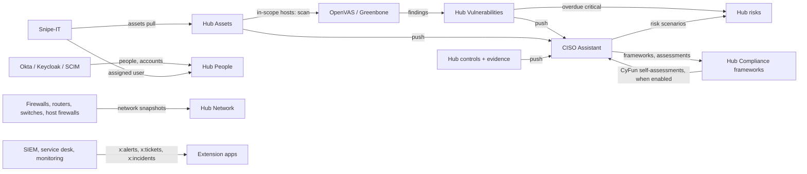

# Integrations

Atrium connects the tools of a suite in three ways:

- **Identity**: every tool signs in through the suite's identity provider ([Single sign-on](#single-sign-on-to-the-suites-identity-provider)).
- **Data**: tools exchange records through the hub's built-in apps ([connections](#connections) and [data flows](#data-flows)).
- **Events**: tools publish events to the hub and receive the ones they listen to ([MANIFEST.md](MANIFEST.md#events));
  a tool with an Atrium bridge publishes through its subsidiary's sidecar ([below](#bridge-events-on-the-tool-bus)).

A tool can also host an agent team of its own, a *subsidiary*, that works inside it through an Atrium bridge in its
code or through its API connection, governed by Atrium ([SUBSIDIARIES.md](SUBSIDIARIES.md)).

The built-in apps are the canonical data model. A record from one tool lands in a hub app first and goes on to other
tools from there; tools never talk to each other directly.

| Hub app | Data domains | Owner agent |
| --- | --- | --- |
| Assets | `assets` | Asset Supervisor (`module:assets`) |
| Vulnerabilities | `vulnerabilities` (and scans) | Vulnerability Supervisor (`module:vulns`) |
| Compliance hub | `controls` (with evidence), `risks`, `frameworks` (read), `assessments` (write) | GRC Supervisor (`module:grc`), see [COMPLIANCE.md](COMPLIANCE.md) |
| People | `people`, `accounts` | People Supervisor (`module:people`), see [PEOPLE.md](PEOPLE.md) |
| Network | `network` (read) | Network Supervisor (`module:network`), see [NETWORK.md](NETWORK.md) |
| Extension apps | `x:<key>`, e.g. `x:alerts`, `x:tickets` | Extensions Supervisor (`module:extensions`), see [AGENTS.md](AGENTS.md#extensions) |



The **Integration map** (Integration hub > Map) draws all of this and lets operators connect tools by dragging
([below](#integration-map)).

## Connections

A **connection** tells the hub how to reach a tool's own API: a connector kind, its settings and its credentials. Each
tool has at most one (collection `connections`, keyed by tool id).

Open a tool's page and choose the **Connection** tab:

1. Pick the connector kind. Kinds the hub detected for the tool come first, with a confidence score (from the tool's
   name and manifest capabilities); any tool can use the generic REST connector. A built-in connector detected with a
   score of 50 or more is offered instead of generating one.
2. Fill in the settings. Secret fields (API tokens, passwords, client secrets) are never shown again after saving:
   leave them empty to keep the stored value.
3. **Test connection** runs the connector's checks (reachability, authentication, which data domains this instance
   supports) and shows a result per check. A successful test makes the Hub Supervisor plan the data flows again.
4. Fields with choices (Snipe-IT model and status label, CISO Assistant folder, OpenVAS scan config, ...) are listed
   from the tool itself, using the stored credentials.

Saving a tool's connection also has its supervisor propose an agent team for it, once
([AGENTS.md](AGENTS.md#proposals)).

For a tool without a built-in connector but with an OpenAPI spec, **Generate connector with Claude** asks the Patch
Agent to write a generic REST mapping; it arrives as an approval of kind `repair` (diagnosis `generated`), and
approving it stores the connection. This needs `ANTHROPIC_API_KEY`.

| Who | May |
| --- | --- |
| viewer | see the connection (kind, settings, which secrets are set, detected kinds, capabilities, last test) |
| operator | test it, list a field's choices (this uses the stored credentials), generate a connector with Claude |
| admin | save and remove it (the credentials) |

| Endpoint | Role | Purpose |
| --- | --- | --- |
| `GET /api/connectors` | viewer | the connector catalog: kinds, fields, capabilities, actions |
| `GET /api/tools/{id}/connection` | viewer | the tool's connection; secrets only as "set" / "not set" |
| `PUT /api/tools/{id}/connection` | admin | `{kind, config, secrets}`; an empty secret keeps the stored one |
| `DELETE /api/tools/{id}/connection` | admin | remove the connection and its credentials |
| `POST /api/tools/{id}/connection/test` | operator | run the connector's checks |
| `GET /api/tools/{id}/connection/options/{field}` | operator | the choices of a select field, read from the tool |
| `POST /api/tools/{id}/connection/generate` | operator | ask the Patch Agent to generate a generic REST mapping (Claude) |

### Credentials and the secret key

Secrets are encrypted with [Fernet](https://cryptography.io/en/latest/fernet/) (`hub/secrets.py`) before they are
stored. The same key protects:

- connection secrets (API tokens, passwords, client secrets of tools),
- API keys of local model providers ([AGENTS.md](AGENTS.md#local-models)),
- the client secret stored by the **Sign-in & SSO** settings ([AUTH.md](AUTH.md#sign-in--sso-settings)).

The key comes from `HUB_SECRET_KEY` or, when that is not set, from `secret.key` in the data directory, generated on
first use and readable by its owner only (on Windows the data folder's permissions protect it). Generate a key with:

```bash
python -c "from cryptography.fernet import Fernet; print(Fernet.generate_key().decode())"
```

To rotate, set `HUB_SECRET_KEY` to the new key followed by the old one, comma-separated: the first key encrypts, every
key decrypts. Values stay encrypted with the old key until they are saved again, so keep the old key in the list
until every secret has been re-entered.

Rules the hub keeps:

- Secrets are decrypted only by the tool's supervisor (`tool:<id>`), the one agent that builds the tool's connector.
- They are never returned by the API, logged, written to the activity log or bus messages, or shown in errors;
  connector errors mask every secret value and credential-looking `key=value` pair.
- A stored secret is only sent to the endpoint (scheme, host and port) it was entered for. Changing the address or the
  connector kind means entering the secrets again, so neither a person editing a setting nor an agent's repair can
  redirect them. For OpenVAS, switching certificate checks off also counts as a new endpoint; for SSH connections,
  so does a new pinned host key or known_hosts file (with another key the password would go to whichever host
  presents it).

**Back up the key separately from the database.** Anyone with both `hub.db` and the key can read the secrets; without
the key they cannot be decrypted, and every credential has to be entered again. With `secret.key` in the data
directory, a backup of the whole data directory holds both, so protect it accordingly. The client secrets the hub
generates for single sign-on are separate files (`workspace/secrets/sso/`, owner-only) and not encrypted with the key.

## Connectors

A connector is the hub's client for one product's API (`hub/connectors/`). It reads (`pull`) and writes (`push`)
records in the canonical shapes below, runs actions (scans) and tests itself. `REGISTRY` in
`hub/connectors/__init__.py` lists them; adding one is a single line.

| Kind | Product | Domains | Authentication |
| --- | --- | --- | --- |
| `snipeit` | Snipe-IT | `assets` read and write (system of record); `accounts` read with "Read user accounts" on | `Authorization: Bearer <token>` |
| `ciso_assistant` | CISO Assistant | `assets` read and write, `controls` write, `risks` read, `vulnerabilities` write (when the instance has them), `frameworks` read, `assessments` write (only with "Send CyFun self-assessments" on) | `Authorization: Token <token>` |
| `openvas` | OpenVAS / Greenbone | `vulnerabilities` read; actions `scan` (side-effecting), `scan_status` | GMP user name and password |
| `okta` | Okta | `people` read; `accounts` read (app assignments) unless switched off | `Authorization: SSWS <token>` |
| `keycloak` | Keycloak admin API | `people` read | client credentials of a service-account client |
| `scim` | any SCIM 2.0 service | `people` read, or `accounts` read (setting "The users are") | `Authorization: Bearer <token>` |
| `generic_rest` | any JSON REST API | the domains its mapping defines, including extension domains (never `network`, `frameworks` or `assessments`) | bearer, token, custom header, basic or none |
| `opnsense`, `pfsense`, `mikrotik`, `fortigate`, `panos`, `cisco_iosxe`, `hostfw`, `windows_firewall` | firewalls, routers, switches, host firewalls | `network` read; guarded device changes where the product has a safe mechanism | per vendor, see [NETWORK.md](NETWORK.md#devices-and-connectors) |

`fake_firewall` (an in-memory firewall) is registered only when the hub runs with `HUB_DEV_FAKE_DEVICES=1`, and in
tests.

### Snipe-IT

Reads hardware into Hub Assets and can create or update hardware from them.

- Settings: URL (a pasted `/api/v1` is removed), API token, TLS verification, the custom field holding the IP address
  or hostname (empty: fields with an IP format or named like IP, hostname, FQDN or DNS name), the model and status label
  for hardware the hub creates, asset tags of new hardware (`hub` or Snipe-IT's `auto`), and **Read user accounts**.
- Lists page with `limit` / `offset`; Snipe-IT's `MAX_RESULTS` caps a page, so paging follows the rows received.
  HTTP 429 is retried after `Retry-After`. Every pull reads all hardware (Snipe-IT cannot filter by change time) and
  the hub skips unchanged records.
- Snipe-IT can answer HTTP 200 with `{"status": "error"}`: that is treated as an error and its messages are shown.
- The assigned user's username and email are kept in the asset's facts (`assigned_username`, `assigned_email`), so
  the People app links the device to the person ([PEOPLE.md](PEOPLE.md#people-and-assets)).
- With **Read user accounts** on, `GET /api/v1/users` is read as the `accounts` domain.
- Not verified against a live instance: that `GET /api/v1/users/me` answers the user object itself; the older error
  message for updating a deleted asset; the `activated`, `last_login` and `deleted_at` fields of `/api/v1/users`.

### CISO Assistant

The hub's compliance work lands in CISO Assistant and its risk scenarios come back.

- Hub assets become supporting assets; hub controls become applied controls (`ref_id` = the hub control id), each
  with one evidence holding the automated check results; hub findings become vulnerabilities; risk scenarios become
  hub risks with likelihood and impact rescaled to 1-5.
- The base URL works with or without `/api`; lists may be plain lists or `{count, next, previous, results}`.
- The chosen folder (domain) receives everything the hub creates and limits what is read; without one, new objects go
  to the Global folder.
- In asset and applied control descriptions the hub only rewrites the block below its marker line
  (`--- Managed by Atrium ... ---`); what people write above it stays.
- Validation errors (HTTP 400) are shown as CISO Assistant wrote them, minus secrets. Write access cannot be probed
  without writing, so the first push shows it.
- Assumption (marked in the code): the undefined applied-control status `--` is accepted on write. The hub sends it
  for controls that are `manual` or `na`.
- A `partial` hub control is sent as `in_progress`. Recent CISO Assistant versions also have `degraded`, which older
  ones refuse: choose it with **Status of partially effective controls** (`partial_status`).
- Each control's evidence is written with an **observation** holding the check result. CISO Assistant then keeps a
  revision (status in review) instead of an empty draft.
- **Frameworks** (`frameworks`, read): the frameworks loaded in CISO Assistant, their requirement trees, compliance
  assessments with results and scores, and mapping sets. They appear read-only in the Compliance hub. This is also how
  the EU Cyber Resilience Act reaches Atrium ([COMPLIANCE.md](COMPLIANCE.md#ciso-assistant-framework-sync)).
- **Self-assessments** (`assessments`, write): with **Send CyFun self-assessments** (`push_assessments`, admin, off by
  default) on, Atrium's CyFun self-assessments are written into compliance assessments there. Atrium never imports
  libraries into CISO Assistant; the connection test reports whether CyFun 2025, CyFun 2023 and the CRA are loaded.

### OpenVAS / Greenbone

A vulnerability scanner reached over GMP, the Greenbone Management Protocol.

- Connection: **TLS** (default port 9390, certificate verification on, optional CA file), **Unix socket** (POSIX only;
  the hub's user needs access to it, usually through the `gvm` group) or **plain TCP** (labs and tests only, labelled
  insecure). gvmd listens only on a unix socket unless started with `--listen` and `--port`.
- Defaults: scan config "Full and fast", the "OpenVAS Default" scanner and the port list "All IANA assigned TCP"
  (their well-known ids), alive test from the scan config, minimum quality of detection 70. All are selectable.
- A scan creates a target and a task for the hub's in-scope hosts (IP addresses, networks and hostnames only;
  everything placed in XML is escaped) and starts it; `scan_status` follows the task.
- `scan` is a **side-effecting action** (`side_effect_actions = {"scan": "scan"}`): the tool's supervisor runs it only
  for a person (`user:` or `token:` sender) or for the Vulnerability Supervisor, which applies the scan approval
  policy. An approval id passed with it must be an approved `scan` approval for this tool. Team agents and other
  modules cannot start scans through `connector.action`. `scan_status` is read-only and stays open.
- Findings: host, port, NVT name and OID, CVEs, description, solution, severity from the score (critical >= 9,
  high >= 7, medium >= 4, low > 0, info 0). `external_id` is `<nvt oid>|<host>|<port>`. An incomplete read of a
  report is refused, because findings missing from a scan are marked fixed.
- Assumptions (marked in the code, not verifiable without an instance): result filters accept `severity>0` and
  `sort-reverse=severity` as GSA uses them; an NVT's solution is in `<solution>` (GMP 20.08 and later) or its tags.

### Okta

Reads the workforce directory into the People app, and each person's app assignments as accounts.

- Settings: the Okta org URL (`https://` only - plain http would send the token in clear text; `http://localhost` is
  allowed for a local mock; not the `-admin` address), an API token (Admin Console > Security > API > Tokens; a
  read-only administrator's token is enough), **Read each person's groups** and **Read app assignments as accounts**
  (each one call per person; the second turns the accounts flow on), TLS verification.
- `GET /api/v1/users` pages with `limit` and the `Link` header; next-page links to another host are refused. The plain
  list leaves out deprovisioned users, so they are read with a second list (`status eq "DEPROVISIONED"`).
- Status: `SUSPENDED` -> suspended, `DEPROVISIONED` -> terminated, every other status -> active. HTTP 429 waits until
  `X-Rate-Limit-Reset`.
- **Unverified**: `profile.managerId` is free text in Okta (often the manager's login or employee id). The hub tries
  it as the manager's Okta id, then login or email.

### Keycloak (admin API)

Reads a realm's users, their groups and whether they are enabled into the People app. A Keycloak tool in the suite
gets this connector detected automatically.

- Create a confidential client with **service accounts** enabled and the realm-management roles `view-users` and
  `query-groups`. The hub gets a token with the client-credentials grant at
  `{base}/realms/{token realm}/protocol/openid-connect/token` (the token realm defaults to the realm read).
- `GET {base}/admin/realms/{realm}/users` pages with `first` / `max`. For Keycloak 16 and older add `/auth` to the URL.
- Keycloak has no "terminated" state: a disabled user is suspended, and a user deleted from the realm counts as having
  left the directory.
- **Unverified**: title, department, manager, phone and location come from user attributes, which Keycloak does not
  standardise; the hub reads the common names (`title` / `jobTitle`, `department`, `manager`, `phoneNumber` / `phone`,
  `location` / `city`).

### SCIM 2.0

Reads `/Users` from any SCIM 2.0 service provider, either as **people** (a directory or HR system) or as **accounts of
this tool** (an application's own SCIM endpoint).

- `Authorization: Bearer <token>`; `GET {base}/Users?startIndex=1&count=N` returning a `ListResponse`. The next
  `startIndex` follows the items actually received; a server that ignores paging is read once.
- Users: `userName`, `name`, `displayName`, `title`, `emails` (primary first), `phoneNumbers`, `addresses`,
  `active` (missing means active), `groups`, and the enterprise extension's `department` and `manager`.
- **Unverified**: written from RFC 7643 / 7644 without checking against a live server or the RFC text during this
  round. Lower-case `resources` and the non-standard `meta.lastLogin` are accepted.

### Generic REST

Any JSON REST API, described by a declarative mapping per data domain, written by hand, generated by Claude from an
OpenAPI spec, or merged in by an [extension pack](AGENTS.md#extensions).

```json
{
  "assets": {
    "list": {
      "path": "/items",
      "items": "data.rows",
      "params": {"status": "all"},
      "since_param": "updated_since",
      "pagination": {"type": "offset", "limit_param": "limit", "offset_param": "offset", "page_size": 100, "total": "total"}
    },
    "fields": {"external_id": "id", "name": "name", "addresses": ["ip", "fqdn"], "facts": {"serial": "serial"}},
    "defaults": {"type": "server"},
    "create": {"path": "/items", "method": "POST", "body": {"name": "{name}"}, "id": "data.id"},
    "update": {"path": "/items/{external_id}", "method": "PATCH"}
  }
}
```

- `list.path` is relative to the base URL and starts with `/`; `items` is the dotted path to the list in the answer
  (empty: the answer is the list); `since_param` (optional) sends the last run's time for incremental pulls.
- Pagination: `none`, `offset` (`limit_param`, `offset_param`, `page_size`, optional `total` path), `page`
  (`page_param`, `size_param`, `page_size`, `start`) or `next` (dotted path to the next page's URL; empty = the `Link`
  header).
- `fields` maps canonical fields to dotted paths in a remote item: a string, a list of paths (collected into a list)
  or an object (for `facts`). `external_id` is required.
- Body templates: a string that is exactly `{field}` inserts the record's value with its type; other strings
  interpolate; dotted paths such as `{facts.serial}` work. Without a body the record is mapped back through `fields`.
- Authentication: `Authorization: Bearer <token>`, `Authorization: Token <token>`, a custom header (default
  `X-API-Key`), basic, or none.
- Every path stays relative to the configured base URL, so a mapping can never send the credentials to another
  scheme, host or port; pagination links pointing elsewhere are refused. At most 200 pages and 10,000 records per
  pull.

### Canonical records

`pull` returns, and `push` receives, one dict per item in these shapes (documented in `hub/connectors/base.py`):

| Domain | Fields |
| --- | --- |
| `assets` | `external_id`, `name`, `type` (server, workstation, network, software, saas, cloud, data, other), `owner`, `status` (active, maintenance, retired), `addresses` (IPs / hostnames), `facts`, `updated_at` |
| `vulnerabilities` | `external_id`, `title`, `severity` (critical, high, medium, low, info), `cvss`, `cves`, `host`, `port`, `description`, `solution`, `detected_at`, `scanner` |
| `risks` | `external_id`, `title`, `description`, `likelihood` 1-5, `impact` 1-5, `status` (open, in_treatment, closed), `treatment` |
| `controls` | `external_id` (the hub control id), `ref_id`, `name`, `description`, `status` (pass, partial, fail, manual, na), `evidence`, `refs` |
| `people` | `external_id`, `display_name`, `email`, `login`, `title`, `department`, `manager_external_id`, `status` (active, suspended, terminated), `groups`, `location`, `phone` |
| `accounts` | `external_id`, `login`, `email`, `display_name`, `active`, `last_login`, `app` |
| `network` | read only: ONE record for the device the connection reaches - `device`, `kind` (firewall, router, switch, host), `revision`, `interfaces`, `zones`, `aliases`, `self_addresses`, `rules` (each with its native `vendor_ref`), `default_policy`, `notes` (`hub/connectors/netmodel.py`; [NETWORK.md](NETWORK.md#the-read-model)) |
| `frameworks` | read only: one record per framework a GRC tool has loaded, with its requirement tree, its assessments there and its mapping sets (`hub/connectors/grcmodel.py`) |
| `assessments` | write only: the hub's CyFun self-assessments, with result and both maturity scores per scored requirement (`grcmodel.py`) |
| `x:<key>` | `external_id` plus the extension domain's own fields by name |

An asset's `facts` may carry `assigned_email` / `assigned_username`: the hub links the asset to that person.

Text that `network` and `frameworks` records carry (rule descriptions, interface names, requirement names) is the
device's or the tool's: shown as text only, never as HTML, never in commands, and never handed to agents.

**Adding a connector**: subclass `connectors.base.Connector` (fields, capabilities, actions, `detect`, the operations
it supports, records in the canonical shapes) and add one line to `REGISTRY`. The planner, the flows and the UI pick
it up from there. Tests pass an `httpx.MockTransport`, so no network is needed.

- **Side-effecting actions** go in `side_effect_actions` with the approval kind that governs them (OpenVAS:
  `{"scan": "scan"}`). The tool's supervisor runs such an action only for a person, or for the agent that owns that
  approval path (`tool_supervisor.ACTION_ROUTES`). Actions not listed must be read-only.
- **Network device connectors** follow the contract in `base.py` and `netmodel.py`: reading, `test()` check names,
  and the write methods. The write methods are never connector actions: a class that lists one is refused when it is
  defined ([NETWORK.md](NETWORK.md#writing-a-device-connector)).

## Data flows

A **flow** moves one data domain between a tool and a hub app (collection `flows`): `domain`, `source` and `target`
(`hub` or `tool:<id>`), `action` (`scan` for scan flows), `schedule_minutes` (0 = only by hand, default 60;
network pulls 10), `status` (`proposed`, `enabled`, `disabled`), `strategy` (`connector`, or `generated` for a
Claude-written mapping), `options`, the last run and result, and the number of consecutive failures.

**Sync links** (collection `sync_links`) pair a hub record with its counterpart in a tool and keep a hash of what was
last sent, so unchanged records are not sent again.

### Planning

The Hub Supervisor proposes flows from each connection's capabilities: what the connector declares for its current
settings, narrowed to what its last successful test reported (a test is kept while the endpoint stays the same, so a
setting switched off since never keeps its domain). Saving a connection removes its enabled or proposed pulls and
pushes it no longer supports (disabled ones stay, so a rejection stays a rejection); when saving widens the
capabilities and the last test covers them, the planner runs again:

| The tool | Flow |
| --- | --- |
| is a scanner (action `scan`) | scan the assets in scan scope and import the findings into Hub Vulnerabilities |
| reads vulnerabilities (and is not a scanner) | pull them into Hub Vulnerabilities |
| writes vulnerabilities | push the hub's findings to it |
| reads assets and is their system of record, or cannot take them | pull and merge them into Hub Assets |
| writes assets and is not their system of record | push Hub Assets to it (the hub's list is canonical, so nothing loops back) |
| writes controls | push the hub's controls with their evidence |
| reads risks | pull them into the risk register |
| reads people (Okta, Keycloak, SCIM, an HR system) | pull them into the People app |
| reads accounts | pull its user accounts into the People app, linked to people |
| reads network (a firewall, router, switch or host firewall) | pull its configuration into the Network app every 10 minutes ([NETWORK.md](NETWORK.md)) |
| reads frameworks (CISO Assistant) | pull its loaded frameworks and assessments into the Compliance hub, read only |
| writes assessments (an admin switched "Send CyFun self-assessments" on) | push the hub's CyFun self-assessments to it |
| reads an enabled extension domain | pull it into that extension app; a tool that only writes it gets a push |

Generated connections (a Claude-written generic REST mapping) never get `network`, `frameworks` or `assessments`
flows: those need a built-in connector's normalised records.

**Loop rule**: a pull and a push of the same domain for the same tool never coexist while either is
enabled or proposed. A scan is not a pull. The planner never proposes such a pair. `POST /api/flows` and enabling a
flow with `PATCH /api/flows/{id}` answer 409 `flow_conflict` (with the conflicting `flow_id`) and change nothing.
When a flow approval is decided while an enabled opposite flow exists, the flow stays disabled and the approval is
marked failed. One effect: a tool that reads and writes vulnerabilities without scanning (only possible with a generic
REST mapping) now gets only the pull.

Each proposal is an approval of kind `flow`; in autonomous mode it is enabled straight away. A rejected proposal stays
as a disabled flow and the planner does not propose it again. This holds whether the proposal was rejected in the
approval queue or dismissed in the flow list. The flow is marked `rejected` (with the approval id) and never runs, not
even by hand (`POST /api/flows/{id}/run` answers 400). Switching it on with `PATCH /api/flows/{id}`
`{status: "enabled"}` does not enable it. It proposes the flow again: a new approval whose proposer is the person who
switched it on, so the second-person guardrail applies (in autonomous mode it is enabled, as a drawn flow would be).
Neither a rejection nor the second-person rule can be undone by flipping the status. A flow that was approved once can
be disabled and enabled freely. Planning runs after a successful connection test, after a generated
connector is approved, when extension packs change, and on demand (**Plan data flows** in the Integration hub,
`POST /api/flows/plan`). A flow can also be drawn on the [Integration map](#integration-map).

### Running

A flow is run by the agent that owns its domain (table at the top), which asks the tool's supervisor for
`connector.pull`, `connector.push` or `connector.action`. Shared code lives in `hub/agents/fabric.py`.

- **Assets**: pulled assets are merged with registered ones by address, hostname, serial or MAC instead of being
  duplicated. Assets a flow created follow the tool; merged ones keep their name and gain the tool's facts. Assets
  that disappear from the tool are retired (flow option `retire_missing`, on by default). Push flows can be limited to
  some asset types (`asset_types`).
- **Vulnerabilities**: see [below](#vulnerabilities-and-scans). Push flows send findings from `min_severity` up
  (default `low`).
- **Controls and risks**: controls are pushed with their latest check result and evidence; pulled risks land in the
  risk register.
- **People and accounts**: merged as described in [PEOPLE.md](PEOPLE.md).
- **Extension domains**: records are typed by the domain's fields and linked to assets and people
  ([AGENTS.md](AGENTS.md#extension-apps-and-their-records)); records a tool stops reporting are marked stale.

The scheduler in the Hub runtime (`Hub.tick_flows`, every `HUB_FLOW_INTERVAL` seconds, default 30) starts due flows,
polls running scans and checks the vulnerability deadlines hourly. It is off when `start_background_tasks` is false
(tests). Pulled records can be large: bus bodies over 32 KB reach their recipient in full but are logged as a summary.

In the UI, **Integration hub > Overview > Data flows** lists every flow with its status, schedule, last result and
failures, with an enable switch, **Run now** and **Repair**. A tool's **Connection** tab shows its own flows, and the
[Integration map](#integration-map) draws them.

| Endpoint | Role | Purpose |
| --- | --- | --- |
| `GET /api/flows` | viewer | every flow |
| `POST /api/flows` | operator | `{domain, source, target, action?, schedule_minutes?, options?}`: create one flow (see [Integration map](#integration-map)) |
| `POST /api/flows/plan` | operator | propose the flows the connections make possible |
| `PATCH /api/flows/{id}` | operator | `{status: enabled or disabled, schedule_minutes, options}`; enabling one that would loop: 409 `flow_conflict`; enabling a rejected one proposes it again (`status: proposed`) |
| `POST /api/flows/{id}/run` | operator | run it now |
| `POST /api/flows/{id}/repair` | operator | ask for a repair proposal |
| `DELETE /api/flows/{id}` | operator | remove it |
| `GET /api/integration/strategies`, `GET /api/tools/{id}/strategies` | viewer | the per-tool strategy overview |

### Strategy overview

For each tool the hub shows how far each way of integrating it has got: identity / single sign-on, events, data
flows, a generated connector, and adapters and patches. Each item has a state (`active`, `pending`, `failing`,
`needs_decision`, `available`, `needs_claude`, `unavailable` or `not_needed`), a detail and, where it applies, the
action that moves it on. It appears in the Integration hub and on a tool's **Integration** tab.

### Repairs

After three consecutive failures of a flow (or when an operator presses **Repair**), the Hub Supervisor sends
`integration.repair` to the Patch Agent with the error and a sanitized sample of the data: secret-looking keys masked,
secret values redacted.

- **With Claude**: a changed generic REST mapping or connection setting, validated like one a person enters. It can
  never point the connection at a different endpoint, and never changes the settings that keep a connection safe -
  Read only, certificate and SSH host-key checks (`verify_tls`, `ca_file`, `host_key`, `known_hosts`), the hub
  address the management-path guard uses, the host firewall's root wrapper, or the switches that let the hub write
  to a tool (`push_assessments`, `read_accounts`, `save_config`). Those stay an administrator's
  (`PUT /api/tools/{id}/connection`).
- **Without Claude**, rules: 401 / 403 -> check the credentials; 404 -> try base-path variants (`/api` added or
  removed) with a connection test and propose the one that works; 400 / 409 / 422 -> the tool's validation message as
  it wrote it.

A **network device's** connection (the firewall connectors) is repaired by the rules only: the device's error text
never reaches a model, and agents read it only reduced to safe characters, without the answer's body. Such a repair
may change only the connection's URL path, only an administrator approves it, and it is never applied by the agent
alone, also in autonomous mode.

The proposal is an approval of kind `repair` (applied directly in autonomous mode when it changes something, except
for a network device); approving it applies the change and runs the flow again.

## Integration map

The Integration hub has three tabs: **Overview** (suite score, data flows, strategies, identity, event routes),
**Map** and **Segmentation** (the firewall segmentation map, see [NETWORK.md](NETWORK.md#segmentation-map)). The
**Map** (`#/integration/map`, also "Integration map" in Ctrl K) draws the whole suite in five lanes:

| Lane | Holds |
| --- | --- |
| Identity providers | identity providers without a connection |
| Sources | tools that mostly bring data into the hub |
| Hub apps | the spine: Assets, Vulnerabilities, Compliance hub, People, Network and one app per enabled extension domain |
| Destinations | tools that mostly receive data or scan |
| Not connected | tools without a connection |

**Edges**:

- **Data flows** in all their states: enabled, proposed, failing, running, waiting for a scan approval, disabled.
- On demand (**Filters**): single sign-on edges from each tool to its identity provider (connected or pending),
  event routes from the tools' manifests with their last delivery, and shared capabilities.

The map is a view of the same data as the Overview: nothing exists only on the map.

**Reading the map** (everyone):

- Select a tool, app or edge to see its details in the inspector. For a flow this reuses the data-flow controls (run,
  enable, repair, edit); for an SSO edge, the provider and pending patch; for an event route, its pattern and recent
  deliveries.
- **Filters**:
  - show SSO, event and capability edges;
  - show all, failing or proposed flows;
  - list the items you hid.
- **Find** (`/`) and **Focus on selection** (dims everything not connected to it).
- **Hide from my map** hides an item for you only, in your browser. Nobody can hide a tool from everyone.
- **List view** (`L`, and a "Skip to list view" link) shows the same information as tables: tools, data flows,
  single sign-on, event routes. Connecting, single sign-on and the flow controls work there without the map.
- **Keyboard**: arrows move between items and lanes, Enter opens details, `E` / Shift+`E` walk an item's connections,
  `+` / `-` / `0` zoom and fit, Shift+arrows pan, `F` is focus mode, `?` lists every shortcut.
- **Deep links**: `#/integration/map/node/<item id>`, `#/integration/map/flow/<flow id>`,
  `#/integration/map/edge/<edge id>`, `#/integration/map/failing`.

**Changing the suite** (operators):

- **Connect**: drag from a tool's grip to a hub app or another tool, click the grip and then the target, use **Connect
  to...** in the inspector or the List view, or press `C`. The **Connect panel** lists what is possible between the
  two items:
  - a pull, push or scan per domain;
  - for two tools, a chain through the hub (one tool's pull plus the other's push);
  - the planner's own proposals first, marked **recommended**, with the same reasons.

  Options that cannot be created say why: no connection, no capability, the other tool is the system of record, the
  flow exists, or it would loop. Choosing one calls `POST /api/flows`:
  - in manual and assisted mode the flow is proposed for approval (the person who drew it is recorded as its
    proposer);
  - in autonomous mode it is enabled at once.
- **Single sign-on**: connecting a tool and an identity provider (or pressing `S` on a tool) opens the provider
  picker, which proposes single sign-on as an SSO patch.
- **Delete** on a selected flow offers **Disable** (the default) or **Remove**. Single sign-on, event routes and
  capabilities cannot be removed from the map: they are changed in the provider picker or come from the tools'
  manifests.
- **Rearrange**: drag a tool, or press `M`, to reorder it within its lane or move it between Sources and Destinations.
  `Ctrl+Z` undoes a move. The arrangement is shared by everyone (collection `canvas_layouts`, SSE `canvas_layout`).
  **Reset arrangement** restores the default order for everyone.

**What viewers never receive**. The map and `GET /api/integration` carry:

- no connection settings or secrets;
- no webhook URLs: event routes only say `has_webhook` (and `webhook` as a boolean);
- no event payloads: tool-event deliveries are listed without payloads, with URLs in their details replaced by
  `<url>`.

The `toolbus` SSE event no longer carries the payload either. The same holds for every other way a tool's manifest
reaches people or models: `GET /api/tools`, `GET /api/tools/{id}`, the `tool` SSE event, the tool supervisors'
replies in the agent bus log and the agents' `get_tool` tool show `events.has_webhook` instead of `events.webhook_url`,
and `launch.env_keys` (the key names) instead of `launch.env`. The stored manifest keeps both.

| Endpoint | Role | Purpose |
| --- | --- | --- |
| `GET /api/integration/map` | viewer | the map: hub apps, tool nodes (connection summary only), flows, SSO edges, event edges, capability links, identity overview and the shared layout |
| `GET /api/integration/map/options?a=<item>&b=<item>` | viewer | the Connect panel's options between two items (`tool:<id>` or `app:<id>`); 404 for an unknown or inactive item |
| `POST /api/flows` | operator | create a flow. Errors carry `detail = {code, message}`: 400 `invalid`, `no_connection`, `no_capability`, `system_of_record`; 404 `not_found`; 409 `flow_exists`, `flow_conflict` (with `flow_id`) |
| `GET /api/layouts/{view}` | viewer | the shared arrangement of `integration` or `segmentation` |
| `PATCH /api/layouts/{view}` | operator | `{items: {id: {order, lane?}}, remove?: [ids]}`: merge per id (at most 5000 items) |
| `DELETE /api/layouts/{view}` | operator | reset the arrangement (logged) |

Layouts hold only the shared arrangement (order in a lane and, for integration tools, a Sources/Destinations lane
override). Camera, hidden items, collapsed zones and filters stay in each viewer's browser.

## Bridge events on the tool bus

A tool with an Atrium bridge ([SUBSIDIARIES.md](SUBSIDIARIES.md)) announces events by calling the bridge's `emit()`:
the bridge keeps them in its outbox (at most 1000 for 24 hours, 16 KiB each, only names its `atrium-bridge.json`
declares), and the subsidiary's sidecar relays them to Atrium (`POST /api/subsidiary/v1/events`, at most 100 per
batch). No integration token is involved.

- Only while the subsidiary's charter relays events (`events.relay`, on when the bridge declares events) and the
  subsidiary is working; otherwise 403 `relay_off` or 423.
- Only names declared in the **approved** bridge manifest and starting with `<tool id>.`; the others are refused and
  counted. The tool cannot announce another tool's events.
- Each accepted event is published on the tool bus with `source` = the tool id and `by` = `subsidiary:<tool id>`, and
  delivered to the tools whose `events.listens` match, like any other event. Its payload is sanitized like data-flow
  samples (the values of secret-looking keys become `***`; long strings and lists are cut short). An event caused by a granted in-tool change carries
  `atrium_cause: {"jti": ...}`, the grant that caused it.
- The subsidiary's audit trail records each batch with counts per name (`events.batch`), never the payloads. Events do
  not start the team's runs.
- API-only subsidiaries have no bridge and relay no events.

## Vulnerabilities and scans

The **Vulnerabilities** app (`#/vulnerabilities`, sidebar under Govern, also in Portals and Ctrl K) holds the findings
of scanners and other tools.

**Scan scope.** Only assets with `scan_scope` on are ever scanned, and only their IP addresses and hostnames. Put
assets in scope in the asset's edit dialog, with the **In scan scope** column, or in bulk
(`POST /api/assets/scan-scope {asset_ids, in_scope}`, operator).

**Who decides a scan.**

- A person pressing **Scan now** (operator; `POST /api/vulnerabilities/scan {scanner_tool_id?, asset_ids?}`) decides
  themselves: the scan starts. Defaults: every in-scope asset, the only scanner.
- Scheduled scans and scans an agent asks for create an approval of kind `scan`, unless the hub runs autonomously or
  an admin switched the guardrail `scans_need_approval` off (which makes control HB-AC-2 partial).

When the scanner reports the scan done, the findings since its start are imported. An open finding on a scanned host
that the scan no longer reports is marked `fixed`, and the scanned assets get `last_scanned_at`.

**Findings** (collection `vulnerabilities`): title, severity, CVSS, CVEs, asset, host, port, source tool, external id,
status (`open`, `in_progress`, `accepted`, `false_positive`, `fixed`), first and last seen, due date, description,
solution and note. The due date is `first_seen` plus the SLA days of its severity (Settings > Vulnerability
management, admin: `vuln_sla_days`, default critical 7, high 30, medium 90, low 180). Open critical findings past their
due date raise one risk per asset, closed automatically once none is overdue. The detail view links CVEs to the NVD.

Two controls evaluate this data:

| Control | Passes when | Otherwise |
| --- | --- | --- |
| HB-VM-2 In-scope assets are scanned for vulnerabilities | every in-scope asset was scanned within 30 days | `partial` / `fail` by share; `manual` when nothing is in scope |
| HB-VM-3 Critical and high vulnerabilities are fixed within SLA | no open critical or high finding is past its due date | `fail` with an overdue critical, `partial` with only overdue highs; `manual` without data |

Both map to ISO 27001 A.8.8, SOC 2 CC7.1 and NIS2 21(2)(e). Their risks are "Vulnerabilities on unscanned assets go
unnoticed" (3 x 4) and "Known critical vulnerabilities remain exploitable" (4 x 5).

| Endpoint | Role | Purpose |
| --- | --- | --- |
| `GET /api/vulnerabilities` | viewer | filters: `status`, `severity` (comma-separated; `active` = open + in progress), `asset_id`, `source`, `q`, `overdue` |
| `GET /api/vulnerabilities/summary` | viewer | open findings by severity and status, overdue counts, SLA days, scan scope, last scan, scanners |
| `GET /api/vulnerabilities/{id}` | viewer | one finding |
| `PATCH /api/vulnerabilities/{id}` | operator | `{status, note}` |
| `POST /api/vulnerabilities/scan` | operator | scan now |
| `POST /api/assets/scan-scope` | operator | put assets in or out of scan scope |

## Single sign-on to the suite's identity provider

A tool whose manifest provides `auth.oidc` or `auth.saml` is an **identity provider** of the suite. Keycloak,
authentik, Zitadel and Authelia are recognised by name; any other tool can declare it. Every other tool should sign in
through one of them, natively where it can.

### Which provider a tool uses

`hub/integration/identity.py` lists the providers with their kind, base URL, protocols and issuer: Keycloak
`{base}/realms/{realm}`, authentik `{base}/application/o/{slug}/` (one application per tool), others `{base}`. The
provider for a tool is chosen in this order:

1. the choice made for that tool (Integration hub > Identity, a tool's **Integration** tab, or
   `POST /api/tools/{id}/sso`),
2. the provider the tool's manifest names (`auth.provider`),
3. the suite default (admin),
4. the only provider in the suite.

With two or more providers and none of these, the tool waits for someone to choose. Hub preferences hold the suite
default (`identity_provider`), the per-tool choices (`sso_choices`) and per-provider settings (`idp_settings`: the
Keycloak realm, default `hub`; the authentik application slug of Atrium's own sign-in, default `atrium`; the public
URL people reach the provider at).

### Strategies

`hub/integration/compatibility.py` picks the fix for a tool's **Single sign-on** check:

| Situation | Fix |
| --- | --- |
| No identity provider in the suite | `sso_proxy` (oauth2-proxy with a placeholder issuer); the detail suggests importing a provider |
| Several providers, none selected for the tool | none: choose a provider for the tool or a suite default |
| The tool signs in natively with a protocol the provider offers (the SSO catalog, its `.env` OIDC keys, or `auth.sso`) | `sso_connect` |
| Source code, no native SSO, Claude available | `sso_code`: Claude adds OIDC login reading `OIDC_ISSUER`, `OIDC_CLIENT_ID`, `OIDC_CLIENT_SECRET` |
| Anything else (also Uptime Kuma, n8n community, Mattermost Team) | `sso_proxy` through the selected provider |

The **SSO catalog** (`hub/integration/sso_catalog.py`) knows how these tools sign in natively and generates their
configuration and redirect URIs:

| Tool | How | Callback |
| --- | --- | --- |
| Grafana | `GF_AUTH_GENERIC_OAUTH_*` environment, roles from `atrium-admins` / `atrium-operators` | `/login/generic_oauth` |
| Gitea, Forgejo | `admin auth add-oauth --provider openidConnect --auto-discover-url` | `/user/oauth2/<name>/callback` |
| MinIO | `MINIO_IDENTITY_OPENID_*` environment | `/oauth_callback` |
| BookStack | `AUTH_METHOD=oidc` and `OIDC_*` environment | `/oidc/callback` |
| Outline | `OIDC_*` environment | `/auth/oidc.callback` |
| Nextcloud | the `user_oidc` app, `occ user_oidc:provider` | `/apps/user_oidc/code` (an assumption, marked in the code) |
| Wazuh dashboard, OpenSearch Dashboards | security plugin `openid_auth_domain`, `opensearch_security.openid.*`, `securityadmin.sh` | `/auth/openid/login` |
| CISO Assistant | values to enter in its SSO settings | `/api/accounts/oidc/openid_connect/login/callback/` |
| Snipe-IT | SAML only: IdP metadata, SP entity ID and ACS | `/saml/acs` |
| Zammad | OIDC in its UI (public client with PKCE) | `/auth/openid_connect/callback` |
| any tool whose `.env` example has `OIDC_*`, `OPENID_*`, `OAUTH_*` or `OAUTH2_*` keys | exactly those keys are filled in | |

[Extension packs](AGENTS.md#extensions) can add recipes for tools the catalog does not know; the built-in entries
always win.

### Registration at the provider

Every SSO patch also registers the tool at the provider: a Keycloak client (`keycloak-client.json` with
`register-keycloak.sh` for `kcadm.sh` on the host and, when the provider runs from a compose file the hub can see,
`register-keycloak-compose.sh` using `docker compose exec`), an authentik blueprint (applied with
`ak apply_blueprint`), or written instructions for other providers. The files land in the tool's adapter folder
(`idp/<provider>/`; tool-side files in `sso/`).

The scripts take values from the provider's repository and manifest, so the hub treats those values as untrusted. Each
one is its own shell-quoted assignment (`SERVICE_DEFAULT=keycloak`, read as `"${KEYCLOAK_SERVICE:-$SERVICE_DEFAULT}"`), and
names in comment lines lose their line breaks. A compose service whose name compose itself would refuse is never used;
without a valid one the hub writes only the host script. A provider URL counts only when it is a plain
`http(s)://host[:port][/path]` with no spaces, quotes or shell characters such as `$`, `` ` ``, `;`, `&`, `|`, `<`, `>`,
`(`, `)` and `\`. Any other manifest URL leaves the provider unconfigured, and the settings screen refuses one.

After the patch is applied, **Run provider registration** on the tool's page (`POST /api/tools/{id}/sso/register`,
operator) asks the Operator Agent to run the registration script. The command policy applies: a person's request runs
directly, API tokens and agents follow the autonomy level.

**Client secrets.** Patches, diffs, approvals, API answers, bus messages and the activity log only ever contain the
`<generated-client-secret>` placeholder. When an SSO patch is applied, the hub generates the secret once per tool and
provider (`workspace/secrets/sso/`) and writes it into the adapter files only; it refuses to commit a known secret to a
tool's repository.

**Changing the provider.** Choosing another provider for a tool, changing the suite default or a provider's settings,
or importing or removing a provider makes the Hub Supervisor score the suite again and the Patch Agent re-plan single
sign-on. A pending SSO patch for another provider is superseded, and its approval rejected with a note.

In the UI: **Integration hub > Identity** lists the providers, the suite default (admins choose it), each tool's SSO
status with **Connect** buttons, and per-provider settings. The tool page's **Integration** tab has "Connect to
[provider]" with a picker; SSO patch approvals show the provider with **Change provider**.

| Endpoint | Role | Purpose |
| --- | --- | --- |
| `GET /api/identity-providers` | viewer | providers, the default, `needs_choice`, each tool's SSO status |
| `PUT /api/identity-providers/default` | admin | `{tool_id}`: the suite default |
| `PATCH /api/identity-providers/{tool_id}` | admin | a provider's settings (realm, slug, public URL) |
| `POST /api/identity-providers/{tool_id}/atrium` | admin | generate the client Atrium itself signs in with (see below) |
| `POST /api/tools/{id}/sso` | operator | `{provider}`: use this provider for the tool (replaces a pending SSO patch) |
| `POST /api/tools/{id}/sso/register` | operator | run the provider registration of an applied SSO patch |

### Atrium's own sign-in through the provider

**Integration hub > Identity > Atrium sign-in** generates the client Atrium itself signs in with at a Keycloak,
authentik or other OIDC provider (redirect `{HUB_PUBLIC_URL}/api/auth/oidc/callback`, groups `atrium-admins` and
`atrium-operators`). The **Sign-in & SSO** settings then offer that provider prefilled and can use the generated
secret without showing it. See [AUTH.md](AUTH.md#generating-atriums-client-from-the-integration-hub).
