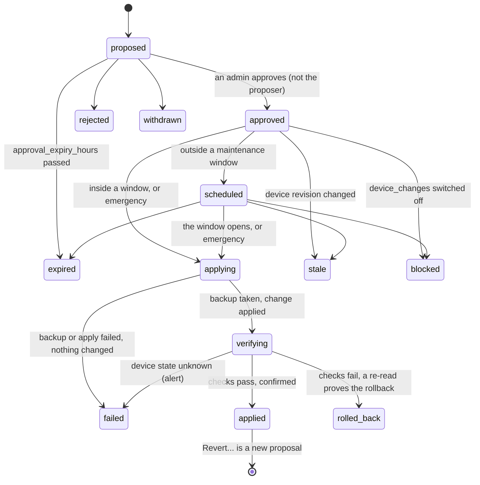

# Network and devices

The **Network** app (`#/network`, sidebar under "Run the suite", also in Portals and Ctrl K) reads firewalls, routers,
switches and host firewalls through their own APIs. For each device it keeps:

- a configuration snapshot and its history;
- drift: changes made outside Atrium;
- encrypted configuration backups;
- the data behind the **segmentation map** and the network compliance controls.

Atrium only **reads** devices unless an administrator switches device changes on. With them on, every change is a
proposal that a second administrator approves. A backup is taken first, the change waits for a maintenance window, it
is verified over a new connection, and it rolls back unless the verification passes ([Device changes](#device-changes)).

**What was tested.** No real network device was available while this was built. Every connector was tested against
fakes built from the vendors' documentation and source code (`httpx.MockTransport` answers, fake SSH sessions, a
NETCONF fake). The Linux connector also ran against nft 1.0.9 in a network namespace. Each vendor section below
lists what was checked against official sources and what is **unverified**. Test a connection against your own device
before you rely on it, and keep device changes off until you have.

## Connecting a device

Each device is one imported tool with one connection.

1. **Import the device as a tool**: Apps > Import tool > SaaS / web service, with its management address.
2. **Pick its connector** in the tool's **Connection** tab and enter the credentials (admin). Use a read-only account
   or key where the product has one ([per vendor](#devices-and-connectors)).
3. **Test the connection** (operator). Every device connector reports the same checklist: `reachability`, `tls`,
   `authentication`, `privileges` (the role found, and "this credential can write; a read-only one is recommended
   until device changes are enabled" when it can write), `version` (and whether the connector supports it) and
   `api_features` (savepoints, transactions, confirmed commit...). Vendor checks follow, such as the full ruleset
   read or what the management-path guard protects.
4. **Approve the proposed data flow** (domain `network`, approval kind `flow`). The Network Supervisor
   (`module:network`) then reads the device every 10 minutes. **Refresh** reads it at once.

The Network app's empty state walks through the same steps (**Connect a device**).

To try the app without a device, start the hub with `HUB_DEV_FAKE_DEVICES=1`. This registers the **fake firewall**
connector (`fake_firewall`): an in-memory firewall that implements the whole read and change contract and changes
nothing real. Connections with the same "Device name" share one simulated device. Never set this in production.

### SSH-based devices

pfSense, Linux host firewalls and Windows Defender Firewall are reached over SSH. IOS-XE uses SSH for NETCONF.
They share these settings: host, port, user, private key (recommended) with optional passphrase, password (only when
the device cannot use keys), a pinned **host key** and an optional `known_hosts` file.

- **Strict host-key checking is always on.** The pinned key wins; otherwise the given `known_hosts` file; otherwise
  the hub user's `~/.ssh/known_hosts`. When none of these exists, nothing is trusted: pin the host key. A
  `known_hosts` path that does not exist is an error, never "trust everything".
- One SSH connection per call. stdout, stderr and the exit status are kept apart, and scripts go on stdin. Output is
  never cut silently: a cut result carries `truncated` and is never parsed as JSON.
- Commands are fixed text. Values Atrium sends are validated and quoted (`runner.posix_command`,
  `runner.ps_quote`, which doubles every character PowerShell reads as a single quote and refuses control
  characters) or passed as data on stdin. Text read from the device never becomes part of a command.
- XML read from a device or a backup (PAN-OS answers, pfSense `config.xml`, NETCONF replies, firewalld service
  files) is parsed without a DTD: a DOCTYPE or entity declaration anywhere in the document, in any encoding, refuses
  the whole document (`netmodel.parse_untrusted_xml`).

## Devices and connectors

| Connector | Product | Reads with | Changes | Rollback mode | Window |
| --- | --- | --- | --- | --- | --- |
| `opnsense` | OPNsense 26.1 or later | REST API (key + secret) | allow, disable, enable | `savepoint` (26.1.x) or `backup_restore` (26.7+) | 60 s / 300 s |
| `pfsense` | pfSense CE and Plus | SSH (`config.xml`); or the unofficial REST package, read only | CE over SSH only: allow, disable, enable | `deadman` | 120 s (60-600) |
| `mikrotik` | MikroTik RouterOS 7.1 or later | REST API | allow, disable, enable | `deadman` | 120 s (60-900) |
| `fortigate` | FortiGate, FortiOS 7.x | REST API token | FortiOS 7.4.1+: allow, disable, enable | `backup_restore` | 300 s |
| `panos` | PAN-OS firewalls | XML API key | PAN-OS 10.1+: allow, disable, enable | `backup_restore` | 300 s |
| `cisco_iosxe` | Cisco IOS-XE switches and routers | RESTCONF | NETCONF with confirmed commit 1.1 only: allow | `commit_confirm` | 120 s (60-600) |
| `hostfw` | Linux nftables, ufw, firewalld | SSH | allow; disable and enable Atrium's own rules | `deadman` | 180 s (60-600) |
| `windows_firewall` | Windows Defender Firewall | SSH + PowerShell | allow, disable, enable | `deadman` | 180 s (60-600) |
| `fake_firewall` | development only (`HUB_DEV_FAKE_DEVICES=1`) | memory | all | selectable | selectable |

Rollback modes:

- `savepoint`: the device reverts by itself unless confirmed in time.
- `commit_confirm`: a confirmed commit that reverts by itself.
- `deadman`: the connector arms a revert job on the device before writing and disarms it on confirm.
- `backup_restore`: no device-side timer. Atrium undoes the change with inverse operations, or restores the backup.
- `none`: not writable.

Every connector has a **Read only** setting ("Never change this device through this connection"). The connection
test can narrow what a connection may change (a read-only key, an unsupported version, a missing feature), never
widen it. Generic REST and generated connections are never write-capable.

### OPNsense

Reads every rule in evaluation order through the REST API: Rules [new] (MVC) rows plus the classic and automatic
rules. It also reads interfaces and VLANs, aliases (resolved, including nested ones, ranges and port aliases), interface
groups (read as their member interfaces) and rule hit counts.

- **Versions**: 26.1 or later. 25.x returns only floating rules through the API and 24.x only four fields, so older
  versions are refused rather than read partially.
- **Changes on 26.1.x**: the savepoint flow. OPNsense reverts the change after 60 s unless Atrium confirms it.
- **Changes on 26.7 and later**: savepoints were removed upstream (opnsense/core PR #10411), so the rollback mode is
  `backup_restore`. Atrium records the newest configuration history entry before writing. To roll back, it deletes
  the rule it created, toggles rules back and applies. If a re-read does not show the old state, it restores the
  whole `config.xml` with `core/backup/revert_backup`. No device-side timer exists here: if the firewall becomes
  unreachable after a change, nothing reverts it by itself. Restore the recorded history entry at the console.
- OPNsense answers HTTP 200 with `{"result": "failed"}` on failed writes; the result is checked.
- `test()` detects a read-only key without changing anything.
- **Least privilege**: a dedicated user with these privileges (System > Access > Groups):
  - Firewall: Rules [new]
  - Status: Interfaces
  - Firewall: Aliases
  - Firewall: Groups
  - Firewall: Rules (hit counts)
  - Lobby: Dashboard (version)
  - Diagnostics: Configuration History (backups and the write check; it also allows reverting and deleting backups)

  Add **System: Deny config write** until device changes are enabled. Optionally restrict the group's source networks
  to the hub's address. Use the `https://` address, with the CA file setting for OPNsense's self-signed certificate.
- **Hub address** (optional): with it, the management-path guard protects only the rules that carry the hub's own API
  traffic. Without it, every rule that can reach the firewall on the API port is protected, including reverting an
  Atrium-made allow whose destination network holds a firewall address.
- **Verified**: every call against the opnsense/core sources (stable/24.7, 25.7, 26.1 and master = 26.7) and
  docs.opnsense.org.
- **Unverified**: that the API grids encode booleans as `"1"`/`"0"` (real booleans are accepted too); that the
  automatic `__<if>_network` aliases hold the interface's networks; the exact output of `apply`; the console steps
  named in lockout messages.

### pfSense

Two modes:

- **SSH** (pfSense CE and Plus) reads `config.xml`, `/etc/version`, `/etc/platform` and `ifconfig -a`. It covers
  interfaces, VLANs, interface groups (read as their members), aliases, and rules in pfSense's evaluation order
  (floating, group, interface). The automatic anti-lockout rule and the default deny are included.
- **REST package (pfrest)** reads the same data, read only, through the **unofficial** pfSense REST API package. It
  is not supported by Netgate and every pfSense upgrade removes it (`test()` then reports 404). The automatic
  anti-lockout rule is not visible through it.

How changes work (pfSense CE over SSH only):

- They use pfSense's own PHP primitives (`config_set_path`, `write_config`, `filter_configure_sync`) through
  `/usr/local/bin/php-cgi`.
- The script refuses to write when `config.xml` changed since Atrium read it.
- Before writing, a `daemon(8)` dead-man job is armed. It copies the pre-change `config.xml` back and reloads the
  filter unless Atrium renames its arm file first. The rename is atomic, so the confirm and the timer cannot both win.
- An approved restore goes through `config_restore()`, which keeps a history entry. It reloads only the firewall
  rules; other services pick up the restored settings on their next reload or reboot.

pfSense Plus is read only: its internals are not public.

- **Least privilege**: pfSense has no read-only SSH role. Use key-only SSH for `admin` (or root), put the hub's
  address on the sshguard pass list, and leave the anti-lockout rule on. For the REST package, use a key of a user
  with only the GET privileges of the firewall, interface and alias endpoints.
- **Verified**: the pfsense/pfsense sources (master = 2.9.0-dev), Netgate's documentation and the pfrest sources.
  The PHP scripts also ran against stub pfSense includes.
- **Unverified**:
  - that Plus uses the same `config.xml` layout;
  - that `pfctl -sr` prints `ridentifier` on every version (the load check is skipped, with a note, when no enabled
    rule shows one);
  - `/sbin/sha256 -q` and `/usr/sbin/daemon` on every version (`test()` checks both before offering changes);
  - telling Plus from CE by its release number;
  - that a non-root account can read `config.xml`;
  - that GUI separators shift only cosmetically.

### MikroTik RouterOS

Reads through the REST API (RouterOS 7.1 or later). It covers identity, routerboard serial, version, interfaces,
VLANs, IPv4/IPv6 addresses, interface lists with their members, address lists, and the IPv4 and IPv6 filter tables.
Interfaces act as zones.

What the record leaves out or widens:

- Rules in jump chains are read without the jump's conditions (wider).
- Some accept rules open no new paths and are left out, counted in the notes: rules that only match
  established/related/untracked traffic, IPsec-policy accepts, and loopback-only input rules.
- RouterOS accepts what no rule drops. The default policy is therefore "pass", and the map shows explicit accept
  rules only.

How changes work:

- RouterOS has no commit step and no Safe Mode over REST. Before writing, a one-shot `/system/scheduler` job is armed
  that undoes exactly this change and removes itself. Confirm deletes the job; rollback undoes the change over REST.
- An allow op takes one network per side and one service. A TCP+UDP pair needs two changes. ICMP over IPv6 is
  refused.

Backups and restores:

- Backups are `/export` files read in chunks. Passwords and keys are not exported.
- `restore_backup` only puts back the filter table, and only where the differences are Atrium's own (marked rules,
  enabled/disabled states). Anything else is refused with a pointer to import the export by hand. A full
  `/system/backup/load` reboots the router and is never used.

Setup and verification:

- **Least privilege**: `/user group add name=atrium-ro policy=read,api,rest-api`. Add `write` for device changes and
  `ftp,test` for backups. The backup guardrail is on by default, so changes need these too. Restrict the user's
  `address` to the hub. Assign a certificate to `www-ssl` and set the CA file in Atrium. Plain HTTP is refused.
- **Verified**: the RouterOS 7.26 manual pages for the menus and properties used.
- **Unverified**:
  - the `/user/group` policy format;
  - whether a plain GET of the filter table includes hit counts and dynamic rules;
  - whether rule `.id`s stay stable across reboots (renumbered rules would show as drift);
  - `next-run` in REST scheduler output;
  - parts of the undo job's script syntax;
  - the scheduler `policy` as a comma string;
  - dates before 7.10;
  - `/file/read` encoding of non-ASCII bytes;
  - a daylight-saving switch inside the undo window shifts the job by the offset.

### FortiGate

Reads one VDOM's firewall policies (in evaluation order), zones, interfaces, address and service objects and groups,
and hit counts through the REST API.

- **Management access** (`allowaccess` on an interface) is shown as a read-only rule "to this device", so the
  management-exposure checks see it. Trusted hosts and local-in policies are not evaluated.
- **Changes**: only on FortiOS 7.4.1 or later, with configuration save mode `automatic`, and not when FortiManager
  manages the unit.
  - Everything is staged in one configuration transaction and committed at once. A failure before the commit leaves
    the firewall unchanged.
  - The new policy gets the name `atrium-<change id>` and the marker in its comments. It uses address and service
    objects with exactly the change's networks and ports (`atrium-...` objects are created when none matches).
  - IPv6 allows are not supported.
  - Rollback (`backup_restore`) deletes the created policy and toggles policies back in a new transaction.
- **Backups and restores**: backups need a `super_admin` profile (Fortinet KB). Atrium does **not** offer restore:
  the restore API's source values are not documented, and a restore may reboot the unit. If a rollback fails, restore
  the backup by hand in System > Configuration > Restore.
- **Least privilege**: a REST API Admin token (System > Administrators > Create New > REST API Admin) with a trusted
  host for the hub's address. Give it a read-only profile until device changes are enabled. Set the optional
  **REST API admin name** so `test()` can read the token's profile and say whether it can write and take backups.
  Without it, `test()` cannot prove the token can write.
- **Verified**: authentication, the request envelope, the transaction API, `firewall/address` and the policy field
  names (Fortinet's documentation and Ansible collection).
- **Unverified**:
  - the other cmdb paths (`system/interface`, `system/zone`, `firewall/addrgrp`, `firewall/address6`,
    `firewall.service/custom`, `firewall.service/group`) and their wire formats;
  - the hit-count fields;
  - `cfg-save` and the admin ports in `system/global`;
  - the FortiManager detection field;
  - `transaction-abort`, the unit of the transaction timeout and where the transaction id sits;
  - whether moves and object creation work inside a transaction;
  - that a PUT with only `status` changes only that field;
  - the 35-character policy name limit;
  - reading the token's profile through `system/api-user` and `system/accprofile`.

### PAN-OS

Reads one vsys's security rules, zones, interfaces (including subinterfaces), address and service objects and groups,
and hit counts through the XML API. The API key is sent in the `X-PAN-KEY` header; keys and xpaths never go into URLs.

- **Management access**: interface management profiles are shown as read-only rules "to this device". The dedicated
  MGT port is not.
- **Changes** (PAN-OS 10.1 or later; the **API admin account** setting is required):
  1. The preflight refuses the change when other administrators have uncommitted changes or hold locks, and on
     Panorama-connected firewalls.
  2. A snapshot `atrium-pre-<id>.xml` is saved on the firewall.
  3. The rule is written to the candidate configuration (application `any` with port-based service objects).
  4. A partial commit of the API admin's own changes follows.
  5. To roll back, Atrium applies inverse operations and a partial commit. The last resort is `load config from` the
     snapshot plus a full commit, which discards other administrators' uncommitted edits.
- Snapshots accumulate on the firewall and are never deleted by Atrium.
- ICMP allows are not supported: they need an App-ID rule.
- **Least privilege**: generate the key once (`type=keygen`) for a dedicated admin account. Use Superuser
  (readonly) or Device admin (readonly) until device changes are enabled. Changes need a role with XML API
  Configuration, Operational Requests and Commit.
- **Verified**: authentication, the reads and xpaths of rules, zones, objects and interfaces, `pending-changes`,
  config and commit locks, `save config`, candidate writes, partial commit and job polling (official documentation
  and pan-os-python).
- **Unverified**:
  - the shared-object and interface-management-profile xpaths;
  - the `show` answer wrapping;
  - that a missing `log-end` means logging at session end;
  - the ports of the predefined `service-http` and `service-https`;
  - the pending-changes and Panorama status texts;
  - the role xpath;
  - the rule-hit-count op (a pan.dev tutorial only);
  - that `type=export&category=configuration` returns the running configuration;
  - the multipart import form;
  - the name rules (63 characters).

### Cisco IOS-XE

Reads over RESTCONF:

- version, chassis model and serial number, host name;
- interface configuration (addresses, VRF, shutdown, ACL bindings, zone membership), plus interface state for
  DHCP-assigned addresses;
- VLANs and SVIs;
- IPv4 standard and extended ACLs and network object groups;
- the VTY lines and the HTTP server's access class;
- ACL hit counters.

Paths and field names follow Cisco's published YANG models for 17.15.1.

How the device is shown:

- Routed interfaces and SVIs are the segments.
- ACL entries become rules (`<ACL name>:<sequence>`), and their remarks become descriptions.
- The VTY and HTTP access classes become rules to the device itself. Without an access class, an "implicit: any
  source" rule shows that management access is open.
- Not read: zone-based firewall policies, IPv6 ACLs, NAT. Source ports, `established`, ICMP types and time ranges are
  shown wider than they are.

Changes:

- **allow only**: an IOS ACE has no disabled state, so `disable_rules` and `enable_rules` are not offered. Reverting
  an applied allow is therefore refused (see [Open points](#open-points)).
- They run over NETCONF (port 830), and only on a device whose NETCONF server offers the **candidate** datastore and
  **confirmed-commit 1.1**. Atrium verifies over a new connection, so the commit must outlive its session (`persist`).
  A device that only offers 1.0 stays read only, and `test()` says why.
- The connector speaks RFC 6242 framing over asyncssh itself; no NETCONF library is needed.
- The new entry goes into the extended ACL already bound inbound on the source interface, after the permits and before
  the first entry that could block.
- Management ACLs are never written: VTY and HTTP access classes, ACLs on management-VRF interfaces, and ACLs on
  interfaces holding the device's management address or the hub's address.

Backups and restores:

- The backup is the modelled running configuration as CLI text, and `copy running-config` keeps the full
  configuration on the device (`atrium-<hash>.cfg`; never deleted by Atrium).
- `restore_backup` replaces the running configuration with `configure replace`. **It has no confirm timer**: no API
  equivalent of `configure confirm` exists, so a restore of an old configuration can change management access with
  no automatic revert.

Setup:

- `restconf` and `ip http secure-server`.
- For changes: `netconf-yang` and `netconf-yang feature candidate-datastore`. This restarts NETCONF and RESTCONF, so
  do it in a maintenance window.
- A dedicated **privilege-15** account: RESTCONF and NETCONF have no read-only role, and `test()` says so. Restrict
  its sources with `ip http access-class`.
- Pin the NETCONF SSH host key.

Unverified:

- that IOS-XE announces `:confirmed-commit:1.1` and honours `<persist>`, `<persist-id>` and `<cancel-commit>`
  (Cisco's guide documents confirmed commit but not persist);
- that `discard-changes` is accepted while a confirmed commit is pending;
- that remarks are written as their own numbered entries;
- that `eq` ports read back as names such as `www`;
- RESTCONF answering 404 or 204 for an empty container;
- that the `copy` RPC overwrites an existing file;
- how `cisco-ia:rollback` behaves with the candidate datastore enabled;
- that default values are left out of answers;
- field shapes on releases before 17.15.

### Linux host firewalls (nftables, ufw, firewalld)

Detects the firewall in use (setting `auto`): firewalld when it is active, else ufw when it is enabled, else nftables.
A host with legacy iptables only is shown without rules, with a note.

What it reads:

- **nftables**: the JSON ruleset (`nft -j list ruleset`); rules reached through jumps are read in place.
- **ufw**: the rule tuples in `/etc/ufw/user.rules` and `user6.rules`. Rules in `before.rules` / `after.rules` are not
  shown.
- **firewalld**: runtime zones, policies, rich rules and service definitions. A difference from the permanent
  configuration is reported.
- All three: interfaces, VLANs, the default route and listening ports.
- Rules that only match return traffic are left out, with a note.

**Least privilege**: a dedicated account with an SSH key and `sudo -n` with exact command lines. Never store a sudo
password. Use the absolute paths `command -v` shows as root, and keep the lines of the manager in use:

```
# reads - keep the lines of the manager in use
Cmnd_Alias ATRIUM_FW_READ = /usr/sbin/nft -j list ruleset, /usr/sbin/nft list ruleset, \
    /usr/sbin/ufw status verbose, /usr/sbin/ufw version, \
    /usr/bin/cat /etc/ufw/user.rules, /usr/bin/cat /etc/ufw/user6.rules, \
    /usr/bin/cat /etc/ufw/before.rules, /usr/bin/cat /etc/ufw/after.rules, \
    /usr/bin/cat /etc/ufw/before6.rules, /usr/bin/cat /etc/ufw/after6.rules, \
    /usr/bin/firewall-cmd --state, /usr/bin/firewall-cmd --version, \
    /usr/bin/firewall-cmd --list-all-zones, /usr/bin/firewall-cmd --permanent --list-all-zones, \
    /usr/bin/firewall-cmd --list-all-policies
# changes - leave this out for a read-only connection
Cmnd_Alias ATRIUM_FW_WRITE = /usr/local/sbin/atrium-fw
atrium ALL=(root) NOPASSWD: ATRIUM_FW_READ, ATRIUM_FW_WRITE
```

**Changes** run only through `atrium-fw`, a root-owned wrapper with fixed verbs that Atrium ships. Install it with
`python -m hub.connectors.hostfw wrapper > /usr/local/sbin/atrium-fw` (root:root, mode 0755).

- The wrapper validates its input again.
- It refuses any change until `arm` has saved the current state and started a transient systemd timer
  (`systemd-run --on-active=<window>`) that restores it.
- `confirm` renames the arm file atomically (so the timer and a confirm cannot both win), stops the timer, and only
  then persists.

Per firewall:

- **nftables**: Atrium writes only inside `table inet atrium`, which an administrator creates once with an input chain
  whose policy is drop. `python -m hub.connectors.hostfw nft-table` prints a starting point that keeps SSH open.
  - An allow is refused while another table's input chain drops by default: a drop in any base chain is final.
  - Confirmed changes are persisted to `/etc/atrium/atrium.nft`. Include that file from the distribution's nftables
    configuration so the table survives a reboot (`test()` reports this).
- **ufw**: `ufw prepend allow ...` with the marker in the comment. ufw saves at once, so a reboot does not undo a
  change; the timer is the only rollback.
- **firewalld**: runtime rich rules (priority -1). The marker is the log prefix, so an allow on firewalld must log.
  - The timer runs `firewall-cmd --reload`, which also drops other people's unsaved runtime changes (the preview says
    so).
  - Confirm repeats the change with `--permanent`.
  - firewalld backups are listings, and restore is not supported.
- Disabling and re-enabling work only on rules Atrium created: none of the three has a disabled state, and Atrium
  never rewrites rules it does not own.
- A zone-to-zone allow passes every subnet of both zones. When an address family is present on one side only, the
  change is refused: no rule could match it.

Unverified:

- the `ifname` key of `ip -j addr` and the `ss -H -tuln` columns;
- that ufw keeps the given port order (changes therefore require ascending ports);
- `ufw prepend` needing ufw 0.35 or later;
- whether `/etc/ufw/*.rules` need root to read;
- firewalld's polkit side (sudo is used instead);
- service definitions outside `/usr/lib/firewalld/services` and `/etc/firewalld/services`;
- the nftables include paths (`/etc/nftables.conf`, `/etc/sysconfig/nftables.conf`).

### Windows Defender Firewall

Reads over OpenSSH and PowerShell. The command line is always the same fixed text: PowerShell reads the real script
from stdin, and values go into scripts only as Base64 JSON data.

- **Rules**: the active store (`Get-NetFirewallRule -PolicyStore ActiveStore`, Group Policy included) with their port,
  address and interface filters.
- **Zones**: the profiles (Domain, Private, Public), and each interface's profile.
- **Also read**: interfaces, the default route and listening ports.
- Windows has no rule order (an explicit block wins over an allow): block rules are shown first.

How changes work:

- Before writing, a one-time Scheduled Task (`\Atrium\atrium-fw-revert-<id>`, SYSTEM) is registered that reverts the
  change. A named mutex makes sure the task and a confirm cannot both win.
- Allows become `New-NetFirewallRule -Name atrium-<change>-<n>` (group "Atrium").
- Disabling and enabling work on local rules; Group Policy rules are changed in the GPO.
- The OpenSSH rule is never disabled, and a block rule that could match the hub's SSH path is never enabled.
- Changes are saved at once: a reboot does not undo them, and the timer is the only rollback.

Backups and restores:

- Backups use `netsh advfirewall export`.
- A restore uses `netsh advfirewall import`, which replaces the whole local store without asking. It runs only for an
  approved restore change or after a failed rollback.

Setup:

- **Least privilege**: no read-only firewall role for these cmdlets was verified. Use a dedicated local account with
  a key in `%ProgramData%\ssh\administrators_authorized_keys` (ACL: SYSTEM and Administrators only), allowed by
  sshd's `AllowUsers` from the hub's address.
- Changes need an elevated SSH session; `test()` checks for one.

Unverified (only PowerShell 7.4.6 on Linux over stub cmdlets was available):

- that `[Console]::In.ReadToEnd()` reads stdin under Windows PowerShell 5.1 over Win32-OpenSSH;
- that a filter's InstanceID equals its rule's (a per-rule fallback is in place);
- whether Win32-OpenSSH sets `SSH_CONNECTION`;
- whether administrators' SSH sessions are elevated;
- `New-ScheduledTaskPrincipal -UserId 'SYSTEM'`;
- whether standard users can run the read cmdlets;
- the address text the filters return for subnets;
- that a `.wfw` export is a full backup;
- the length limit of a Scheduled Task's arguments.

## The read model

The Network Supervisor (`module:network`) runs each device's `network` pull flow (every 10 minutes by default). It
stores the normalised record as the device's snapshot (`hub/integration/network.py`). The record shape is documented in
`hub/connectors/netmodel.py`:

- **device**: vendor, model, version, hostname, management address, serial;
- **kind**: `firewall`, `router`, `switch` or `host`;
- **revision**: the device's own, or a hash of what was read;
- **interfaces** (with role `lan`, `wan`, `mgmt` or `other`), **zones**, **aliases** and `self_addresses`;
- **rules** in evaluation order. Each rule has its stable native `vendor_ref`: OPNsense uuid, FortiGate policyid,
  PAN-OS rule name, IOS-XE `ACL:sequence`, nft handle, ufw number and tuple, firewalld zone and rich rule, or Windows
  rule Name;
- **default_policy** per direction, and notes.

How snapshots are kept:

| Collection | Holds |
| --- | --- |
| `network_snapshots` | the current snapshot per device: Atrium's `rev` counter (+1 per content change), the device's revision, a hash, read time, the record and counts |
| `network_snapshot_history` | one entry per content change; the last `history_limit` (default 50) per device are kept |
| `network_drift` | drift items (below) |
| `network_baselines` | an approved configuration per device |
| `device_backups` | encrypted configuration backups |

- A re-read that changes nothing (hit counters and read times are ignored) does not add a revision.
- The History tab diffs any two revisions (`GET /api/network/devices/{id}/diff`).
- A snapshot older than `stale_after_minutes` (default 15) is **stale**. Device changes refuse to start from a stale
  snapshot.

**Device text is untrusted.** Rule descriptions, interface, zone and alias names, and drift lines are:

- shown only as text (escaped templates, `textContent`, the diff view), never as HTML;
- stripped of control and bidi-override characters;
- never used in commands;
- never handed to agents. Agents see counts only: the `network_summary` tool and the Network team's summary. The
  `read_tool_records` tool cannot read the `network` domain (the hub checks every tool call against its schema,
  whatever the model provider), and a tool's supervisor answers a `network` pull only to the Network Supervisor. The
  network controls name rules by position ("rule #8"), and device rule ids appear only in evidence lines people read.

## Drift

Each read is compared with the previous snapshot. Every difference is a drift item:

| Kind | Severity |
| --- | --- |
| `any_any_introduced` (an enabled pass rule from any to any, any service), `management_exposed` (a pass rule from anywhere reaching the device's management) | critical |
| `rule_added`, `rule_removed`, `rule_changed`, `rule_enabled`, `rule_disabled`, `interface_added` / `removed` / `changed`, `zone_added` / `removed` / `changed`, `default_policy_changed` | warn |
| `rules_reordered`, `alias_added` / `removed` / `changed`, `device_changed` | info |

**Attribution.** A change Atrium made itself is marked `attributed` to its change id instead of `open`. Only changes
that are being applied or verified, or that changed status since the previous snapshot, can explain an item. An old
change never hides a new edit: a change that ended with nothing changed on the device (a failed change whose result
is `unchanged`) explains nothing, and neither does a finished change whose own re-read is already the previous
snapshot.

- An added rule counts as Atrium's only when it carries the change's marker (`atrium:<change id>`) and matches the
  allow exactly. A copied marker on another rule stays unexplained.
- A removed rule carrying the marker counts as a rollback.
- Rules enabled or disabled must be named by the change's operations.
- After a restore, or a rollback that put the configuration back, everything that changed is attributed to that
  change - in the re-read the change path stores right after it, and only there. The next scheduled read, and any
  read after a restore that failed, report an edit made on the device as unexplained drift.

Unexplained drift writes an activity entry (an error when it is critical) and sends the SSE event `network_drift`.
Then, in the Network app:

- **Acknowledge** (operator, optional note) marks an item reviewed.
- **Accept as baseline** (admin) approves the current configuration of a device and acknowledges its open drift. The
  device page then lists the **baseline deviations** of later snapshots.
- **Remove baseline** (admin) removes it again.

## Backups

Atrium keeps its own configuration backups (collection `device_backups`):

- **Encryption**: the content is encrypted with the hub's secret key (`HUB_SECRET_KEY` or `secret.key`, see
  [INTEGRATIONS.md](INTEGRATIONS.md#credentials-and-the-secret-key)) and stored with its SHA-256, size, format,
  device revision, reason (`pre-change`, `manual` or `scheduled`), who took it and the change it belongs to.
- **Integrity**: a backup whose content no longer matches its SHA-256 is refused. The plain configuration never
  reaches the bus, the activity log or any API answer except the admin download.
- **When**: before every device change (while `device_changes_need_backup` is on), by hand (**Take backup now**,
  operator), and on schedule while the device's network flow is enabled, at most every `backup_interval_hours`
  (default 24; 0 = no scheduled backups). A device whose flow is not enabled gets manual backups only.
- **Retention**: the newest `backup_retention` (default 20) per device are kept, and the newest one always. A backup
  that an open change names is always kept, and so is the pre-change backup of an applied restore that was not
  reverted (reverting it restores that backup). A manual backup only pushes out older manual backups, so taking
  backups by hand again and again cannot rotate out the scheduled and pre-change ones.
- **Download** (admin) returns the configuration file with `X-Content-SHA256`. It is logged as a warning, because a
  configuration often holds password hashes and keys.
- **Restore** is never direct: **Restore...** creates a change proposal of operation `restore`, with the same approval
  rules as any change. It rewrites the configuration, so it needs a writable device like any change: not on a
  connection set to read only, a connector without a rollback mechanism, or one whose last test narrowed the write
  capability away (403 `not_writable`, reason `not_capable`); the tool supervisor checks it again before restoring.

Settings > Network changes (admin) holds `backup_retention` (1-500), `backup_interval_hours` (0-720), `history_limit`
(5-500) and `stale_after_minutes` (1-1440); they are also available as `PATCH /api/network/settings`.

## Segmentation map

**Integration hub > Segmentation** (`#/integration/segmentation`) draws one firewall at a time (firewalls, routers
and switches; host firewalls are not drawn). It shows zones in lanes by trust, the hub's assets inside them, and the
traffic the rules may allow between zones. The read model is `hub/integration/segmentation.py`.

**Zones.**

- Zones are the device's vendor zones when it has them, otherwise its interfaces and VLANs (`z:<tool>:<native id>`).
- WAN interfaces and every address outside the firewall's internal subnets are the pseudo-zone **Internet**
  (`z:internet`).
- Each zone has a **role**: internet, dmz, management, servers, users, guest, iot, ot, dev, backup, remote or
  unknown. The role decides its lane: Internet | Edge | Users | Servers | Core | Unclassified.
- Roles come from the name (`mgmt` -> management, `guest`, `dmz`, ...) and show "role not confirmed" until an
  administrator confirms or overrides them (`PATCH /api/segmentation/zones/{id}`).

**Assets.**

- Non-retired assets are placed by **longest-prefix match** of their addresses against the zones' networks. The
  first match decides; further matches add "multi-homed".
- A public address outside every zone is "external" (Internet).
- A private address outside every zone, or a hostname-only asset, is "unplaced". The hub never does DNS lookups.
- Operators can place an asset by hand (`PUT /api/segmentation/placements/{asset_id}`). This only changes the
  drawing, never the network, and a contradicting address shows a warning.

**Allowed traffic is an approximation.** Every enabled pass rule adds an edge from each zone its traffic can enter
through to each zone its destination matches, aggregated per zone pair with services, rules and hit counts.

- Block and reject rules, rule order, NAT, VPNs and implicit vendor rules are **not** evaluated, so an edge may not
  be reachable. The map says so.
- Unresolved aliases and negated endpoints count as "any" and are noted on the edge.
- Traffic within one zone is not an edge.

**Policy** (`GET` viewer, `PUT` admin):

- **Rules**: zone-role pairs with a verdict `allowed`, `restricted` (optionally with allowed services) or `forbidden`,
  and the control they evidence.
- **Defaults**:
  - untrusted (internet, guest, iot, users) -> management: forbidden;
  - internet -> anything but the DMZ: forbidden;
  - guest/iot -> internal zones: forbidden;
  - dev -> servers: restricted;
  - no any-to-any pass rule (HB-NW-5).
- Every violation is a **possible** violation while the evaluation is approximate.

**Overlays.**

- **Compliance** highlights possible violations ("may violate HB-NW-1").
- **Vulnerabilities** shows open findings per zone by severity. An edge from Internet, guest or IoT into a zone with
  open critical or high findings on its allowed ports shows "exposes N critical".

**Using the map.**

- Keyboard: arrows move between zones, Enter opens details, `L` switches to the List view (tables and a zone-pair
  matrix), `F` is focus mode, `?` lists every shortcut.
- Operators can drag a zone's handle to another zone, or press `C`, to propose an allow (when device changes are on
  and the device is writable). They can select traffic and press Delete to propose disabling its rules.
- Proposed changes appear as dashed lines with lifecycle chips. While a change is verifying, a banner counts down.
- Deep links: `#/integration/segmentation/zone/<zone id>`, `/edge/<edge id>`, `/change/<change id>`.

## Network compliance controls

The GRC Supervisor evaluates five controls from the snapshots. Their framework references are analyst mappings,
marked UNVERIFIED in `hub/grc/baseline.py` ([COMPLIANCE.md](COMPLIANCE.md#hub-security-baseline)).

| Control | Pass | Partial | Fail | Manual |
| --- | --- | --- | --- | --- |
| HB-NW-1 Network segmentation follows the policy | no possible violation; every zone role confirmed; no unresolved alias | a possible violation (never fail while approximate), or roles not confirmed, or unresolved aliases | - | no firewall connected |
| HB-NW-2 Device configuration changes are explained | every change made through Atrium or acknowledged | open unexplained drift | open critical drift (any-to-any or management exposure) | no device |
| HB-NW-3 Device management is not exposed to the internet | no rule lets traffic from anywhere reach device management | - | such a rule exists | no device |
| HB-NW-4 Device configurations are backed up | every device has a backup from the last 7 days | some do | none do | no device |
| HB-NW-5 Firewall rules are least-privilege and documented | no any-to-any pass rule, every pass rule described | pass rules without a description | an any-to-any pass rule | no device |

**HB-CM-3 Network device changes are controlled** (Change management) is judged from the guardrails and the change
history. It fails while `device_changes_need_second_person` or `device_changes_need_backup` is off, or when a change
left a device in an unknown state in the last 90 days. It is partial while `device_changes_need_maintenance_window` is
off or after emergency changes in the last 90 days. It passes otherwise, including while device changes are off. It
is manual with no device and no applied change.

## Device changes

Atrium can make exactly three kinds of change:

- **allow**: add one pass rule between two zones' networks, with explicit services;
- **disable_rules**: disable pass rules in place;
- **revert** and **restore**: the way back.

Editing, removing and restricting rules are not supported. The change path is `hub/integration/changes.py`, driven by
the Network Supervisor (`hub/agents/network.py`).

### Guardrails

In **Settings > Network changes** (admins; group "network" of the guardrail registry). Every change is logged with the
actor, and relaxing one first shows the risk and asks for confirmation.

| Guardrail | Default | Effect | Relaxed |
| --- | --- | --- | --- |
| `device_changes` | **off** | Atrium may change devices: only changes a person proposed and an administrator approved | logged as relaxing; not a compliance weakness by itself. Switching it **off** is the kill switch (S14) |
| `device_changes_need_second_person` | on | only an administrator who did not propose a change can approve it | HB-CM-3 fails |
| `device_changes_need_maintenance_window` | on | approved changes wait for a maintenance window | HB-CM-3 partial |
| `device_changes_need_backup` | on | an encrypted backup is taken before every change; a failed backup refuses the apply | HB-CM-3 fails |
| `approval_expiry_hours` | 24 (1-72) | a proposal must be approved and applied within this many hours; also the decision window of self-patch approvals | logged as relaxing when raised |

The general guardrail `approvals_need_second_person` (default off) applies the same second-person rule to other
approvals that record their proposer, such as self-patches someone asked for or flows drawn on the integration map
([AGENTS.md](AGENTS.md#guardrails)).

### Lifecycle



1. **Propose** (operator or admin, `POST /api/segmentation/changes`):
   - Only people propose. The role is looked up in the user store, never taken from the message.
   - The Network Supervisor reads the device fresh and plans the change. It checks the segmentation policy (S11) and
     the anti-lockout rule (S12), then asks the device's connector to check the change (`preview_change`).
   - It stores the change (collection `firewall_changes`) with an approval of kind `firewall`.
   - `POST /api/segmentation/changes/preview` shows the same plan from the stored snapshot without contacting the
     device: operations, diff, possible violations, impact (assets and zones), notes, rollback mode, expiry and the
     next maintenance window.
2. **Approve** (Approvals page; administrators only, never the proposer). The card shows:
   - the diff, a violations banner ("Violates HB-NW-1"), the proposer and justification;
   - the impact, the rollback mode and the binding (revision and operations hash);
   - when it will be applied, and an expiry countdown.

   Approve is hidden for non-admins and the proposer, and the server enforces both.
3. **Wait** for a maintenance window (status `scheduled`) when the guardrail is on, unless an administrator applies it
   as an **emergency** with a justification of at least 20 characters. Emergencies are logged and counted in HB-CM-3.
4. **Apply** (Network Supervisor, through the device's Tool Supervisor):
   - re-read the device; another revision makes the change `stale`, and nothing is applied;
   - re-check the approval binding, expiry and guardrail;
   - take Atrium's pre-change backup; when it fails, nothing is changed;
   - `apply_change`. The connector arms its rollback mechanism before writing and marks the rule
     `atrium:<change id>`.
5. **Verify** over new connections: a connection test, and a re-read that shows exactly the change. Only then is it
   confirmed, and never within 2 seconds of the device's own rollback deadline.
6. **Roll back** when verification fails. A re-read must prove the rollback.
   - If the device's own rollback did not revert the change, Atrium restores its pre-change backup.
   - If even that cannot be proven, Atrium waits for the device's own timer, plus 120 s.
   - Otherwise the change becomes `failed` with the device state unknown, and an error alert is logged.
7. **Revert** an applied change with **Revert...**. This creates a new proposal of the inverse operations, with its
   own approval (S10/F4). Reverting a restore restores the backup taken before it.
8. **Restore** an Atrium backup with **Restore...** on the Backups tab: a proposal of operation `restore`, same rules.

**Withdraw** a change that has not touched the device: the proposer, or any administrator. An approved change inside
a window (or with the window guardrail off) is applied right after the approval. Scheduled changes are applied on the
first scheduler pass after their window opens (every `HUB_FLOW_INTERVAL`, default 30 s). The same pass expires
proposals and settles changes left verifying, for example after a restart.

### Maintenance windows

Maintenance windows are in Settings > Network changes (admin; collection `maintenance_windows`). Each one:

- covers some devices, or all of them;
- is **weekly** on chosen days from a start to an end time, or **once** between two date-times (at most 14 days);
- has an IANA time zone (default UTC).

An end at or before the start runs into the next day (22:00-02:00). An approved change outside every window that
covers its device waits as `scheduled` and is applied when the next window opens. The revision, expiry, guardrail and
approval binding are checked again first. With `device_changes_need_maintenance_window` off, approved changes are
applied at once.

A scheduled change still expires `approval_expiry_hours` after its proposal. Plan windows inside that time.

### The safety rules S1-S16

The design's safety model (`docs/research/canvas-design.md` 6.6) as implemented:

| # | Rule | How it is enforced |
| --- | --- | --- |
| S1 | Off by default | `device_changes` is off; only admins change guardrails |
| S2 | Writable only when everything holds | role operator or higher; `device_changes` on; the connector declares a write capability with a rollback mode other than `none` (narrowed by the last test and the Read only setting); the last connection test passed; the snapshot is at most `stale_after_minutes` old; no other change of the device is approved, scheduled, applying or verifying. The reason is returned (`writable`, `reason`, `reasons`) and shown |
| S3 | Every change is a proposal | approval kind `firewall`, also in autonomous mode |
| S4 | Four eyes | only admins decide kind `firewall` (403 `admin_required`), as people - not with an API token (403 `person_required`); not the proposer while the second-person guardrail is on (403 `same_person`). An API token counts as the person who created it, and the proposer is recorded with the approval (`proposer_ids`), so a token - even a revoked one - does not make a second person. User names such as `operator` or `system` are people, never mistaken for agents. Checked again before applying |
| S5 | Decided on the Approvals page | the maps and the Network app link there and have no Approve button. The Change panel sends the previewed `base_revision` with the proposal: when the device changed since the preview the server answers 409 `stale_snapshot` and the panel shows the new preview instead of proposing a different change |
| S6 | Binding | the change keeps `base_revision`, `base_hash` and `ops_hash` (for a restore: the backup id and its SHA-256); the approval payload carries them; a re-read before applying must match, else `stale` |
| S7 | Expiry | `approval_expiry_hours` after the proposal (default 24): proposed, approved or scheduled changes become `expired`; an expired approval cannot be approved. When the next maintenance window opens only after the approval expires, the preview (`maintenance.expires_before_window`), the approval card and the scheduled change (`expires_before_window`) say so: it can then only be applied as an emergency |
| S8 | One execution path | only `module:network`, through the Tool Supervisor subjects `network.preview`, `network.apply`, `network.confirm`, `network.rollback` and `network.restore`. Each reloads the change and its approval and checks them again. The write methods can never be connector actions: a connector listing one is refused when it is defined, and `connector.action` refuses them |
| S9 | Verify, then confirm | connection test and a re-read over new connections; otherwise roll back and prove it |
| S10 | Revert is a new proposal | `POST /api/segmentation/changes/{id}/revert` |
| S11 | Policy | a possible `forbidden` violation: administrators only, with a justification of at least 20 characters (422 `policy_forbidden` / `justification_required`); `restricted`: a justification of at least 10 characters from anyone. A restore whose backup no stored snapshot matches cannot be checked against the policy, so it takes the forbidden path (422 `policy_unknown` for operators; `preview.policy_unknown` and a banner on the approval card) |
| S12 | Anti-lockout | the hub refuses disabling a pass rule addressed to the device itself: "this firewall", or one of its own addresses as a single host, directly or through an alias (422 `lockout`). A backup restore is checked the same way when a stored snapshot has the backup's revision: a pass rule to the device itself that is on now and off or missing in the backup refuses the restore (422 `lockout`); when no snapshot matches, the proposal (an administrator's, with a justification) notes that the anti-lockout check could not run. A rule to a network that merely contains a device address gets a note; the connector's management-path guard (which knows the hub's address and management port when configured) and the connection check after applying cover the rest |
| S13 | Never "any" | both zones must have networks (the Internet pseudo-zone and zones without subnets are refused); services are explicit (TCP and UDP need ports), at most 16 |
| S14 | Kill switch | switching `device_changes` off blocks every approved or scheduled change at once; a change being verified completes or rolls back as usual |
| S15 | Audit | activity entries for proposing, deciding, scheduling, applying, rolling back, expiring, going stale, blocking, emergencies, backups and backup downloads |
| S16 | Device text is untrusted | shown as text only; approval titles, activity entries and anything agents read use ids reduced to safe characters; a failed read's error reaches the flow result (which agents and the repair read) reduced to safe characters, without the answer's body, and a device connection's repair never asks a model (see [INTEGRATIONS.md](INTEGRATIONS.md#repairs)) |

S12 deviates from the design's literal wording, which refuses any rule "whose destination includes a self address".
Read literally, it would refuse reverting almost every allow, because zone subnets contain the firewall's own
interface address.

### Roles

| Who | May |
| --- | --- |
| viewer | read devices, snapshots, history, drift, backups (metadata), changes, windows and the segmentation map |
| operator | refresh devices, take backups, acknowledge drift, place assets, preview and propose changes, withdraw their own, propose reverts and restores |
| admin | everything above; approve changes (not their own), apply as an emergency, withdraw any change, accept or remove baselines, download backups, change the guardrails, network settings, zone roles, the segmentation policy and the maintenance windows |

## The Network app

- **Devices** list:
  - kind and vendor;
  - connection state, snapshot age (stale, read errors) and rule counts;
  - open drift and backup age;
  - the rollback mode, and whether a change is possible now (or why not);
  - the baseline status.

  The figures at the top: devices, connections not ok, open drift, changes in progress, and backups older than 7 days.
- **Drift** and **Changes** tabs for all devices.
- **Device page** (`#/network/<tool>/<tab>`): the connection checklist from the last test, and a live banner while a
  change is scheduled, applying or verifying. Its tabs:
  - **Rules** (read-only);
  - **Interfaces & zones**;
  - **History** (diff between two revisions);
  - **Drift** (acknowledge; accept or remove the baseline);
  - **Backups** (take, download, Restore...);
  - **Changes** (lifecycle chips, countdown, links to Approvals).

  `#/network/<tool>/changes/<id>` opens a change with its binding, steps, diff, verification, result and history.
- **Settings > Network changes** (`#/settings/network`): the five network guardrails, the maintenance windows and the
  backup and snapshot settings.

## Endpoints

| Endpoint | Role | Purpose |
| --- | --- | --- |
| `GET /api/network/devices` | viewer | devices with connection, snapshot, counts, drift, backup, write status and baseline |
| `GET /api/network/devices/{id}` | viewer | a device with its record, history, baseline deviations, backups and open drift |
| `GET /api/network/devices/{id}/history/{rev}` | viewer | one stored revision |
| `GET /api/network/devices/{id}/diff?from_rev=&to_rev=` | viewer | unified diff between two revisions (to the current one without `to_rev`) |
| `POST /api/network/devices/{id}/refresh`, `POST /api/network/refresh` | operator | read one, some (`tool_ids`) or all devices now |
| `POST` / `DELETE /api/network/devices/{id}/baseline` | admin | accept the current configuration as baseline / remove it |
| `GET /api/network/drift?tool_id=&status=&limit=` | viewer | drift items and counts |
| `POST /api/network/drift/{id}/ack` | operator | `{note?}` |
| `GET /api/network/backups?tool_id=` | viewer | backup metadata (never content) |
| `POST /api/network/devices/{id}/backups` | operator | take a backup now |
| `GET /api/network/backups/{id}/download` | admin | the configuration file (logged) |
| `POST /api/network/backups/{id}/restore` | operator | propose restoring it (a change, never a direct restore) |
| `GET` / `PATCH /api/network/settings` | viewer / admin | retention, backup interval, history limit, staleness |
| `GET /api/segmentation?firewall=` | viewer | the segmentation map of one firewall |
| `POST /api/segmentation/refresh` | operator | `{firewall?}` |
| `PATCH /api/segmentation/zones/{zone id}` | admin | `{role?, label?}` (null resets) |
| `PUT /api/segmentation/placements/{asset_id}` | operator | `{zone_id}` or null |
| `GET` / `PUT /api/segmentation/policy` | viewer / admin | the segmentation policy |
| `POST /api/segmentation/changes/preview` | operator | what a change would do (no side effects) |
| `POST /api/segmentation/changes` | operator | propose: `{firewall, op: allow or disable_rules, source_zone, target_zone, services, log, description, rule_ids, justification, base_revision?}` |
| `GET /api/segmentation/changes`, `GET /api/segmentation/changes/{id}` | viewer | changes with their approval (never the connector's token) |
| `DELETE /api/segmentation/changes/{id}` | operator | withdraw (the proposer or an admin) |
| `POST /api/segmentation/changes/{id}/revert` | operator | propose the revert |
| `POST /api/segmentation/changes/{id}/emergency` | admin | `{justification}` (20+ characters): apply now, outside the windows |
| `GET /api/network/maintenance-windows` | viewer | windows with their next opening |
| `POST` / `PATCH` / `DELETE /api/network/maintenance-windows/{id}` | admin | manage windows |
| `POST /api/approvals/{id}` | admin for kind `firewall` | decide a change |

Change errors carry `detail = {code, message}`:

- 403: `device_changes_disabled`, `not_writable`, `forbidden`, `not_proposer`
- 404: `not_found`
- 409: `change_in_flight`, `stale_snapshot`, `not_applied`, `already_reverted`, `rule_not_found`, `no_backup`,
  `not_withdrawable`, `not_approved`, and for an emergency `expired` or `blocked`
- 422: `policy_forbidden`, `justification_required`, `invalid`, `lockout`, `device_refused`
- 502: `device_unreachable`, `device_error`

SSE events (never device secrets or backup content): `network_snapshot`, `network_drift`, `network_baseline`,
`device_backup`, `network_settings`, `segmentation`, `firewall_change` and `maintenance_window`.

## Writing a device connector

The contract is documented in `hub/connectors/base.py` (methods and the order the hub calls them) and
`hub/connectors/netmodel.py` (record shape, operations and helpers). `hub/connectors/fake_firewall.py` implements all
of it and is the reference.

- **Reading**: declare `capabilities = {"network": {"read"}}`, return one record from `pull("network")`, and use the
  standard `test()` check names.
- **Writing**: declare `network_write = {"ops": [...], "rollback": <mode>, "window_s": <10-3600>}` and implement
  `backup()`, `preview_change(ops, snapshot)`, `apply_change(ops, base_revision, backup)`, `confirm_change(token)`,
  `rollback_change(token, backup)` and optionally `restore_backup(backup)`. These are never connector actions.
- Failures raise `netmodel.ChangeError(message, code, state)`. Messages never quote device text or secrets.
- Tests use `httpx.MockTransport` or `execution/sshfake.FakeSshTransport`. No device is needed.

## Open points

- **IOS-XE revert**: a revert is the inverse operations, so reverting an applied allow means disabling its entry,
  which IOS-XE cannot do. Revert through a restore of the pre-change backup instead (with no confirm timer, see
  above). During the verification window, `rollback_change` removes the entries itself.
- **Allow size**: on OPNsense, pfSense, MikroTik, FortiGate and PAN-OS, an allow must fit one native rule: one network
  per side, one address family, one protocol (or TCP/UDP with the same ports), and one port list or range. Wider
  changes are refused at preview ("split the change").
- **Management-path guard**: the generic guard stays conservative without the hub's address. Set the **Hub address**
  setting where a connector offers it.
- **Segmentation**: first-match evaluation (block rules, order, NAT) is a later phase.
- **Documentation ranges**: Python's `ipaddress` treats documentation ranges such as 198.51.100.0/24 as private, so
  an asset with such an address is "unplaced" rather than "external". Real public addresses are not affected.
- **Time zones**: windows at daylight-saving gaps and overlaps follow `zoneinfo` and were not tested.
