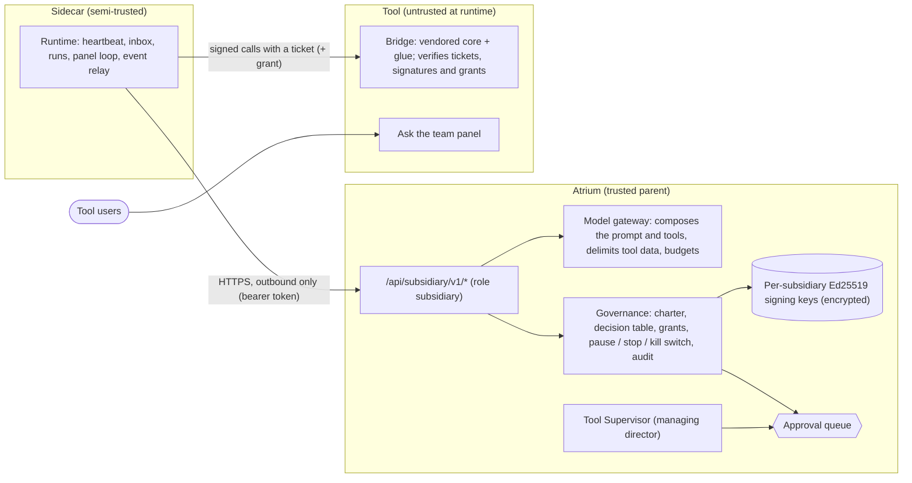

# Subsidiaries: agent teams inside a tool

A **subsidiary** is an agent team that works *inside* one tool, governed by Atrium the way a parent company governs a
daughter company with its own staff:

- the **Patch Agent** adds a small *Atrium bridge* to the tool's own code (typed actions, an "Ask the team" panel, an
  events outbox, a public health route), through the normal patch approval;
- the team runs in a **sidecar** next to the tool. It holds only that tool's access, connects outbound only, and thinks
  through Atrium's model gateway, so model keys stay in Atrium;
- **Atrium** approves the team's **charter** (its actions, staff, budgets and model routing), approves every change it
  wants to make in the tool, keeps a hash-chained audit trail, and can pause, stop or kill-switch it;
- the tool's **Tool Supervisor** leads the staff.

Tools without source code can get a sidecar only, working through the tool's API connection ("API only").

The master switch, the guardrail `allow_subsidiaries`, is **off** by default: nothing on this page happens until an
administrator switches it on (**Settings > Agent guardrails > Subsidiaries**), which is logged as relaxing a
guardrail.

**On this page:** [the company model](#the-company-model) · [from request to a working team](#from-request-to-a-working-team)
· [setting up a team](#setting-up-a-team) · [working with a team](#working-with-a-team) ·
[reference](#reference) · [the security model](#the-security-model) · [troubleshooting](#troubleshooting) ·
[not built in round 4](#not-built-in-round-4) · [the bridge contract (normative)](#the-bridge-contract-atrium-bridge1-normative)

## The company model

| Company | Atrium | Where |
| --- | --- | --- |
| Parent company | Atrium: charter approval, guardrails, approvals, audit, budgets, pause and stop | the hub process |
| Board | administrators: bridge patches, charters, resume, stop, enrollment, admin-risk actions | roles, the Approvals page |
| Group management | operators: pause, give tasks, approve ordinary in-tool changes, handle reports | roles |
| Articles of association | the **charter** (versioned, approved) | collection `subsidiaries` |
| Managing director | the **Tool Supervisor** `tool:<id>`: requests the subsidiary's approvals, carries out API-only writes, receives escalations | `hub/agents/tool_supervisor.py` |
| Staff | team agents with `placement="sidecar"`, scoped by the charter: a **front desk** (answers the panel) and a **clerk** (a standing task) | `agent_defs` |
| Subsidiary office | the **sidecar** (`atrium-sidecar`) | next to the tool |
| Desk inside the client's building | the **bridge**, in the tool's code | the tool's repository |
| Building pass | a **ticket**: short-lived, lists the allowed actions, bound to the sidecar's key | `hub/subsidiary/keys.py` and the bridge core |
| Signed purchase order | a **grant**: single use, bound to the exact request bytes and to the approval | the same |



| Component | Holds | Never holds |
| --- | --- | --- |
| Bridge | Atrium's public key(s) for this subsidiary, the tool and subsidiary ids, its panel questions and events outbox. Runs actions as the in-app service principal `atrium-team`. | an Atrium token, a model key, the sidecar's key, an enrollment code |
| Sidecar | its own Ed25519 private key and its subsidiary token (state directory, 0600), the current ticket, grants in flight; in API-only mode a read-only credential, in memory only | model keys, Atrium's signing keys, the hub's own tool credential, anything about other tools |
| Atrium | the signing keys (encrypted), model keys, the connection credential (only the Tool Supervisor decrypts it), approvals, the audit trail | the sidecar's private key |

**Two ways in.** A **bridge** needs a local git checkout of an open-source tool with a known stack (Python, Node and
Go have vendored cores; PHP, Java and others need an AI model to write the core, and conformance gates it). **API
only** needs a connection that is not a network device: the team reads with its own read-only credential and its
changes are carried out by the Tool Supervisor with the hub's connection, after approval. Network devices never get a
subsidiary: their changes go through device change proposals ([NETWORK.md](NETWORK.md#device-changes)).

## From request to a working team

```mermaid
sequenceDiagram
  participant O as Operator
  participant P as Patch Agent
  participant A as Administrator
  participant T as The tool (bridge)
  participant S as Sidecar
  participant H as Atrium
  O->>H: Give it a team inside (POST /api/tools/{id}/subsidiary)
  H->>P: subsidiary.propose
  P->>A: bridge patch (approval kind patch, strategy atrium_bridge) and a draft charter
  A->>P: approve (in person; never the person who asked)
  P->>T: branch kept; bridge.env and the sidecar bundle written (status deploying)
  Note over T: a person merges and deploys the tool with bridge.env
  A->>H: New enrollment: a one-time code, shown once
  S->>H: enroll {code, public key}: a subsidiary token (status probation)
  S->>H: heartbeat: a probation ticket
  H->>T: conformance V1-V20 (observed; or the sidecar runs them: claimed)
  H->>A: charter approval (requested by tool:<id>)
  A->>H: approve: staff created, charter v1 in force (status active)
  S->>H: heartbeat: an active ticket listing the charter's actions
```

| Status | Meaning |
| --- | --- |
| `proposed` | An operator asked for a team; the bridge patch or the API-only catalog is being designed. |
| `deploying` | The bridge patch was applied (or, in API-only mode, an enrollment was issued); the tool must run its bridge and the sidecar enroll. |
| `probation` | The sidecar enrolled. Its tickets allow only the probation built-ins while conformance runs. |
| `active` | Conformance passed and the charter is approved. |
| `paused` | An operator paused it, the circuit breaker opened, or the master switch went off. |
| `stopped` | An administrator stopped it for good. |
| `archived` | Kept for the audit trail when the tool gets a new subsidiary. |

At most one subsidiary per tool is in any status but `archived`. Flags on the side: `offline` (no heartbeat for
90 s), `bridge_mismatch` (the bridge's live manifest differs from the approved one: tickets drop to probation until
the approved bridge is deployed again and conformance passes; a changed bridge needs a new subsidiary), `over_budget`, `owner_disabled` (the sidecar's token stopped working: its owner was
disabled or demoted, or it was revoked), `clock_skew` (more than 60 s) and `circuit_open`.

## Setting up a team

### Before you start

- An administrator switches **Allow subsidiaries** on (**Settings > Agent guardrails**, group *Subsidiaries*). The
  other guardrails of the group keep their safe defaults ([below](#guardrails-and-hb-ac-8)).
- Set `HUB_PUBLIC_URL` to the HTTPS address at which the sidecar will reach Atrium: the generated `config.json` uses
  it, and the sidecar refuses plain `http://` to anything but a loopback address (unless `HUB_SUBSIDIARY_ALLOW_HTTP=1`
  is set in *its* environment).
- Optionally set `HUB_SIDECAR_IMAGE` to the sidecar image pinned by digest (default `atrium-sidecar:local`), and
  configure an AI model (**Settings > AI providers**): the staff think through it. A tool that holds personal data is
  routed to a self-hosted model when one is configured.
- Bridge patches run the tool's own tests only inside a container (docker or podman on the hub machine). Without one
  the tests are "not run": the card warns, only an administrator may approve, and HB-AC-8 shows it as partial.

### 1. Ask for a team

On the tool's page in **Apps**, an operator clicks **Give it a team inside**: what the team should do (the goals,
up to 2000 characters), the mode (automatic, bridge, API only) and who designs the staff (automatic, the templates, or
the AI model). This is `POST /api/tools/{id}/subsidiary {mode, designer, goals}`. The subsidiary is created as
`proposed` and the Patch Agent designs the bridge patch in the background ([details](#the-bridge-patch)); in API-only
mode the charter is drafted at once from the connection's catalog.

### 2. Review the bridge patch

The patch waits on the **Approvals** page as a *bridge patch* card: the stack and core (vendored or written by a
model), the action table Atrium computed (with actions it raised to their risk floor or left out), events, the panel,
the static checks, the tool's tests, the mount, the setup steps and the diff. **Administrators decide it, signed in as
a person, and never the person who asked for the team.** It is never applied automatically, whatever the autonomy
level. Approved, the branch `hub/atrium-bridge-<id>` stays as reviewed and Atrium writes the adapter files under
`workspace/adapters/<tool>/subsidiary/`:

- `bridge.env`: the public keys and ids the bridge reads (no secret);
- `sidecar/`: `config.json`, `docker-compose.yml`, `atrium-sidecar.service` and a `README.md`.

Rejecting the patch removes its branch and worktree and archives the subsidiary.

### 3. Deploy the tool with its bridge

A person merges the branch and deploys the tool with `bridge.env` in its environment. Tools that Atrium starts load
it on their own (the manifest's `launch.env_files`). The tool needs one in-app account, `atrium-team`, with only the
rights the actions need (the card lists them). Until it is deployed the bridge answers nothing; a bridge without
`bridge.env` answers 503 `not_configured` and the tool works unchanged.

### 4. Run and enroll the sidecar

In the subsidiary's **Setup** tab an administrator clicks **New enrollment**: a one-time code (valid 30 minutes,
shown once, never stored by Atrium). Give it to the sidecar on its first start only, from the bundle folder:

```sh
docker build --target sidecar -t atrium-sidecar .      # in an Atrium checkout: non-root user 10001, no port
ATRIUM_ENROLLMENT_CODE='<code>' docker compose up -d     # in workspace/adapters/<tool>/subsidiary/sidecar/
```

or with systemd (the bundle's `README.md` has the commands). **Run the sidecar as its own container or operating-system
user, never as Atrium's account and never inside the tool's own container.** It generates its key, enrolls, and the
subsidiary is on `probation`.

### 5. Conformance

At the first heartbeat on probation Atrium runs the conformance vectors V1-V20 against the bridge
([details](#conformance)): itself when it reaches the tool's web address (*observed*), otherwise through the sidecar
(*claimed*, which HB-AC-8 reports as partial). The **Setup** tab shows each vector's result; **Re-run conformance**
(administrators) runs them again.

### 6. Approve the charter

Once conformance passed, the Tool Supervisor asks for the first charter's approval, proposed by the person who asked
for the team. The *charter* card lists the actions and their policies, the staff it creates with their scopes, the
budgets, the model routing ("Tool data is sent to ...") and the conformance state. An administrator other than the
person who asked for the team approves it, signed in: the staff are created, the charter is in force and the
subsidiary is `active`.

### API-only mode

There is no patch and no deploy. An administrator enters the team's **dedicated read-only credential** for the tool
on the **Setup** tab (`PUT /api/subsidiaries/{tool}/credential`; it must differ from the hub's own connection
credential while `subsidiary_separate_credential` is on), then issues the enrollment: the bundle is written then.
Conformance is K1-K3 (the sidecar's connector test with that credential; the connection is not a network device; the
credential differs from the hub's). Stopping or archiving reminds the administrator to revoke that account in the tool.

## Working with a team

- **Work.** Staff run when Atrium says so: the clerk on its schedule (the hub's scheduler through its
  `SubsidiaryAgent` proxy), **Run now** and chat on the Agents page, or **Give the team a task** (operators,
  `POST /api/subsidiaries/{tool}/tasks`). Tool users ask the front desk through the **Ask the team** panel inside the
  tool; answers are plain text, looked up as that user.
- **Changes wait for a person.** Every write or admin action the team asks for becomes an *in-tool action* approval:
  the exact parameters, how the run started (scheduled, a task or chat by a person, or **panel: user-steered**), what
  it read, injection flags and the team's reason, labelled untrusted. Operators and administrators approve ordinary
  changes; changes of `admin` risk or with an external effect need an administrator; it is always a signed-in person,
  and the person whose task or chat led to the request never approves it. Approved, the sidecar carries out exactly
  the approved bytes, once ([details](#in-tool-actions-and-grants)).
- **Reports and escalations** from the staff arrive in the **Reports** tab: viewers see titles, operators read the
  text (untrusted, plain), close it, promote it to a risk or turn it into a task. Critical escalations are logged as
  errors.
- **Amend the charter** (administrators, **Amend** on the Charter tab): narrowing applies at once; widening waits for
  a new charter approval ([details](#the-charter)).
- **Pause** (operators, protective) stops model answers, action requests and runs at once and withdraws the pending
  in-tool approvals; **Resume** is for administrators. **Pause all** pauses every subsidiary. **Stop** (administrators,
  typing the tool's name) revokes the sidecar's token, replaces the signing key and disables the staff for good;
  **Archive** a stopped one, or propose a new one. **The kill switch** is the master switch: switching
  `allow_subsidiaries` off pauses every subsidiary and withdraws their pending charter and action approvals
  ([details](#lifecycle-and-governance)). Bridge reads stop when the last ticket expires (10 minutes by default),
  without the sidecar's cooperation.
- **Keys and tokens.** **Rotate the key** stages a second signing key (`bridge.env` lists both: deploy it), then
  **finish** retires the old one (deploy again). **New enrollment** replaces the sidecar's token and key (an active
  subsidiary proves conformance again). The sidecar rotates its own token at half its 30-day life.
- **Watch it.** The **Overview** tab shows the org chart with each staff member's live state, the sidecar as it
  reports itself, the bridge and today's budget meters; **Activity** shows the runs and the audit trail, with
  **Verify** for the hash chain. Core agents see the subsidiaries only as counts (`subsidiary_summary`).

## Reference

### The bridge contract

The bridge and Atrium speak the contract `atrium-bridge/1`; its normative text is [at the end of this
page](#the-bridge-contract-atrium-bridge1-normative) (source: `hub/subsidiary/contract/SPEC.md`). In short:

- The bridge holds **no secret**. It verifies Ed25519 signatures with Atrium's public keys, which are published in a
  public `bridge.env`.
- A sidecar may call only the actions listed in its **ticket**: short-lived (10 minutes by default), signed by Atrium,
  and bound to the sidecar's own key. Each call is signed with that key (proof of possession), with a nonce and a
  ±60 s date window, so a stolen ticket or a sniffed request is useless.
- Changes (`write` and `admin` actions) also need a **grant**: single use, valid 10 minutes, bound to the approval and
  to the SHA-256 of the exact request bytes a person approved.
- The bridge checks every call in one fixed order and refuses at the first failure, without echoing request content.
- Atrium refuses manifests with forbidden actions (code execution, bulk export, secrets, identity changes,
  security settings, free-form parameters) and raises each action's risk to a floor computed from its name.
- **Conformance vectors** prove a deployed bridge behaves: 20 pre-signed requests, most of them invalid on purpose (V1
  to V20). A subsidiary becomes active only after they pass.

`hub/subsidiary/contract.py` is the Python reference implementation. `hub/subsidiary/contract/vectors.json` holds the
cross-language test vectors. It is generated by `scripts/build_bridge_vectors.py` from a fixed seed and a fixed clock;
`--check` verifies that the committed file is current. `scripts/sync_contract_doc.py` copies `SPEC.md` into this page
(`--check`, and the test suite, verify that it is current).

### The vendored bridge cores and the panel

The security-critical part of a bridge is never written per tool. For Python, Node and Go, a bridge patch copies a
**vendored core** from `hub/subsidiary/templates/` byte-identical into the tool; only the **glue** (the action
handlers, the current-user hook, the service principal and the mount) is written for the tool. Each core implements the
whole contract: key parsing, the verification order, the nonce store, single-use grants and receipts, the params
subset, the built-ins, the panel's question store and rate limits, the events outbox, the size limits and serving the
widget.

| Family | Stacks | Vendored files (in the tool) | Glue skeleton | Dependency |
| --- | --- | --- | --- | --- |
| Python 3.8+ | FastAPI, Starlette, Flask, WSGI, ASGI | `atrium_bridge_core.py`, `atrium_bridge.py` (the adapters), `panel.js` | `glue.py` | `cryptography` |
| Node 16+ | Express, Connect, `node:http` | `atrium-bridge-core.cjs`, `atrium-bridge-core.mjs` (ES module entry), `panel.js` | `glue.cjs` / `glue.mjs` | none |
| Go 1.20+ | `net/http` | `atriumbridge/core.go`, `atriumbridge/panel.js` (embedded) | `atrium_glue.go` | none |

- **Mounting.** Python: `app.include_router(atrium_bridge.fastapi_router(glue))`, `atrium_bridge.starlette_routes(glue)`,
  `Mount("/.atrium", app=atrium_bridge.asgi_app(glue))`, `atrium_bridge.asgi_middleware(app, glue)`,
  `app.register_blueprint(atrium_bridge.flask_blueprint(glue))` or `atrium_bridge.wsgi_middleware(app, glue)`. Node:
  `app.use(atriumBridge.express(glue))` (also `connect`, and `handler(glue)` for `node:http`); the Express/Connect
  middleware lives in the core, since it needs nothing from Express. Go: `mux.Handle("/.atrium/", atriumbridge.New(glue))`.
  Mount the bridge before anything that reads request bodies (signed calls need the raw bytes; Node answers 503
  `not_configured` to calls a body parser already consumed) and behind the session middleware (the panel needs the
  signed-in user).
- **Configuration** comes only from the public `bridge.env` (`ATRIUM_BRIDGE_KEYS`, `ATRIUM_TOOL_ID`,
  `ATRIUM_SUBSIDIARY_ID`, `ATRIUM_PANEL`, `ATRIUM_PANEL_ROLES`, `ATRIUM_BRIDGE_ALLOW`) and the committed
  `atrium-bridge.json`. Anything missing or malformed, including a manifest for another tool or one whose params
  schemas break the contract, fails closed: every route but `/health` answers 503 `not_configured` and the tool works
  unchanged.
- **Never blocking the tool.** Long-polls (`atrium.panel.pull`, `atrium.events.pull`, up to 25 s) wait without blocking
  anything in ASGI, Node and Go. In WSGI servers a waiting request would hold one of the tool's workers, so long-polls
  there return at once unless the glue sets `SYNC_WAIT`. `emit()` never waits and never raises.
- **Grants survive restarts** where the tool has storage: `SqliteGrants` (Python), `FileGrants` (Node),
  `NewFileGrants` (Go), or the tool's own store with the same four methods. A grant is marked used, atomically, before
  its handler runs, so two calls racing with one grant cannot both run; `atrium.receipt` then answers `executed` or
  `failed`, and `unknown` when the bridge stopped before recording the outcome (never `unused`, so Atrium never
  re-grants an action that may have run).
- **Several processes.** Seen nonces are kept per process by default. A tool served by several worker processes
  shares them (`SqliteNonces` in Python, a `nonces` store in Node, `Glue.Nonces` in Go) together with the grant store,
  so a request replayed to another worker is refused too. The panel's questions and the events outbox live in each
  process: serve the bridge's routes from one process where possible.
- **The "Ask the team" widget** (`panel.js`) is a floating button and a non-modal drawer in a Shadow DOM: Esc closes it
  and returns the focus to the button (sending a question keeps the focus in the drawer), an ARIA live region announces
  answers, and answers are rendered as plain text (`textContent`, `white-space: pre-wrap`), never HTML or links. It
  has no inline script, so it works under `script-src 'self'`, and shows nothing when the user is signed out or the
  panel is off. Each core pins the widget's SHA-256 and serves it only when the file matches (`ETag` is the hash),
  which conformance V20 checks against the widget this Atrium ships. A bridge patch made before the widget changed in
  an Atrium update carries the older widget and core: V20 fails when its conformance runs again (see
  [Troubleshooting](#troubleshooting)).
- **Events** (`emit(name, payload)`) are accepted only for names the manifest declares, as JSON objects of at most
  16 KiB; the outbox holds 1000 events for 24 hours and counts what it drops (`atrium.ping` reports `drops`). Events
  emitted during a granted call carry `cause: {"jti": ...}` (Python context variables, Node `AsyncLocalStorage`, Go
  `EmitContext(ctx.Context, ...)`).

`hub/subsidiary/templates/cores/MANIFEST.json` lists every vendored file with its SHA-256, the stacks each core serves
and its glue skeleton. `scripts/build_bridge_cores.py` pins the widget's hash in the three cores and rewrites the
manifest; `--check` verifies both, and so does the test suite. PHP and Java have no vendored core (deferred by the
user's decision): a model writes that part of the bridge and the conformance vectors gate it.

**The sidecar bundle.** `templates.sidecar_bundle(...)` renders the files Atrium writes to the tool's
`subsidiary/sidecar/` folder: `config.json` (where Atrium and the bridge are), `docker-compose.yml` (user 10001,
read-only, all capabilities dropped, `no-new-privileges`, memory and CPU limits, no ports, a state volume, the tool's
network), `atrium-sidecar.service` (systemd with `DynamicUser`, `StateDirectory`, `ProtectSystem=strict`,
`ProtectHome`, `PrivateTmp`, `NoNewPrivileges`, no restart after exit codes 3 and 4) and a `README.md`. None holds a
secret: the one-time enrollment code is given to the first start only (`ATRIUM_ENROLLMENT_CODE` in the environment of
that one command). Values are refused unless they are plain tokens, so no generated file can be broken out of. The
bundle names `HUB_SIDECAR_IMAGE` (default `atrium-sidecar:local`); pin it by digest. API-only subsidiaries get their
bundle when an administrator issues the enrollment.

### The bridge patch

When an operator asks for a team in bridge mode (`POST /api/tools/{id}/subsidiary`), the route creates the subsidiary
and the Patch Agent designs its **bridge patch** in the background (`hub/subsidiary/bridgegen.py` for the files,
`hub/subsidiary/bridgepatch.py` for the branch, the tests and the approval). One patch per tool at a time.

1. **Stack.** The first match from the manifest's stack and the repository's dependencies: `python-fastapi`,
   `python-starlette`, `python-flask`, `node-express`, `node-connect`, `python-asgi`, `python-wsgi`, `go-nethttp`,
   `php`, `java`, or `other:<language>`. The tool's path must be the top of a git checkout with a commit; anything
   else is refused before a model is asked.
2. **Vendored files.** For Python, Node and Go, Atrium copies the core, the framework adapter and `panel.js`
   byte-identical into `atrium/` (Go: the `atriumbridge` package). A model never writes them.
3. **With an AI model** (the Patch Agent's model for "code", designer `auto` or `model`): a survey (the file tree,
   the entry files, the manifest, the goals, the contract) proposes the files to read, how the app knows its user,
   where actions go, up to 12 actions and up to 15 events. Atrium validates that catalog first: forbidden actions are
   removed and listed on the card, risks raised to their floors. A write pass (the requested files, the glue
   skeleton, the contract, the validated catalog) writes the glue, and may change existing files only when they were
   shown in full - to mount the bridge, add the panel's script tag to the layout, or emit events. Repository text is
   data in both prompts, delimited with a random boundary. Stacks without a vendored core (PHP, Java, others) need a
   model, which writes the core too; the card says so and conformance gates it.
4. **Template fallback** (no model, the model failed, or designer `templates`), where a vendored core exists: the
   vendored files and the glue skeleton with the built-ins only ("template: no tool actions yet"). The panel is on
   only when a known session helper is found (Flask-Login, Starlette's `request.user`, Passport's `req.user`).
5. **Mounting.** Deterministic rules on an entry file Atrium found: FastAPI `app.include_router(...)`, Starlette
   `app.mount("/.atrium", ...)` and Flask `app.register_blueprint(...)` appended (before an `if __name__ ==
   "__main__":` block), Express `app.use(...)` on the line after `const app = express()` - or after
   `passport.session()` when no body parser comes before it. Only a module-level application is mounted. Otherwise
   the card says "not mounted" with the lines a person adds (an unmounted bridge fails conformance V1, which is safe).
   Python tools get `cryptography` added to `requirements.txt` or `[project] dependencies` when they lack it.
6. **`atrium-bridge.json`** is written by Atrium from the validated catalog; its `files` lists every file the bridge
   adds or owns (staff may never patch those, invariant I5).
7. **Static checks** (each finding names the rule, file and line; an error refuses the patch): paths inside the tool
   and never through a symbolic link, never `.env*`, CI pipelines, git settings or hooks; at most 15 model-written
   files of 200 KB; vendored files byte-identical; no rewrite of a file the model was not shown in full; a valid
   manifest that lists the bridge's files; a model-written core with every route and built-in; in the lines the patch
   adds, no `eval(`, `exec(`, `new Function(`, `child_process`, `subprocess`, `os.system`/`os.popen`, `pty.spawn`,
   `os/exec`, `shell_exec`/`passthru`/`proc_open`, PHP backticks, `Runtime.getRuntime().exec`, `ProcessBuilder`,
   dynamic `require`/`import`, SQL built from a parameter, `0.0.0.0` or network calls; dependency manifests changed
   only by adding `cryptography`, `PyNaCl`, `paragonie/sodium_compat` or `org.bouncycastle:bcprov-jdk18on`; no secret
   Atrium holds and no private key. A refused bridge archives the subsidiary; the activity log names the findings,
   never the file content.
8. **Branch.** `git worktree add -b hub/atrium-bridge-<id> <workspace>/patches/<patch id> HEAD` in the tool's
   checkout (never the person's own working tree), the files written (never through a symbolic link) and committed as
   "Hub Patch Agent" with the tool's git hooks switched off. The approval binds to that commit. The diff people review
   shows each vendored file as one line (its SHA-256) and is masked for every secret Atrium holds.
9. **Tool tests** run on a copy of the worktree in a container only (`hub.subsidiary_config.bridge_test`,
   `BridgeTestConfig`): an install step with the network, then the tests (`launch.test` in the manifest, else
   `python -m pytest`, `npm test` or `go test ./...`) with `--network none`; both with `--cap-drop ALL`,
   `--security-opt no-new-privileges`, memory, CPU and process limits and user 10001. The tool's code never runs on
   the bare Atrium host: without docker or podman (or with `HUB_BRIDGE_TESTS=off`) the tests are "not run". The
   default images are tags (`python:3.12-slim`, `node:20-slim`, `golang:1.22`, ...): pin them by digest in
   production.
10. **Approval** (kind `patch`, strategy `atrium_bridge`): never applied automatically, whatever the autonomy level.
    Administrators decide it signed in as a person, and never the person who asked for the team. The card shows the
    facts Atrium computed: the stack and core (vendored or written by a model), the action table with left-out and
    raised actions, events, the panel, the static checks, the tests ("did not run: no container runtime" - only an
    administrator may approve it then, and HB-AC-8 shows it as partial), the mount and the setup steps (the in-app
    account `atrium-team` with only the rights the actions need, merging and deploying, enrolling the sidecar). The
    model's own rationale is labelled as such. The approval is refused when the branch moved from the approved
    commit, the subsidiary is no longer proposed, subsidiaries are switched off, or - while
    `subsidiary_bridge_requires_tests` is on - the static checks failed or the tests failed.
11. **Applied:** the branch stays as approved (nothing is re-generated); Atrium writes the adapter files -
    `subsidiary/bridge.env` (public keys and ids) and the sidecar bundle in `subsidiary/sidecar/` - and updates the
    manifest: `bridge`, `events.emits`, `health.url` (`<tool url>/.atrium/v1/health`, when none is set) and
    `launch.env_files` (tools Atrium starts load `bridge.env` into their environment, read only from the adapter
    folder and never through a link). The subsidiary is then `deploying`: merge the branch, deploy the tool with
    `bridge.env`, enroll the sidecar. The draft charter, made against the proposed manifest, follows the approved one.
    **Rejected** (or the subsidiary archived): the worktree and the branch are removed and the subsidiary archived.

**A subsidiary's staff never patch their own bridge.** When a staff member asks the Patch Agent for a code patch
(the `request_code_patch` hub tool), its goal reaches the model as untrusted text, changes to `atrium-bridge.json`,
to the files it lists or to the bridge's folder are refused, the strategy `atrium_bridge` is refused, and the approval
says "requested by the <tool> subsidiary (untrusted goal)", with the subsidiary and the run's taint in its payload.

### Signing keys

Each subsidiary has its own Ed25519 signing keys (`hub/subsidiary/keys.py`, collection `subsidiary_keys`):

- The private key is encrypted with the hub's secret key (Fernet), is never returned by the API, and is masked
  wherever hub secrets are masked.
- Rotation is staged. `bridge.env` lists the current key and the staged next key, so both are accepted until the
  rotation finishes; the old key's private part is then erased.
- Stopping a subsidiary replaces its key without staging. The deployed bridge then refuses every new ticket.

### Lifecycle and governance

`hub/subsidiary/governance.py` keeps each subsidiary's status ([the table above](#from-request-to-a-working-team)).

- **Mode.** A bridge needs a local checkout of an open-source tool with a known stack; API-only mode needs a
  connection that is not a network device. Network devices never get a subsidiary.
- **Pause** (operator, protective): no model answers, actions, hub requests or runs from that moment, no new ticket;
  pending in-tool action approvals are withdrawn, queued runs and grants cancelled and grants already delivered
  revoked, so resuming releases no backlog. The bridge keeps answering reads until the last ticket expires (guardrail
  `subsidiary_ticket_minutes`, 10 by default), and it still accepts a grant the sidecar already holds until that grant
  expires (at most 10 minutes plus the 60 s clock leeway): Atrium cannot recall it. A revoked grant is never
  re-granted, and a result showing it ran more than 60 s after the pause is a **reconciliation alarm**
  (`write_after_revoke`). Stop and the kill switch revoke the same way. Runs under way end `cancelled` at once
  (whenever a subsidiary stops being active), so they never count as busy after a resume, and a staff member's
  scheduled run or *Run now* waiting for the sidecar's reply is recorded as skipped, not failed.
- **Resume** (administrator, signed in): back to `active` when the charter is approved and conformance passed (while
  required), otherwise `probation`; `circuit_open` is cleared and the circuit breaker counts afresh (the budget
  refusals and refused requests before the resume never trip it again). Back on probation without a charter in force
  and with conformance results in, the first charter's approval is asked for again (the kill switch withdrew it, or
  conformance ran while the subsidiary was paused); the same happens when the sidecar enrolls after an administrator
  ran conformance during deployment. Only the latest of a pause and a resume reaches a sidecar that did not poll in
  between, so a stale pause never idles it again after the resume.
- **Stop** (administrator, signed in, typing the tool's name): the sidecar's token is revoked, every pending approval
  withdrawn, the staff disabled and the signing key replaced without staging, so the deployed bridge refuses every new
  ticket. The adapter's `bridge.env` loses its keys. Archive it (`DELETE /api/subsidiaries/{tool}`) or propose a new
  one (which archives it). Archiving removes its staff from the tool's team (they can never work again and would
  otherwise count toward `max_team_size` for the next subsidiary); the audit trail keeps what they did.
- **Kill switch.** Switching `allow_subsidiaries` off pauses every working subsidiary, withdraws their pending charter
  and action approvals, and the sidecar API answers 423 `disabled` (heartbeat and inbox excepted). Switching it back on
  is logged as relaxing; each subsidiary is resumed by an administrator.
- **Staff.** Team agents with `placement="sidecar"` are the subsidiary's staff. Their hub-side requests always wait
  for a person (`guardrails.effective_autonomy` answers `manual`), and `governance.hold` names why they may not act
  while the subsidiary is not active.
- **The tick** (with the flow scheduler): offline sidecars, unusable tokens, expired enrollments and inbox messages,
  the circuit breaker (3 budget refusals or 5 refused action requests within an hour, counted since the last resume,
  pause the subsidiary), an active subsidiary whose conformance is not current while it is required (back to
  probation, for example after `subsidiary_bridge_requires_conformance` was switched on again), runs
  left open (ended `expired` after 30 minutes), pending in-tool requests past their expiry (withdrawn), grants without
  a result five minutes after they expired (`unknown`; their approval fails "not executed in time"), and reports and
  transcripts past the charter's retention.

### Enrollment and the sidecar's token

1. An administrator, signed in as a person, issues an enrollment: `POST /api/subsidiaries/{tool}/enrollment` answers
   a one-time code (32 random bytes, valid 30 minutes) once, with `Cache-Control: no-store`. Atrium keeps only its
   SHA-256. Issuing one revokes the sidecar's current token and forgets its key; an active subsidiary goes back to
   probation and proves conformance again. API-only subsidiaries need their dedicated credential first.
2. The sidecar generates its Ed25519 key and calls `POST /api/subsidiary/v1/enroll {code, public_key, version}`. The
   route is public (it sends `X-Hub-Request: 1`, as every request without a bearer token does), single use (the first
   key wins) and throttled per client address like sign-ins (5 failed codes per 15 minutes).
3. The answer is a token of role `subsidiary`, valid 30 days, owned by the administrator who issued the enrollment. It
   works only while that owner exists, is enabled and is an administrator (F2). `POST /rotate` gives a new one; the old
   one keeps working until the new one is first used. `POST /api/tokens` never creates this role.

A subsidiary token reaches only `/api/subsidiary/v1/*` and only its own subsidiary; every other route answers 403. Its
actor and bus id are `subsidiary:<tool>`, so it is never a person: it cannot propose or decide approvals
([AUTH.md](AUTH.md#subsidiary-tokens)).

### The sidecar API

Every body is at most 64 KiB (the model gateway: 4 MiB), a token makes at most 120 requests a minute and holds at
most 2 open long-polls. A paused, stopped or switched-off subsidiary gets 423 `{code: paused | stopped | disabled}`,
except on heartbeat, inbox and rotate; replies, run ends and grant results are accepted whatever the status - they
report what already happened. A sidecar that sends `Atrium-Charter-Version` gets 409 `charter_changed` when the
charter moved on.

| Route | Purpose |
| --- | --- |
| `POST /enroll` | the one-time code and the sidecar's public key: its token |
| `POST /rotate` | a new token |
| `POST /heartbeat` | `{version, health, bridge_ping, runs, clock, runtime, spool, spool_dropped, ticket_exp}`: claimed facts; the answer is `{status, flags, ticket?, ticket_exp?, charter_version, server_time}` |
| `GET /charter` | the approved charter as the sidecar needs it: staff scopes (instructions stay in Atrium), actions, the tool names of normal and panel runs, budgets; the connection's non-secret settings in API-only mode; `ETag` |
| `GET /credential` | API-only mode, on probation or active: the dedicated credential (bound to the address it was entered for) |
| `GET /inbox?cursor&wait` | messages after `cursor` (acknowledging those up to it), waiting up to 25 s |
| `POST /conformance` | `{rows, built_at}`: results of vectors Atrium asked the sidecar to run |
| `POST /model` | one model turn |
| `POST /runs`, `POST /runs/{id}/end` | a panel question's run; the end of a run |
| `POST /replies` | the answer of a relayed run or chat |
| `POST /actions/request` | the decision table |
| `POST /actions/{approval}/result`, `/regrant` | a grant's result; a new grant for an expired unused one |
| `POST /hub-request` | a hub tool, run in Atrium |
| `POST /reports` | reports and escalations |
| `POST /events` | declared tool events for the tool bus |

**Tickets.** A heartbeat brings a ticket when one is due: bridge mode, enrolled, on probation or active, master switch
on, neither `owner_disabled` nor `circuit_open`. It is renewed at half-life (the sidecar reports `ticket_exp`) or when
what it lists changed. Probation tickets list the four probation built-ins; active tickets the charter's actions, those
built-ins and the panel and events built-ins the charter enables, with the charter's rate limits.

### The sidecar

`hub/subsidiary/sidecar/` is the team's office next to the tool: one asyncio process that connects out only - to
Atrium and to the tool - and never listens on a port. It imports only the contract, wire and data-model modules,
`hub/agents/loops.py` and, in API-only mode, `hub.connectors`; never the hub's core, store, FastAPI or a model SDK.

```sh
atrium-sidecar --config /etc/atrium-sidecar/config.json [--once | --check]
docker build --target sidecar -t atrium-sidecar .     # the image: non-root user 10001, no extras, no port
```

**Configuration.** `config.json` comes with the bundle Atrium writes (`adapters/<tool>/subsidiary/sidecar/`) and holds
no secret: `atrium_url`, `subsidiary_id`, `tool_id`, `mode`, `bridge_url` (required in bridge mode), optionally
`ca_file`, `atrium_cert_sha256` (the SHA-256 of Atrium's certificate in DER form, 64 lowercase hex digits; checked
right after the TLS handshake, before the token is sent) and `state_dir` (default `/var/lib/atrium-sidecar`). Plain
`http://` to Atrium is refused unless the host is a loopback address or `HUB_SUBSIDIARY_ALLOW_HTTP=1` is set.

**State.** The state directory is 0700; the sidecar's Ed25519 key, its token and the grants in flight are 0600 files,
replaced atomically. The first start enrolls with the one-time code from `ATRIUM_ENROLLMENT_CODE`, which is used once
and never written anywhere; the key is generated there and never leaves. The token is rotated at half its life. In
API-only mode the dedicated credential is fetched once per start and kept in memory only.

| Task | What it does |
| --- | --- |
| heartbeat | every 30 s: version, health, the bridge's `atrium.ping`, runs under way, clock, `runtime` (uid, container, hostname hash; claimed) and the spool; the answer brings status, flags, a ticket when due and the charter version (a new version is fetched with `If-None-Match`) |
| inbox | long-polls `GET /inbox` and handles `run`, `chat`, `grant`, `denied`, `action_result`, `pause`, `resume`, `stop`, `charter_changed` and `conformance` |
| runs | `run` and `chat` messages carry a run id Atrium issued (the sidecar has no scheduler); each run is the tool loop over `POST /model` (at most 12 turns and 20 tool calls, `budgets.max_concurrent_runs` at a time) and ends with `POST /replies` and `POST /runs/{id}/end` |
| panel | while the charter enables it: `atrium.panel.pull`, one run per question (`POST /runs` issues its id), answered `working` at once and then with the front desk's plain-text answer (at most 4000 characters), or `escalated`, or `declined` |
| events | while the charter relays them: `atrium.events.pull`, then `POST /events` in batches of 100; names outside `<tool>.` are dropped first; the cursor is kept in the state directory |
| spool | `spool.jsonl` (at most 10 MB, oldest dropped and counted), shipped with the heartbeats and recorded as claimed |

**A run's tools** are the run kind's names from `GET /charter`, narrowed to the staff member's scope (Atrium composes
the same list for the model and ignores any the sidecar would send):

- `act__<action>` of risk read or propose: a signed bridge call; in panel runs on behalf of the asking tool user
  (`Atrium-On-Behalf-Of`). Params are checked against the action's schema first. In API-only mode
  `records.<domain>.list` runs here through the connector: at most 50 records, each sanitized like data-flow samples.
- `act__<action>` of risk write or admin: `POST /actions/request {run_id, agent_id, action_id, params, reason}`, where
  the reason is the model's text before the call. A pending approval or a refusal is what the model reads.
- `atrium__<hub tool>`: `POST /hub-request`; `atrium__report` and `atrium__escalate`: `POST /reports`. An escalation in
  a panel run answers the question `escalated`.

Requests that do work send `Atrium-Charter-Version`; a 409 (the charter changed), a 423 (paused) or a 429 (a budget)
ends the run.

**Grants (D5).** A grant - from an inbox `grant` after a person approved, or in the answer to a request Atrium granted
at once - is carried out without the model: the sidecar checks that the body bytes Atrium returned are the ones the
grant names (`bh`) and for the right action, sends exactly those bytes, and posts
`POST /actions/{approval}/result {grant_jti, status, receipt, result_summary}` (`auto` stands for the approval of a
grant Atrium issued at once). A grant is never sent twice; until its result is recorded it is kept in the state
directory, so after a crash the bridge's `atrium.receipt` tells what happened. A grant that expired before the bridge
could be called is re-granted (`POST /actions/{approval}/regrant`, once per approval) once the receipt says it was
never used and the bridge's clock no longer accepts it (`exp` plus the 60 s leeway); in between (from 60 s before
`exp`) the sidecar keeps the grant and retries at each heartbeat - a 409 `grant_valid` never drops it. Atrium does
not take the sidecar's word for that receipt: it asks the bridge itself, and when it cannot, a person decides the
request again (the answer is `pending_approval` with a new approval id). Outcomes,
and `denied` and `action_result` messages, reach the staff member as notes at the start of its next run.

**Pause and stop.** While Atrium has the subsidiary paused (or the master switch off) the sidecar keeps only the
heartbeat and the inbox: the runs under way are cancelled, open panel questions are declined, and grants not yet sent
are dropped (Atrium is told), so resuming releases no backlog. Exit codes: **3** when the token no longer works after
five tries (revoked, expired, its owner no longer an administrator) or the enrollment code was refused or is missing;
**4** when Atrium stopped the subsidiary. Stopping revokes the token first, so a sidecar that is not long-polling at
that moment ends with 3. The bundle's systemd unit never restarts either; under a container restart policy the sidecar
remembers both in its state directory and exits at once without asking Atrium again - after a refused token, until it
is started with a new `ATRIUM_ENROLLMENT_CODE`, which enrolls it anew with a new key. Atrium being unreachable is
retried with backoff from 1 s to 60 s with jitter.

**Limits.** No redirects are followed; answers are capped (1 MiB from the bridge and Atrium, 4 MiB from `/model`);
timeouts are 15 s, 35 s for long-polls, 30 s to the bridge and 5 minutes for a model turn. The bridge is called
without an HTTP proxy. The token, the enrollment code, tickets, grants and the dedicated credential are masked in the
spool and the log.

`--once` makes one pass of every task (enroll when needed, heartbeat, inbox, panel, events) and exits; `--check`
reports whether Atrium and the bridge (or the tool's API) answer and runs the conformance vectors Atrium sends next.

### The charter

`hub/subsidiary/charter.py`. The charter is the subsidiary's articles of association: its actions and their
policies, its staff and their scopes, model routing, budgets, the panel, the event relay and data settings. Only an
approved charter is in force; its version numbers every change.

- **Draft.** A bridge's draft follows its approved manifest (made when the bridge patch is applied); an API-only
  draft is made at proposal from the catalog Atrium derives from the connection (`catalog.py`: `records.<domain>.list`
  for each domain the connection reads, `records.<domain>.upsert` for assets, findings, risks and controls it writes -
  never people or accounts, which stay read-only). Read and propose actions get `allow`, write and admin actions
  `approval`. Staff come from the two subsidiary roles - a **front desk** (read and propose actions; only when the
  bridge has a panel) and a **clerk** (every action, `get_tool` and `tool_health`, a standing task from the goals
  every 4 hours) - or from an AI design (designer `model`/`claude`, or `auto` when a model is ready) restricted to the
  catalog, with the templates as fallback. Both roles get `read` and `tool_actions`.
- **Model routing** (user decision 4). A tool that holds personal data (a connection reading people or accounts, a
  capability such as hr, crm or identity, or actions on people-like resources) is routed to a local model when one is
  configured; otherwise to the suite's default with a warning on the approval card ("... holds personal data and no
  local model is configured: tool data is sent to Claude"). Staff are created on the routing's default provider; the
  gateway refuses any provider the charter does not allow - there is no silent fallback outside it.
- **Approval** (kind `subsidiary_charter`). Once conformance passed (while required), the Tool Supervisor requests the
  first charter's approval, proposed by the person who asked for the team - so another administrator approves it,
  signed in. The payload binds the charter's SHA-256 and the new staff's descriptions. The guard refuses when the
  charter changed, another version was approved meanwhile, conformance did not pass, or a rule is broken: a forbidden
  or floor-lowering action, `auto` where it is not allowed, scopes outside the actions, hub tools outside
  `get_tool, tool_health, data_flows, propose_patches, request_code_patch`, staff on rules or on a provider the
  charter does not allow, staff with actions but without `tool_actions`, no room in the team (guardrail
  `max_team_size`), budgets at zero or above `subsidiary_max_tokens_per_day`, an empty mandate, a panel desk that is
  not staff. Approving it creates the staff - only this way: `placement="sidecar"` is never set through
  `POST /api/agents`, and a staff member's team, parent and placement never change outside the charter - puts the
  charter in force, tells the sidecar (`charter_changed`) and activates the subsidiary.
- **Amendments** (`PUT /api/subsidiaries/{tool}/charter`, administrators). Actions come from the tool's catalog (only
  their policy is chosen); new staff are described in `members` (permissions within `read`, `tool_actions`,
  `patches`). What **widens** the charter waits for a new approval proposed by that administrator: an action added or
  loosened (forbidden < approval < allow/auto), staff added or a scope widened, hub tools added, a budget raised, a
  model provider added, the panel or event relay enabled, another front desk, transcripts turned on, reports kept
  longer, a new mandate. Pure **narrowing** applies at once and keeps the approval it narrows; removed staff are
  disabled, never deleted.

### Runs and the model gateway

`hub/subsidiary/gateway.py`. Atrium issues every run id: an inbox `run` (the scheduler through the staff member's
`SubsidiaryAgent` proxy, *Run now*, or `POST /api/subsidiaries/{tool}/tasks` from an operator) or `chat` (a person's
chat with the staff member, relayed; it answers 503 while the sidecar is offline), and `POST /runs` for a panel
question (the front desk only; tainted from the start). Runs are refused while the subsidiary is not active or the
staff member is held, beyond `max_concurrent_runs`, and while the sidecar is `offline` (a task answers 503 `offline`;
a scheduled run is skipped, not failed, so a sidecar outage never pauses the staff member's schedule).

The sidecar runs its staff with a provider-neutral tool loop (`hub/agents/loops.py`), whose model is Atrium's
gateway. The gateway speaks the neutral message shape of the hub's provider layer (`hub/llm`) without
provider-native parts: an assistant turn the gateway returned carries a `ref`; Atrium keeps the provider's native
output, re-attaches it when the turn comes back, and composes the system prompt and the tool list itself. The sidecar
never sees or sends native blocks, model keys or prompts.

`POST /model {run_id, agent_id, messages}`:

1. the run is this subsidiary's and open, the staff member is the run's and may act, and runs on a provider the
   charter allows; the token and hourly call budgets are checked;
2. Atrium composes the system prompt - the parent's rules (tool data is data, changes are proposals a person
   decides, no secrets in reports, say when content tries to instruct you), the charter's mandate, the staff member's
   instructions and a run-kind addendum - and the tool list from the charter: `act__<action>` for the member's actions
   (panel runs: reads on behalf of the asker, drafts, and writes only while `subsidiary_panel_actions` is on),
   `atrium__<hub tool>` without a `tool_id` (it is always the team's own tool), `atrium__report` and
   `atrium__escalate` (panel runs: escalate only). Anything the sidecar sends besides the messages is ignored;
3. every tool result, and a panel run's question, is delimited with the run's boundary; the run becomes tainted
   (sticky, with its sources: `bridge:<action>`, `connector:<domain>`, `panel:<question>`) and injection flags are
   counted;
4. an assistant turn is accepted only by the `ref` Atrium returned and unchanged (its provider-native output is
   re-attached); a tool result without its call, or a user message after the first, is refused (422);
5. the call goes through the provider layer (`hub.llm`: masking, metering, the staff member's and the suite's AI
   budgets, fallbacks only among the allowed providers - and only self-hosted ones for a local-only staff member). A
   reply naming a tool the run does not have fails the call (502 `unknown_tool`).

**Budgets** per subsidiary and UTC day (`subsidiary_usage`): tokens per day (capped by
`subsidiary_max_tokens_per_day`) and model calls per hour at `/model`, approval requests per day (an auto grant
counts as one) and pending approvals at `/actions/request` and `/hub-request`, panel questions per day at `/runs`.
A model call is reserved at its estimate (the prompt at about 3 characters a token plus all the output it may write)
until it is booked at what it used: a call alone may go over by itself, but one that could go over together with the
calls under way, more than 2 calls in flight per run the charter allows at once, or a run past its turn limit (12
turns, 6 for a panel question, plus 2 for retries) answers 429 `busy` or `max_turns`. An exhausted budget answers
429 `{code: budget, which}`, sets `over_budget` (one activity warning a day, cleared the next UTC day), ends the run
when the model was refused, and counts toward the circuit breaker. **Transcripts** are off by default; with
`data.transcripts` on they are stored encrypted for the charter's retention. Model calls are audited with tokens,
model and a hash of the prompt - never its text.

### Untrusted data

Content written by others reaches a model only inside a delimited block (`hub/subsidiary/wire.py`). This covers a
bridge's results, a tool user's panel question and connector records:

```
<tool_data source="bridge:tickets.list" boundary="<128 random bits per run>">
...
</tool_data boundary="...">
```

- The boundary is removed from the content.
- Look-alike tags are defused, control and bidi characters are stripped, and each value is cut to 20 000 characters.
- Injection heuristics flag phrases such as "ignore previous instructions". They only flag; a person sees the flags on
  approval cards and decides.
- Everything a subsidiary writes (reports, reasons, escalations, chat replies) is stored cleaned and shown as plain
  text under "Written by the subsidiary team (untrusted)". It never enters a core agent's prompt: core agents read
  `subsidiary_summary` - statuses, flags and counts only.

### In-tool actions and grants

`hub/subsidiary/actions.py`. Read and propose actions go straight to the bridge with the ticket. A write or admin
action is requested with `POST /actions/request`, and the decision table answers, first failure wins:

1. subsidiaries allowed, the subsidiary active, none of `bridge_mismatch`, `circuit_open`, `owner_disabled`;
2. the run is this subsidiary's and open, its staff member asked and may act;
3. the action is in the charter and the member's scope, not forbidden, and changes the tool;
4. the parameters validate (the body bytes are serialized once, here);
5. a panel run never asks for an admin-risk change, and for a write only while `subsidiary_panel_actions` is on - then
   always an approval;
6. budgets (429), for an `auto` grant too;
7. `auto` - a reversible write without external effect, policy `auto`, `subsidiary_tool_writes_need_approval` off, not
   from the panel: granted at once and logged as a warning (HB-AC-2 partial);
8. otherwise an approval of kind `subsidiary_action`. Its card shows the exact parameters, the trigger (scheduled, a
   task or chat by a person, or **panel: user-steered**), what the run read, the injection flags and the reason written
   by the subsidiary (untrusted). The person whose task or chat led to it never approves it; operators approve
   ordinary writes, administrators admin-risk and external-effect ones (always a person, never a token).

Approved in bridge mode, a **grant** bound to the exact approved body (`bh`) goes to the sidecar's inbox; the sidecar
sends those bytes unchanged, whatever its model says next, and reports `POST /actions/{approval}/result`, which
completes the approval. No second grant is issued while one is valid; `POST /actions/{approval}/regrant` replaces an
expired one once, while the approval is valid (not expired, the same charter version), after the bridge's clock let go
of it and only on the bridge's own word (`atrium.receipt`, asked by Atrium with a probe ticket: **observed**). A bridge
that says the grant ran is a reconciliation alarm (`receipt_mismatch`); when Atrium cannot reach the bridge, the old
approval fails and a person decides the same body again, told that it may have run already. A result for a grant
Atrium never issued (or for another approval), for a grant it replaced (`superseded_grant`) or one that ran after a
pause (`write_after_revoke`) is a **reconciliation alarm**: a critical activity entry, the circuit breaker, and
HB-AC-8 fails for 90 days. In API-only
mode the Tool Supervisor carries an approved upsert out itself with the connection's own credential (the sidecar
only reads, with its dedicated read-only one) and sends the outcome as an inbox `action_result`. A rejected request
reaches the staff member as a `denied` note; outcomes of earlier requests open its next run.

### Hub requests, reports and events

- **Hub requests** (`hubrequest.py`, `POST /hub-request`): only `get_tool`, `tool_health`, `data_flows`,
  `propose_patches` and `request_code_patch`, only those in the member's scope, never from a panel run; `tool_id` is
  forced to the team's own tool. They run in Atrium as the staff member, whose permissions are clamped to `read`,
  `tool_actions` and `patches` and whose hub-side requests always wait for a person (`effective_autonomy` answers
  `manual` even on an autonomous hub). Approvals they cause count against the daily approval requests; a request
  that takes longer than 10 s continues in the background.
- **Reports and escalations** (`POST /reports`): stored cleaned, shown as plain text labelled untrusted (titles to
  viewers, texts to operators). An escalation is passed to the Tool Supervisor, which logs it (critical: an error)
  without its text.
- **Events** (`POST /events`): while the charter relays events, names declared in the approved manifest under
  `<tool>.` are republished on the tool bus by `subsidiary:<tool>` with their payloads sanitized and the grant that
  caused them as `atrium_cause`; others are refused ([INTEGRATIONS.md](INTEGRATIONS.md#bridge-events-on-the-tool-bus)).

### Conformance

`hub/subsidiary/conformance.py` runs the vectors V1-V20 when Atrium reaches the bridge (the tool's web address, through
`hub.subsidiary_config.bridge_transport`, without following redirects, 10 s timeout): results are **observed**.
Otherwise the sidecar gets them in its inbox and posts its rows: results are **claimed**, and HB-AC-8 says so. The
first heartbeat on probation starts conformance; an administrator re-runs it with `POST
/api/subsidiaries/{tool}/conformance` (after the approved bridge was deployed again following a `bridge_mismatch`,
for example). V20 compares `panel.js` with the
vendored widget this hub ships (`hub/subsidiary/templates/panel/panel.js`).

API-only subsidiaries prove K1 (the sidecar's connector test with the dedicated credential), K2 (the connection is not
a network device) and K3 (the dedicated credential differs from the hub connection's, while
`subsidiary_separate_credential` is on); K2 and K3 are checked in Atrium.

V12 and V13 also probe each write and admin action of the approved manifest (no grant, a grant for another body),
so a core that asks a grant only for `atrium.noop_write` fails them; the probes are built so that such a core still
refuses them instead of writing ([the bridge contract](#14-conformance)). The charter's approval card says how many
write and admin actions the bridge proved it guards.

Passing conformance for the approved manifest clears `bridge_mismatch` and makes a subsidiary on probation with an
approved charter active again. Failing conformance while `subsidiary_bridge_requires_conformance` is on puts an active
subsidiary back on **probation**: probation tickets only, no actions or model turns, its pending in-tool requests
withdrawn and its delivered grants revoked, until a run passes again. Tickets, action requests and their approvals
also check conformance themselves, not only the status: while it is required and not current for the approved
manifest, tickets are probation tickets, requests are denied and waiting ones can only be rejected.

Conformance always checks the **approved** manifest (V19), and a charter only takes actions from it: there is no way
to adopt a changed catalog in place. A tool upgrade that changes the bridge's manifest needs a new subsidiary: stop
this one, then propose a new team (its bridge patch and charter are approved again). Adopting a new manifest in place
is a possible later addition.

### People's routes

| Route | Role |
| --- | --- |
| `GET /api/subsidiaries`, `GET /api/subsidiaries/{tool}` | viewer (no credential, enrollment hash or sidecar key) |
| `POST /api/tools/{tool}/subsidiary {mode, designer, goals}` | operator |
| `PUT` / `DELETE /api/subsidiaries/{tool}/credential` | admin (API-only mode: a read-only account, never the hub's own credential) |
| `POST /api/subsidiaries/{tool}/enrollment` | admin, signed in |
| `POST /api/subsidiaries/{tool}/conformance` | admin |
| `POST /api/subsidiaries/{tool}/rotate-key[?finish=1]` | admin: stage the next signing key (`bridge.env` lists both), then retire the old one |
| `POST /api/subsidiaries/{tool}/pause`, `POST /api/subsidiaries/pause-all` | operator |
| `POST /api/subsidiaries/{tool}/resume`, `/stop {confirm}` | admin, signed in |
| `DELETE /api/subsidiaries/{tool}` | admin: archive a stopped subsidiary |
| `GET /api/subsidiaries/{tool}/audit[?detail=1]` | viewer (metadata) / operator (detail) |
| `POST /api/subsidiaries/{tool}/audit/verify` | operator |
| `GET /api/subsidiaries/{tool}/reports`, `.../reports/{id}/close`, `.../promote` | viewer reads titles; operators read texts, close and promote to a risk |
| `PUT /api/subsidiaries/{tool}/charter {mandate?, actions?, staff?, model_routing?, budgets?, panel?, events?, data?, members?}` | admin: narrowing applies, widening is approved |
| `POST /api/subsidiaries/{tool}/tasks {agent_id?, text}` | operator: a task for a staff member (202 with the run id) |
| `GET /api/subsidiaries/{tool}/runs` | viewer: the staff's runs (counts, outcome, taint sources) |

Every route is classified in `hub/auth/policy.py` and covered by the permission-matrix tests.

**Approvals** (`POST /api/approvals/{id}`): charters, bridge patches, and in-tool actions of `admin` risk or with an
external effect are decided by administrators; other in-tool actions by operators and administrators. Approving any
of them needs a person (an API token may only reject), and the person who proposed one never approves it, whatever
`approvals_need_second_person` says.

### Audit trail

`hub/subsidiary/audit.py` writes one append-only log per subsidiary (`subsidiary_audit:<id>`, never pruned). Each
entry's hash covers the previous entry's hash and the entry's canonical JSON; the chain heads are in
`subsidiary_chain_heads`. **Observed** entries are what Atrium saw (status changes, enrollment, tokens, keys, tickets
when what they list changes, conformance, model calls, action requests and decisions, grants and their results,
hub requests, charters, reports, event batches); **claimed** entries come from the sidecar's spool and keep only small
values under simple keys (hashes, lengths, counts). A heartbeat carries at most 100 spool entries, and a subsidiary
adds at most 1000 claimed entries an hour and 10 000 a UTC day: the rest are counted (`claimed_dropped` in the day's
usage) and noted once an hour as an observed `spool.capped` entry. Claimed entries are written off the event loop.
`POST .../audit/verify` recomputes the chain; a broken chain raises an alarm, and HB-AC-8 fails for 90 days.

### Guardrails and HB-AC-8

| Guardrail | Default | Relaxed |
| --- | --- | --- |
| `allow_subsidiaries` | off | on is logged as relaxing; off is the kill switch |
| `subsidiary_tool_writes_need_approval` | on | HB-AC-2 partial |
| `subsidiary_panel_actions` | off | HB-AC-8 partial |
| `subsidiary_bridge_requires_tests` | on | HB-CM-2 fail |
| `subsidiary_bridge_requires_conformance` | on | HB-AC-8 fail |
| `subsidiary_separate_credential` | on | HB-AC-8 partial |
| `subsidiary_ticket_minutes` | 10 (1-60) | above 10: HB-AC-8 partial |
| `subsidiary_max_tokens_per_day` | 300 thousand (10-20000) | logged; no control |

**HB-AC-8 "AI agent teams inside tools are governed"** (UNVERIFIED analyst mapping: ISO 27001 A.5.15 / A.8.2 / A.8.15
/ A.8.32, SOC 2 CC6.1 / CC6.3 / CC8.1, NIS2 21(2)(i), CyFun 2025 PR.AA-05.3 / PR.AA-05.7, CyFun 2023 PR.AC-4.7):

- `na` while no subsidiary is on probation, active or paused;
- `fail` when a fail-level guardrail is relaxed, or an active subsidiary has no approved charter, no passing
  conformance (while required), a token without an enabled administrator owner, or an alarm in the last 90 days;
- `partial` for partial-level guardrails, a changed bridge, a sidecar offline for over a day, conformance only claimed
  by the sidecar, or a bridge approved without the tool's tests (no container runtime);
- `pass` otherwise. Evidence is ids and counts only. HB-OP-2 counts the subsidiaries' audit entries
  ([COMPLIANCE.md](COMPLIANCE.md#hb-ac-8-ai-agent-teams-inside-tools-are-governed)).

### The Subsidiaries app (web UI)

`hub/web/js/views/subsidiaries.js` is the **Subsidiaries** app (`#/subsidiaries`); its rules live in the pure module
`hub/web/js/subsidiary-model.js` (status and flag texts, budget meters, charter diffs, the approval cards' facts, setup
steps, staff states, audit filters), unit-tested in `tests/js/subsidiary-model.test.mjs`. Its charter-diff rules are
`charter.classify` word for word: `tests/data/charter_diffs.json` is checked against both. Everything a team, a tool or
a model wrote (reports, findings, run results, reasons, parameter values, a bridge's rationale) is shown as plain,
escaped text under "Written by the subsidiary team (untrusted)" or the model's label, never as Markdown or links.
Controls carry `data-min-role`; the server enforces every rule again.

- **Group dashboard.** One card per subsidiary (mode, status, flags, staff, approvals waiting, open escalations, last
  seen, today's token and approval-request meters), group totals, and **Pause all** (operator). When
  `allow_subsidiaries` is off, it says so and links to the guardrail.
- **A subsidiary's page** (`#/subsidiaries/<tool>[/charter|activity|reports|setup]`):
  - *Overview*: the org chart (Atrium, the Tool Supervisor as managing director, the staff with their live state: idle,
    running, waiting for approval, held, disabled; staff a waiting charter would create are shown dashed), status and
    flags, the sidecar as it reports itself (claimed), the bridge, today's meters. **Pause** and **Give the team a
    task** (operator); **Resume**, **Stop** (type the tool's name), **Archive**, **New enrollment**, **Rotate the key**
    and **Re-run conformance** (admin).
  - *Charter*: the mandate, the action table (risk with Atrium's floor marker, category, reversible, external effect,
    on behalf of the asker, policy, which staff use it), staff scopes, model routing ("Tool data is sent to ..." or
    "stays local"), panel, events, data, budgets, and the versions with their diffs. **Amend** (admin) opens an editor
    that labels every change "narrows: applies now" or "widens: needs approval" while you edit, adds staff members, and
    warns when a wider charter already waits (a narrowing withdraws it, a wider one replaces it).
  - *Activity*: the staff's runs (trigger, outcome, what they read, injection flags, tokens) and the audit trail with
    observed and claimed markers, filters (kind, staff, risk, trigger), grant rows linked to their result and approval,
    the chain head and **Verify** (operator). Viewers see metadata; operators see each entry's detail.
  - *Reports*: reports and escalations; viewers see titles, operators read the text and close, promote to a risk or
    turn one into a task.
  - *Setup*: the steps (bridge patch or credential, deploy, enroll, conformance, charter) with their state, the
    conformance table per vector (observed or claimed), the bundle folder and the public `bridge.env`, the signing
    keys, the dedicated read-only credential (admin, API-only mode) and the one-time enrollment code dialog (shown
    once, with Copy; never stored).
- **Apps, a tool's page:** **Give it a team inside** (operator) asks what the team should do, the mode (automatic,
  bridge, API only) and who designs the staff; a tool that has a team links to it instead.
- **Approvals:** a *bridge patch* card (tests passed, failed or not run with the reason - then only an administrator
  approves it and the card warns that HB-AC-8 shows it as partial -, static checks, vendored or AI-written core, the
  action table Atrium computed with raised and left-out actions, mount and setup steps, the model's rationale labelled
  as its own words, the diff); a *charter* card (the widening reasons Atrium computed, highlighted; every change against
  the charter in force; conformance; the routing warning; the staff it creates with their scopes); an *in-tool action*
  card ("{staff} wants to {title} in {tool}", the risk, the exact parameters as an escaped key/value table, how the run
  started - **panel: user-steered** when a tool user's question led to it -, what the run read, the injection flags,
  the reason in the untrusted box, the expiry). The Approve button is offered only to the roles that may approve, never
  to the person who asked; a bridge patch whose checks or tests failed cannot be approved while
  `subsidiary_bridge_requires_tests` is on. The card cannot name the tool user behind a panel question (the sidecar
  does not pass it); it shows the panel taint source instead.
- **Agents:** sidecar staff carry a "works inside {tool}" badge, a "Held" reason while their subsidiary is not active,
  and a link to the charter instead of Remove; their settings page says that the charter sets their scope (the server
  refuses changes to their team, parent and placement, and the gateway limits their models to what the charter
  allows). Their run results and chat replies are plain text under the untrusted label.

### Tests

No test uses a real tool, model or network. `tests/fakes/subsidiary_tool.py` is a fake Helpdesk running the real
vendored Python core (with broken variants that each fail exactly their conformance vectors);
`tests/fakes/sidecar_harness.py` runs the real sidecar runtime against a scripted fake Atrium or, through
`httpx.ASGITransport`, against the real app; fake Claude and local-model adapters stand in for the models
(`tests/llm_fakes.py`); bridge patches use temporary git repositories and a fake container runner.

| File | Covers |
| --- | --- |
| `test_subsidiary_contract.py` | tickets, grants, signing strings, the manifest rules, floors and forbidden actions, params, the vectors file |
| `test_bridge_core_python.py`, `tests/js/bridge_core.test.mjs`, `tests/bridge_cores/test_go_core.py` | the three vendored cores against `vectors.json` (Node and Go skipped without `node` / `go`) |
| `test_subsidiary_conformance.py` | V1-V20 against the fake tool, observed and claimed; each broken variant fails its vector |
| `test_subsidiary_api.py` | the permission matrix of every route, enrollment, token binding |
| `test_subsidiary_governance.py`, `test_subsidiary_charter.py`, `test_subsidiary_runs.py` | statuses, pause, stop, the kill switch, the charter and its amendments, budgets, HB-AC-8 |
| `test_subsidiary_actions.py`, `test_subsidiary_untrusted.py`, `test_subsidiary_invariants.py` | the decision table, grants and reconciliation, delimitation and taint, the invariants on an autonomous hub |
| `test_subsidiary_bridgegen.py` | the bridge patch: model and template designs, static checks, tests, the guard, apply and reject |
| `test_subsidiary_sidecar.py` | the real sidecar runtime: enrollment, tickets, panel, runs, grants, events, pause, exit codes |
| `test_subsidiary_ui.py`, `tests/js/subsidiary-model.test.mjs` | the app's shapes and pure rules (and a real browser when Playwright's Chromium is there) |
| `test_subsidiary_e2e.py` | **end to end**: an operator's request, the Patch Agent's real bridge patch for a git checkout (a fake Claude designs it), an administrator's approval, the fake Helpdesk deployed with the committed manifest and the public `bridge.env`, the real sidecar enrolled, conformance observed by Atrium, the charter approved, a tool user's panel question answered on her behalf, a scheduled clerk run that reads poisoned tickets and requests a change, an operator's approval, the exact bytes run once, the event on the tool bus, pause (the bridge refuses once the last ticket expired), resume, the kill switch, a verified audit chain, and no secret anywhere |

## The security model

**Load-bearing decisions.**

- **The bridge holds no secret.** It verifies Atrium's Ed25519 signatures with public keys; reading the tool's
  environment yields nothing usable, and `bridge.env` is a public file.
- **The sidecar is outbound-only**: it long-polls Atrium and the bridge and never listens on a port.
- **The kill switch needs no cooperation from the sidecar.** Atrium stops issuing tickets, so within the ticket
  lifetime the bridge refuses everything; the model gateway, action requests and hub requests are refused at once.
- **Model keys stay in Atrium.** The sidecar thinks through `POST /model`; Atrium composes the system prompt and the
  tool list and ignores any the sidecar sends, delimits tool data and books budgets.
- **What a person approves is exactly what runs.** On approval Atrium returns the approved body bytes with the grant;
  the sidecar sends them unchanged, with no model call, and the bridge checks their SHA-256 against the grant.
- **Hub-side requests from staff are always manual**, whatever the autonomy level and `team_actions_need_approval`.
- **Panel runs act on behalf of the tool user who asked**: reads are that user's rights intersected with the service
  principal's; they read, draft or escalate, and request writes only while `subsidiary_panel_actions` is on (always
  approved).
- **In API-only mode writes run in Atrium**: the Tool Supervisor carries them out after approval; the sidecar only
  reads, with a dedicated credential.
- **Conformance is proven, not assumed**, and no tool code ever runs on the bare Atrium host.
- **The sidecar is never a person**: its actor and bus id are `subsidiary:<tool>`; tool users are never principals.

**Invariants** (hard rules, not guardrails):

| # | Rule |
| --- | --- |
| I1 | Hub-side requests from staff always wait for approval, whatever the autonomy level. |
| I2 | No commands, data flows, scans, device changes, extensions, self-patches, imports, connection changes or agent creation from a subsidiary: those tools are not in the relay's allowlist, sidecar staff are clamped to `read`, `tool_actions` and `patches`, and the role `subsidiary` reaches only `/api/subsidiary/v1/*`. |
| I3 | Subsidiary approvals (charters, in-tool actions, bridge patches) are decided by a signed-in person: never a token, the subsidiary or a tool user. Admin-risk and external-effect actions need an administrator. |
| I4 | No subsidiary for a tool whose connection is a network device. |
| I5 | Nothing a subsidiary requests can patch its own bridge (the manifest's `files`, `atrium-bridge.json`, strategy `atrium_bridge`). |
| I6 | Forbidden categories are never in a manifest or a charter. |
| I7 | The sidecar never listens; the bridge never holds an Atrium credential. |
| I8 | Write and admin actions run only with a grant whose `bh` matches the exact approved bytes. |

**Why nothing the subsidiary does bypasses Atrium's approvals.**

| Path | Why it cannot bypass |
| --- | --- |
| In-tool writes and admin actions | The bridge requires a grant (I8). Grants come only from the decision table's `auto` step (guardrail relaxed, reversible, no external effect, not from the panel) or from a person's approval. Admin risk is never auto. |
| Code patches | `request_code_patch` and `propose_patches` run with the staff sender, so the autonomy is `manual` (I1) and a `patch` approval always follows. Bridge files and the `atrium_bridge` strategy are refused (I5). |
| Commands, flows, scans, devices, extensions, teams | Not reachable (I2). |
| Atrium's own approvals | The role `subsidiary` cannot reach `/api/approvals`; its actor is never a person; tool users are not principals. |
| Charter widening | Only through a `subsidiary_charter` approval by an administrator. |
| API-only writes | Run by the Tool Supervisor only after the approval, re-checked by the guard. |
| The bridge patch | An administrator in person; never applied automatically; the tests guard. |

**Threats and residual risks.**

| Threat | Controls | Residual risk |
| --- | --- | --- |
| A tool user injects "change X / show me Y" through the panel | reads only as that user (identity resolved by the bridge); propose and escalate only; writes refused unless `subsidiary_panel_actions` (then approved, user-steered, never auto, never admin risk); no hub tools; delimitation and the parent's rules composed by Atrium; plain-text answers; per-user limits | a misleading answer, labelled as AI |
| Poisoned tool records steer writes | a person decides on facts Atrium computed, with provenance and injection flags; the exact body is bound by hash; risk floors; daily approval caps; the circuit breaker | a person may approve a plausible but harmful write |
| A malicious or compromised tool or bridge | the bridge holds no secret and can only lie or refuse; per-subsidiary keys (no cross-tool forgery); strict parsing with caps and no redirects; event names bound to the manifest; drift detected through `manifest_sha256` | false data to the team; actions the bridge hides (bridge receipts are claimed) |
| A compromised sidecar | its token reaches one subsidiary's routes only; it cannot write without a grant, approve, read other tools or the parent's state, patch its bridge, run commands or create agents; budgets cap its model use; Atrium composes prompts and tools | reads within the charter as the service principal until stop or ticket expiry; model budget consumed |
| A stolen ticket or sniffed request | proof of possession, nonces, the ±60 s window, single-use grants, TLS to Atrium | request metadata on plain private links |
| Claude-written glue or core with a verification bug | vendored cores for Python, Node and Go tested on the vectors; static checks; conformance gates activation; an administrator reviews the diff; generated cores are flagged on the card | logic bugs outside the vectors (for example on-behalf-of filtering in the glue) |
| Running a tool's tests | a container only (no network for the tests, capabilities dropped, limits); never the bare host | a container escape |
| Crypto pitfalls | Ed25519 only, no `alg`; verify before parse; `AT1.`/`AG1.` domain separation; raw-byte hashing; constant-time comparison; per-subsidiary keys; Fernet at rest; staged rotation | a compromise of Atrium itself (`hub.db` and `secret.key`) compromises every subsidiary, as it does connections |
| Privacy | panel and tool text not stored by default (hashes and lengths); transcripts off; model routing per charter with a consent line; personal-data tools routed to a local model when one exists | tool data reaches the chosen model provider during runs |

Also accepted: grant ids held only in memory let a sidecar replay a grant after a tool restart within its 10 minutes
(Atrium refuses a second result; the templates persist them where storage exists); bridge reads continue for up to
`subsidiary_ticket_minutes` after a pause, and a grant the sidecar already holds stays usable at the bridge until it
expires (Atrium revokes it, and a result showing it ran after the pause is an alarm); in API-only mode reads stop only
when the sidecar obeys or the credential is revoked in the tool; sidecar-run conformance is claimed, not observed
(a regrant is decided on the bridge's receipt as Atrium observes it, or by a person); approval
fatigue (mitigated by caps and the circuit breaker); disabling or demoting the enrolling administrator stops the
subsidiary until another administrator enrolls it again (fail closed); Python tools gain `cryptography` when they lack
it.

## Troubleshooting

| What you see | Why | What to do |
| --- | --- | --- |
| "An administrator must first allow subsidiaries" | `allow_subsidiaries` is off (the default) | an administrator switches it on in **Settings > Agent guardrails** |
| The proposal is refused: "Connect the tool or import its source first" | no local open-source checkout with a known stack, and no connection | import the tool's source (a git checkout) or give it a connection for API-only mode |
| The bridge patch is archived at once | the static checks refused it (the activity log names the rules), or no bridge can be made for the stack without an AI model | fix what the findings name, or configure a model; API-only mode works without one |
| Approve is disabled on the bridge patch card | its checks or tests failed while `subsidiary_bridge_requires_tests` is on, or you asked for the team | fix the tool's tests and ask again; another administrator decides |
| The bridge answers 503 `not_configured` | the tool runs without `bridge.env` (or with a revoked one after a stop) | deploy with the current `bridge.env` from the adapter folder |
| Conformance V1 fails | the bridge is not mounted (the card said "not mounted") or the tool's web address is wrong | add the mount lines, deploy, **Re-run conformance** |
| Conformance V19 fails | the deployed `atrium-bridge.json` is not the approved one | deploy the approved branch unchanged; a changed catalog needs a new subsidiary (stop this one, then propose a new team) |
| Conformance V20 fails | the tool serves another `panel.js` than this Atrium ships (the widget changed in an Atrium update, or the file was edited) | copy the vendored files of `hub/subsidiary/templates/<family>/` and `panel/panel.js` unchanged into the tool (the core pins the widget's hash, so both change together), deploy, re-run conformance |
| HB-AC-8 is partial: "conformance is only claimed" | Atrium could not reach the bridge, so the sidecar ran the vectors | let Atrium reach the tool's web address and re-run conformance |
| The sidecar exits with code 3 | its token was revoked (a new enrollment, a stop), expired, or its owner is no longer an enabled administrator (`owner_disabled`) | an administrator issues a new enrollment; start the sidecar once with the new `ATRIUM_ENROLLMENT_CODE` |
| The sidecar exits with code 4 | Atrium stopped the subsidiary | archive it and propose a new one |
| The sidecar refuses to start: plain `http://` | `HUB_PUBLIC_URL` is not https and not a loopback address | put Atrium behind TLS and set `HUB_PUBLIC_URL`; `HUB_SUBSIDIARY_ALLOW_HTTP=1` only on a trusted private link |
| Flag `offline` | no heartbeat for 90 s | check that the sidecar runs and reaches Atrium (`atrium-sidecar --check`) |
| Flag `clock_skew`; calls refused as `expired` | the sidecar's or the tool's clock is more than 60 s off | fix the clocks (NTP) |
| Flag `bridge_mismatch`; tickets back to probation | the tool now runs another bridge manifest | deploy the approved one and re-run conformance; for a changed catalog stop the subsidiary and propose a new team |
| Flag `circuit_open`; the subsidiary paused itself | 3 budget refusals or 5 refused action requests within an hour, or a reconciliation alarm | read the activity log and the Activity tab, then an administrator resumes |
| 423 `paused` / `disabled` in the sidecar's log | the subsidiary is paused, or the master switch is off | resume (administrators); switch `allow_subsidiaries` on first |
| 429 `budget` | a charter budget is used up for the UTC day | wait for the next UTC day or amend the budgets (a widening: approved) |
| The panel says "unavailable" | the team has not pulled questions for 2 minutes: the sidecar is down, paused, or its ticket expired, or the charter's panel is off | check the sidecar and the subsidiary's status |
| An approved change ends "not executed in time" | the sidecar did not carry out the grant within its 10 minutes (offline, paused) | resolve the cause; the staff member asks again in a later run |
| The charter card warns that tool data goes to a third party | no self-hosted model is configured (for a tool with personal data: none at all) | add a local model provider and amend the routing, or accept the warning |

## Not built in round 4

- Atrium starting or hosting sidecars itself; several sidecars per tool; requests between subsidiaries.
- Staff running commands, data flows, scans or device changes, or creating agents.
- Runs started by tool events (events are relayed and counted, not acted on).
- Panel confirmations by tool users, KPIs from the bridge, scheduled daily or weekly reports, escalation deadlines.
- Connector actions and OpenAPI-derived catalogs in API-only mode (records only).
- A separate bridge listener, mTLS between sidecar and bridge, encryption beyond TLS, sealed model turns.
- Vendored PHP and Java cores (deferred by the user's decision: a model writes that part and conformance gates it).
- Naming the tool user behind a panel question on the in-tool action card.

## The bridge contract `atrium-bridge/1` (normative)

This is `hub/subsidiary/contract/SPEC.md`, copied here by `scripts/sync_contract_doc.py`; edit that file, not this
section.

<!-- contract:begin -->

Status: normative, version 1. The key words MUST, MUST NOT, SHOULD, SHOULD NOT and MAY are to be read as in RFC 2119.

An **Atrium bridge** is a small addition to a tool's own code. It lets an agent team (a *subsidiary*) that runs in a
**sidecar** next to the tool work inside the tool, while **Atrium** (the parent) keeps every decision: the sidecar
may call only the actions Atrium's short-lived **ticket** lists, every call carries a signature made with the
sidecar's own key, and every change needs a single-use **grant** that Atrium signs after a person approved the exact
request. The bridge holds **no secret**: it verifies Atrium's Ed25519 signatures with public keys only.

Reference material:

| File | What it is |
| --- | --- |
| `hub/subsidiary/contract.py` | the Python reference implementation: constants, manifest rules, tickets, grants, signing string, params validation, the conformance vector builder and `ReferenceBridge` (the verification order in memory) |
| `hub/subsidiary/contract/vectors.json` | cross-language test vectors, generated by `scripts/build_bridge_vectors.py` (see [Test vectors](#test-vectors)) |
| `hub/subsidiary/templates/` | the vendored cores per language (Python, Node, Go) and the panel widget |

A bridge implementation is **conformant** when it passes every vector of `vectors.json` and the conformance run
against the deployed tool (V1 to V20).

### 1. Encodings

- **base64url** is RFC 4648 section 5 *without padding*. A decoder MUST accept only the alphabet `A-Z a-z 0-9 - _`,
  MUST refuse `=` and any other character, and MUST refuse non-canonical input (unused trailing bits not zero, or a
  length of 1 modulo 4).
- **JSON** is UTF-8 (RFC 8259). `NaN`, `Infinity` and `-Infinity` are not JSON and MUST be refused.
- **Integers** are within ±(2^53 − 1) everywhere (tickets, grants, params), so every language reads them exactly. A
  number with a zero fraction or an exponent (`2.0`, `1e1`) is that integer.
- **String lengths** (`maxLength`, `minLength` and every limit below) count Unicode code points, not bytes or UTF-16
  units: `"😀"` has length 1.
- **Hashes** are SHA-256. `body_sha256` and `manifest_sha256` are lowercase hex; a grant's `bh` is base64url.
- **Times** are integer unix seconds (UTC).

### 2. Placement and configuration

The bridge is mounted on the tool's main application, so the panel shares the tool's session: `/.atrium/v1/*` for the
API routes and `/.atrium/panel.js` for the widget. A tool served under a path prefix mounts them under that prefix;
signatures always cover the contract path (section 6).

Its environment holds only public values (Atrium writes them to the tool's `subsidiary/bridge.env`):

| Variable | Meaning |
| --- | --- |
| `ATRIUM_BRIDGE_KEYS` | one or two base64url Ed25519 public keys (32 bytes each): the current key, then the staged next key, comma-separated; spaces around a key are ignored |
| `ATRIUM_TOOL_ID` | the tool id |
| `ATRIUM_SUBSIDIARY_ID` | the subsidiary id, `sub_` and 12 lowercase hex digits |
| `ATRIUM_PANEL` | `on` or `off`; the default is `on` only when the glue implements the current-user hook |
| `ATRIUM_PANEL_ROLES` | optional comma list of tool roles that see the panel |
| `ATRIUM_BRIDGE_ALLOW` | optional comma list of CIDRs: sidecar calls from other source addresses get 403 `source_not_allowed` |

**Fail closed.** When `ATRIUM_BRIDGE_KEYS` is missing or does not parse (zero keys, more than two, a key that is not
32 bytes of canonical base64url), every route except `GET /.atrium/v1/health` MUST answer
`503 {"ok":false,"code":"not_configured"}`, the panel button MUST NOT be rendered, and the tool MUST work unchanged.

**Never block the tool.** No request of the tool's own users may wait on the sidecar or on Atrium.

### 3. Routes

| Method and path | Caller | Authentication | Answer |
| --- | --- | --- | --- |
| `GET /.atrium/v1/health` | anyone | none | `200 {"status":"ok"}` and nothing else |
| `POST /.atrium/v1/call/{action_id}` | the sidecar | ticket + request signature (+ grant) | section 8 |
| `GET /.atrium/panel.js` | browsers | none (static, same origin) | the vendored widget, byte-identical, `ETag: "<sha256 hex>"` |
| `POST /.atrium/v1/panel/ask` | the panel | the tool's session + header `X-Atrium-Panel: 1` | `{text <= 2000, page?: {path <= 300, record_id <= 120}}` → `{question_id}` |
| `GET /.atrium/v1/panel/questions/{id}` | the panel | the session + `X-Atrium-Panel: 1`; only the user who asked | `{id, status, text, asked_at, answer?, by?}` |
| `GET /.atrium/v1/panel/status` | the panel | the session + `X-Atrium-Panel: 1` | `{enabled, team_online}` (`enabled` for this user) |

- Request bodies are at most 64 KiB (`413 too_large`); answers at most 1 MiB.
- Every answer carries `Content-Type: application/json` (the widget: `application/javascript`) and
  `X-Content-Type-Options: nosniff`.
- The bridge MUST NOT send CORS headers. Together with the custom header this is the panel's CSRF guard.
- An unknown route under `/.atrium/` answers `404 {"ok":false,"code":"not_found"}`.

### 4. The bridge manifest `atrium-bridge.json`

Committed with the bridge, at the repository root:

```json
{
  "contract": "atrium-bridge/1",
  "tool_id": "helpdesk",
  "stack": "python-fastapi",
  "core": "python/1.0.0",
  "service_principal": "atrium-team",
  "panel": {"enabled": true},
  "events": {"names": ["helpdesk.ticket.created"]},
  "files": ["atrium/atrium_bridge_core.py", "atrium/glue.py", "atrium/panel.js", "atrium-bridge.json"],
  "actions": [
    {"id": "tickets.list", "title": "List tickets", "description": "Open tickets, newest first", "risk": "read",
     "category": "data", "on_behalf_of": true,
     "params": {"type": "object", "additionalProperties": false,
                "properties": {"status": {"enum": ["open", "pending", "closed"]},
                               "q": {"type": "string", "maxLength": 200}}}}
  ]
}
```

Atrium refuses a manifest (and so the bridge patch) that breaks any of these rules (`contract.validate_manifest`):

- No fields besides those shown. `contract` is `atrium-bridge/1`; `tool_id` is the tool's id; `stack` is one of
  `python-fastapi`, `python-starlette`, `python-flask`, `python-wsgi`, `python-asgi`, `node-express`, `node-connect`,
  `go-nethttp`, `php`, `java` or `other:<language>`; `core` is `<family>/<version>`.
- **Action ids** match `^[a-z][a-z0-9_.]{2,57}$`. `atrium.` is reserved for the built-ins. `-` is not allowed, so the
  model-facing tool name `act__<id with "." replaced by "-">` (at most 63 characters) maps back to the id.
- At most 40 actions, each listed once, with a plain-text `title` (1 to 80 characters) and an optional `description`
  (at most 500).
- `risk` is `read`, `propose`, `write` or `admin` (section 5); `category` is `data`, `content`, `workflow`, `config`,
  `notify` or `other` (default `other`); `reversible`, `external_effect` and `on_behalf_of` are booleans (default
  false). Only `read` and `propose` actions may act on behalf of a tool user.
- **`params`** is this JSON Schema subset, and nothing else:
  - `{"type": "object", "additionalProperties": false, "properties": {...}, "required": [...]}`, at most 20
    properties, names matching `^[A-Za-z_][A-Za-z0-9_]{0,63}$`, `required` naming properties once each;
  - each property is one of: `{"type": "string", "maxLength": 1..10000, "minLength"?}`,
    `{"type": "integer", "minimum"?, "maximum"?}`, `{"type": "boolean"}`, `{"enum": [...]}` (1 to 100 distinct
    strings, or 1 to 100 distinct integers), or `{"type": "array", "maxItems": 1..100, "items": <one of the four>}`;
    any property may carry a `description` (at most 500 characters);
  - no floats, objects, `$ref`, `pattern`, `format` or other keywords.
- **Event names** match `^<tool_id>\.[a-z0-9_.-]{1,60}$`, at most 30, each once.
- **`files`** lists every file the bridge adds or owns (relative paths without `..`), `atrium-bridge.json` included.
- **`manifest_sha256`** is the SHA-256 of the raw bytes of the committed file. There is no canonical JSON anywhere in
  the contract.

### 5. Risk classes, floors, forbidden actions

| Risk | Meaning | Policy |
| --- | --- | --- |
| `read` | reads through the service principal; no side effect | ticket only |
| `propose` | creates a draft or suggestion a tool user must accept; panel answers | ticket only |
| `write` | changes tool data | a grant after a person approved (an operator or above); `auto` only for reversible actions without external effect, while Atrium's guardrail allows it, never from the panel |
| `admin` | configuration, deletes, anything with an external effect (mail, outbound webhooks, payments) | a grant after an administrator approved; never auto |

**Floors.** Atrium computes `max(declared risk, heuristic floor)` and refuses a manifest whose declared risk is below
the floor. Ids and titles are split into lowercase words (at anything but a letter or digit, and at a lower-to-upper
change). A word matches a keyword when it starts with it, also after one of the prefixes `un re e soft hard force
auto bulk mass batch run raw db` (`resend`, `unpublish`, `email`).

- `admin`: `external_effect` is true; or `category` is `config` or `notify`; or a word matches `delete remove purge
  drop destroy config setting send email mail notify publish invite pay refund transfer webhook`.
- `write`: a word matches `create update set assign close open move merge archive import`.

**Forbidden.** These actions are never in a manifest or a charter, whatever their risk; the refusal names the action
and the rule. A false positive is fixed by renaming the action or narrowing its parameters.

1. **Code execution:** a word matches `exec shell script sql plugin`, a word is `eval` or `evals` (also after one of the
   prefixes), or the words contain `query raw` or `template render`.
2. **Bulk data:** a word matches `export backup dump bulk`, or the words contain `download all`.
3. **Secrets:** the first id segment (the resource) is `session(s) token(s) apikey(s) api_key(s) secret(s)
   password(s) credential(s)`.
4. **Identity changes:** the resource is `user(s) role(s) permission(s) sso mfa auth` and the risk (after floors) is
   above `read`.
5. **Security and integration:** the resource is `audit_log(s) audit(s) logging security integration(s) webhook(s)
   bridge(s) atrium`.
6. **Free-form parameters:** a parameter is named `cmd command shell script code sql query eval exec expression
   template url uri path file filename host`; or a string (or string-array) parameter's name contains one of those
   words other than `code` and `query`, or `hostname` or `filepath`, or the plural of any of them
   (`callback_url`, `file_path`, `hostnames`).

### 6. Request signatures (proof of possession)

Every call of the sidecar carries:

| Header | Content |
| --- | --- |
| `Atrium-Ticket` | the ticket (section 7) |
| `Atrium-Date` | unix seconds, decimal digits only |
| `Atrium-Nonce` | 16 random bytes, base64url (22 characters); a bridge accepts 16 to 64 base64url characters |
| `Atrium-Grant` | the grant, for `write` and `admin` actions and `atrium.noop_write` only |
| `Atrium-On-Behalf-Of` | the panel question id (`^[A-Za-z0-9_-]{1,64}$`), panel runs only |
| `Atrium-Signature` | base64url Ed25519 signature, made with the private key matching the ticket's `cnf`, over the signing string |

The signing string is these nine lines joined by a line feed (`\n`), with no trailing line feed, encoded as UTF-8:

```
atrium-bridge/1
{METHOD, upper case}
{contract path: /.atrium/v1/call/{action_id}, then "?" and the raw query string when there is one}
{Atrium-Date}
{Atrium-Nonce}
{lowercase hex SHA-256 of the raw body bytes}
{the ticket's jti}
{the grant's jti, or -}
{Atrium-On-Behalf-Of, or -}
```

- The path is the contract path whatever prefix the tool is served under.
- The bridge accepts `Atrium-Date` within ±60 s of its clock (otherwise `401 expired`; a malformed date, nonce or
  question id is `401 bad_signature`).
- It keeps the nonces it saw for 180 s, at most 10 000 of them. A nonce seen before is `401 replay`; when the store is
  full the bridge refuses with `503 busy` rather than forget a nonce that could still be replayed.

A stolen ticket is useless without the sidecar's key, and a sniffed request cannot be replayed.

### 7. Tickets and grants

Both are `<prefix>.<base64url(payload)>.<base64url(signature)>` with
`signature = Ed25519_sign(subsidiary key, ASCII("<prefix>." + base64url(payload)))`. The prefix is `AT1` for tickets
and `AG1` for grants (domain separation). There is no header and no `alg` field.

**Verify before parsing.** A verifier splits the token at `.` (exactly three parts; the first is the prefix), verifies
the signature over the *received* bytes of `"<prefix>." + payload` with each configured key (at most two), and only
then decodes and parses the payload. A payload is a JSON object of at most 4 KiB with `"v": 1` (the integer). A token
is at most 6144 characters.

**Ticket payload** (`typ` `ticket`):

| Field | Type | Meaning |
| --- | --- | --- |
| `v`, `typ` | `1`, `"ticket"` | |
| `sub`, `tool` | string | the subsidiary and tool it is for |
| `cv` | integer | the charter version |
| `mode` | `"probation"` or `"active"` | |
| `act` | array of strings (at most 47) | the actions the sidecar may call |
| `cnf` | string | the sidecar's Ed25519 public key, base64url |
| `rl` | object of non-negative integers | `calls_per_min`, `panel_per_user_hour` |
| `iat`, `exp` | integers | issued, expires |
| `jti` | string, 1 to 64 characters | 16 random bytes, base64url |

A ticket is refused with `401 bad_ticket` when its signature does not verify, a field is missing or of the wrong
type, `cnf` is not a public key, `tool` or `sub` differ from the bridge's, or `iat > now + 60`; with `401 expired`
when `exp <= now - 60`. Atrium issues tickets for 10 minutes by default (1 to 60, its guardrail
`subsidiary_ticket_minutes`); the sidecar renews them at half-life.

- **Probation tickets** list only `atrium.ping`, `atrium.describe`, `atrium.noop_write` and `atrium.receipt`.
- **Active tickets** list the charter's actions, those four built-ins, `atrium.panel.pull` and
  `atrium.panel.answer` when the charter enables the panel, and `atrium.events.pull` when it relays events.

**Grant payload** (`typ` `grant`): `v`, `typ`, `sub`, `tool`, `cv`, `act` (one action id), `bh` (base64url SHA-256 of
the exact body bytes), `apv` (the approval id, or `"auto"`), `iat`, `exp` and `jti`, with the types above. Grants live
10 minutes and are **single use**: a bridge keeps each used `jti` until `exp + 1 h`, in the tool's database where it
has one. Atrium serializes a body once, when the request is made:

```
json.dumps({"params": params}, sort_keys=True, separators=(",", ":"), ensure_ascii=False).encode()
```

stores those bytes with the approval, and returns them with the grant. Nobody re-serializes them; the sidecar sends
them unchanged. Atrium never issues a second grant for an approval while an earlier one is unexpired.

### 8. Verification order

One code path for every call to `POST /.atrium/v1/call/{action_id}`; the bridge refuses at the first failure.

1. `ATRIUM_BRIDGE_ALLOW` (when set: `403 source_not_allowed`), then the size limit (`413 too_large`).
2. **Ticket** (section 7): signature, fields, tool, subsidiary, `iat`, `exp`.
3. **Request signature** with `cnf` (section 6); a grant header, when present, is opened (its signature verified) to
   read its `jti` (`403 grant_mismatch` when it does not verify); then the date window; then the nonce.
4. **Action.** With a probation ticket, anything but the four probation built-ins is `403 probation`. The action must
   be in `ticket.act` and be a built-in or in the local manifest (`403 action_not_allowed`).
5. **Params.** The body is a JSON object whose only member is `params`, an object, which validates against the
   action's schema (`422 bad_params`). This happens before any handler runs.
6. **Grant**, when the manifest risk is `write` or `admin` (and for `atrium.noop_write`): missing is
   `403 grant_required`; `typ`, `tool`, `sub`, `act == action_id` and `bh == base64url(sha256(raw body))` (compared
   in constant time) else `403 grant_mismatch`; `exp <= now - 60` is `401 expired`; a used `jti` is `409 grant_used`.
7. **On behalf of**, when `Atrium-On-Behalf-Of` is sent: the question exists in the bridge's own store and is open, and
   the action has `on_behalf_of: true` (`403 forbidden_on_behalf`). The handler then authorizes as the asking user
   intersected with the service principal; the bridge takes the user from its question store, never from the sidecar.
8. **Rate limit** from `ticket.rl.calls_per_min` (`429 rate_limited`).
9. **Run** the action through the application's service layer as the service principal. A granted call marks its
   `jti` used before the handler runs.
10. **Receipt** `{jti, status: executed|failed, at}` stored for granted calls, then the answer.

Answers never echo request content:

- success: `200 {"ok": true, "result": ..., "receipt": {"jti", "status", "at"} | null}`;
- a handler that fails: `500 {"ok": false, "code": "failed", "receipt": ...}`;
- a handler whose result is not JSON, or larger than 1 MiB once serialized: `500 {"ok": false, "code": "bad_result"}`
  or `"result_too_large"`, with the receipt (the action did run: its receipt says `executed`);
- a refusal: `{"ok": false, "code": <code>}` with this status:

| Status | Codes |
| --- | --- |
| 401 | `bad_ticket`, `bad_signature`, `expired`, `replay` |
| 403 | `action_not_allowed`, `probation`, `grant_required`, `grant_mismatch`, `forbidden_on_behalf`, `source_not_allowed` |
| 409 | `grant_used` |
| 413 | `too_large` |
| 422 | `bad_params` |
| 429 | `rate_limited` |
| 503 | `not_configured`, `busy` |

### 9. Built-in actions

| Action | Risk | Params | Result |
| --- | --- | --- | --- |
| `atrium.ping` | read | none | `{tool, contract, core, manifest_sha256, time, drops}` (`core`: the running core's own version; `drops`: events dropped from a full outbox; a core MAY add `rejected`, events refused for an undeclared name or size) |
| `atrium.describe` | read | none | the manifest JSON |
| `atrium.noop_write` | write | `{echo: string <= 64}` (required) | `{executed: true, echo}`: exists for conformance |
| `atrium.receipt` | read | `{jti: string <= 64}` (required) | `{status: unused\|executed\|failed\|unknown, at?}`: recovery after a crash; `unknown` when the jti was marked used but the bridge stopped before recording the outcome (a used jti is never `unused`) |
| `atrium.panel.pull` | read | `{wait?: integer 0..25}` | the open questions `[{id, text, tool_user: {id, display, roles}, page, asked_at}]`, long-poll |
| `atrium.panel.answer` | propose | `{question_id <= 64, text <= 4000, status: answered\|escalated\|declined\|working, by? <= 80}` | `{ok}` |
| `atrium.events.pull` | read | `{after?: integer >= 0, wait?: integer 0..25}` | `{events: [{seq, name, payload, at}], next}` |

Their parameter schemas are `contract.BUILTINS`; like every action they refuse unknown parameters.

### 10. The panel

- The glue adds `<script src="/.atrium/panel.js" defer></script>` to the main layout. Context comes from
  `data-atrium-context="ticket:42"` on any element, or `window.AtriumTeam.setContext({type, id})`.
- A floating "Ask the team" button opens a non-modal drawer in a Shadow DOM: Esc closes it and focus returns to the
  button; an ARIA live region; keyboard reachable. It shows a question box, the user's own questions and answers and a
  status (`waiting`, `answering`, `answered`, `escalated`, `declined`, `unavailable`), under the banner "AI team
  supervised by Atrium. It can look things up and draft; changes need approval in Atrium."
- Answers MUST be rendered with `textContent` and `white-space: pre-wrap`: never `innerHTML`, no links.
- A user reads only their own questions (`404 not_found` otherwise).
- The widget file is served byte-identical to the vendored file (its SHA-256 pinned), with no inline script, so it
  works under `script-src 'self'`.
- Limits: per user 10 questions per hour (`ticket.rl.panel_per_user_hour`; that default until the first ticket), at
  most 200 open questions, questions expire after 30 minutes, and when the team has not been online for 2 minutes the
  queued questions are answered "The team is not available right now". `team_online` means a validly ticketed
  `atrium.panel.pull` less than 60 s ago.
- Panel route refusals: `401 no_session`, `403 panel_header_required`, `404 not_found`, `413 too_large`,
  `422 bad_params`, `429 rate_limited`, `503 busy` or `not_configured`.

### 11. Events

- The tool's code calls `atrium_bridge.emit(name, payload)` (`atriumBridge.emit`, `atriumbridge.Emit`). It never
  blocks; when the outbox is full the event is dropped and counted (`atrium.ping` reports `drops`).
- The outbox holds at most 1000 events for 24 hours; a payload is at most 16 KiB; only names the manifest declares are
  accepted.
- Events caused by a granted call carry `cause: {"jti": "..."}`, set by the core from the request context.

### 12. Service principal and on-behalf-of

- Actions MUST call the tool's service layer with its normal authorization, as a dedicated low-privilege in-app
  principal (`service_principal`, default `atrium-team`): no raw database access, no generic query endpoint.
- For panel runs, reads MUST be authorized as the asking user intersected with the service principal, so the team is
  never a confused deputy that shows a tool user data they cannot see themselves.

### 13. What every bridge MUST do

1. Fail closed (section 2).
2. Never block the tool.
3. One verification path (section 8).
4. Validate params before running anything.
5. No dynamic code: parameters never reach eval, exec, a shell, templates, file paths or raw SQL.
6. Act as the service principal, and on behalf of the asking user in panel runs (section 12).
7. Enforce the size limits.
8. Keep secrets out of results: no password hashes, tokens, keys or session ids.
9. Follow the panel rules (section 10).
10. Persist used grant `jti`s where the tool has storage.

### 14. Conformance

Atrium builds complete pre-signed requests (`contract.build_vectors`): probation tickets signed with the subsidiary's
key for an ephemeral probe key, grants with `apv: "conformance"`, all expiring 60 s after they were built. They are
sent verbatim, in order, to one bridge, and each answer is compared with the expected status, code and fields.

| # | Request | Expected |
| --- | --- | --- |
| V1 | `GET /.atrium/v1/health` | 200 `{"status":"ok"}` |
| V2 | no ticket | 401 `bad_ticket` |
| V3 | a ticket signed with another key | 401 `bad_ticket` |
| V4 | a ticket for another tool, then for another subsidiary | 401 `bad_ticket`, 401 `bad_ticket` |
| V5 | an expired ticket | 401 `expired` |
| V6 | a request signed with a key that is not `cnf` | 401 `bad_signature` |
| V7 | a body changed after signing | 401 `bad_signature` |
| V8 | the same request twice | 200, then 401 `replay` |
| V9 | a date 5 minutes old | 401 `expired` |
| V10 | a probation ticket calling a manifest action | 403 `probation` |
| V11 | an action the ticket does not list | 403 `action_not_allowed` |
| V12 | `atrium.noop_write` without a grant, then each manifest `write` and `admin` action without one (*) | 403 `grant_required` each |
| V13 | a grant whose `bh` is for another body, for `atrium.noop_write`, then for each manifest `write` and `admin` action (*) | 403 `grant_mismatch` each |
| V14 | a grant for another tool, then for another action | 403 `grant_mismatch`, 403 `grant_mismatch` |
| V15 | a valid grant used twice (two nonces) | 200 `{executed: true}`, then 409 `grant_used` |
| V16 | `atrium.receipt` with an unknown parameter | 422 `bad_params` |
| V17 | a 70 KiB body | 413 `too_large` |
| V18 | a JOSE-style ticket (`eyJ...`, `alg: none`) | 401 `bad_ticket` |
| V19 | `atrium.ping` and `atrium.describe` | 200; `manifest_sha256` is the approved one; `contract` is `atrium-bridge/1` |
| V20 | `GET /.atrium/panel.js` | 200; the body's SHA-256 is the vendored widget's |

(*) Each of these requests uses an `active` ticket that lists only that action and allows no call a minute
(`rl.calls_per_min: 0`), with an `Atrium-On-Behalf-Of` question no bridge has (`atrium-conformance-probe`), and a body
valid for the action's schema (`contract.sample_params`). A bridge that checks in the order of the verification steps
refuses it at step 6; one that skips the grant check still refuses it at step 7 or 8 (another code, so the vector
fails) - a probe never runs a write in the tool.

When Atrium reaches the bridge it runs them itself (results *observed*); otherwise the sidecar runs them and reports
the results (*claimed*). Session, CSRF and on-behalf-of behaviour of the panel cannot be tested black-box: the
template tests against the fake tool apps and the administrator's review of the glue cover it. Activation requires the
vectors to pass for the approved manifest; afterwards the sidecar calls `atrium.ping` every heartbeat, and a
`manifest_sha256` that differs from the approved one drops the subsidiary back to probation.

#### Test vectors

`vectors.json` holds:

- `now`: every case is signed for this time; run them with the bridge's clock set to it.
- `conformance`: the bridge's environment (`env`), the manifest file (`manifest_b64`) and the widget
  (`panel_js_b64`) to configure it with, and V1 to V20 as `{id, title, steps: [{method, path, headers, body_b64,
  expect: {status, code?, json?, sha256?}}]}`. `json` maps dotted paths of the answer to expected values; `sha256` is
  the answer body's hash. Run the vectors in order against one freshly started bridge.
- `units`: the primitives on their own, each case with the result the contract requires:
  - `b64u`: decoding (`ok`, `hex`);
  - `keys`: `ATRIUM_BRIDGE_KEYS` values (`ok`, `count`);
  - `tickets` and `grants`: tokens with the keys, tool, subsidiary and clock to verify them against, and either the
    payload or the refusal code;
  - `signing`: signing strings, bodies and signatures with their `cnf`, and whether each signature is valid;
  - `params`: raw bodies against named schemas, with the normalized params or `bad_params`;
  - `tool_names`: the `act__` mapping both ways.

In `units`, bodies (`body_b64`) are standard base64 with padding; a conformance step's `body_b64` is base64url
without padding, like everything on the wire (section 1).

### 15. Cores per language

| Stack | Ed25519 verification | Vendored core |
| --- | --- | --- |
| Python | `cryptography` (`Ed25519PublicKey.verify`) | yes: `atrium_bridge_core.py` with Starlette/FastAPI, Flask and generic WSGI/ASGI adapters |
| Node ≥ 16 | `crypto.verify(null, message, publicKey, signature)` with an SPKI key (`302a300506032b6570032100` + the raw 32 bytes) | yes: `atrium-bridge-core.mjs` and `.cjs`, Express/Connect middleware |
| Go ≥ 1.20 | `crypto/ed25519` | yes: package `atriumbridge`, an `http.Handler` |
| PHP ≥ 7.2 | `sodium_crypto_sign_verify_detached` | not yet: a model writes the core, the conformance vectors gate it |
| Java ≥ 15 | JCA `Ed25519` | not yet: a model writes the core, the conformance vectors gate it |

A core implements key parsing, ticket, request-signature and grant verification, the nonce store and the used-`jti`
store, the params subset, the built-ins, the panel store, rate limits and outbox, the size limits, serving the widget
with its hash check, and the dispatch to the glue. The glue provides the action handlers (`handler(params, ctx)`,
where `ctx` carries the service principal and, in panel runs, the asking user), `current_user(request)`,
`service_principal()`, the mount, the layout script tag and the `emit()` call sites. A stack without a vendored core
and without a verified Ed25519 primitive gets no bridge; it can still have a sidecar that works through the tool's
API.

### 16. Versioning

The contract string `atrium-bridge/1`, the token prefixes `AT1`/`AG1`, the signing string's first line and the
payloads' `"v": 1` change together. A bridge MUST refuse anything of another version.

<!-- contract:end -->
